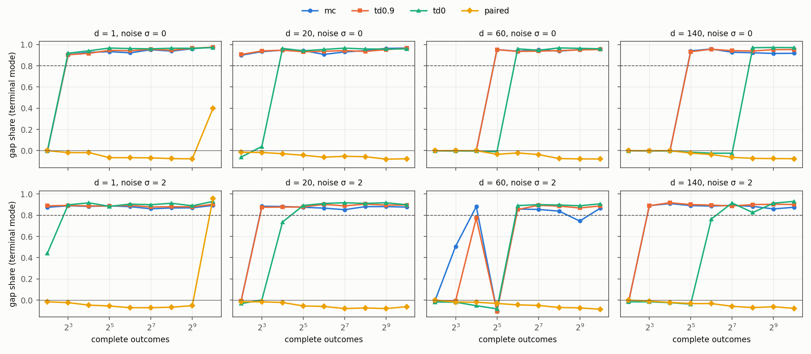

# Credit test stack: findings (2026-10-26)

**Preregistration:** [credit_testbed.md](credit_testbed.md), commit `00ba718`.

**Run:** `runs/2026-10-26_credit_testbed_001`. Setup and the round-1 sweep are
complete (14 configurations; 62 sweep jobs; 5 data seeds for the fork, 3 for
MountainCar). The MountainCar policy-iteration phase was not run; see the
Walker gate below.

**Evidence:** copied to
[experiment_evidence/2026-10-26_credit_testbed](experiment_evidence/2026-10-26_credit_testbed/README.md).

## What the results say

1. **A learned terminal value recovers MPPI's missing ending from very few
   complete outcomes.**
   - Fork: MC and TD(.9) values deployed as MPPI's terminal cost close .87–.98 of
     the gap to MPPI with the exact value, at every delay past the horizon (up
     to 7 horizons) and both noise levels.
   - MountainCar, one round from MPPI-alone data with exploring starts: TD(.9)
     closes 1.15 (power .001) and 1.04 (.0007) of the gap from about 500
     outcomes, and ≥ .92 already at 255. Shares above 1 mean it beats MPPI with
     the exact grid value, which is itself 1.8–2× slower than optimal at these
     powers.
2. **The sample-efficiency mechanism is discovery of a different ending, not
   precision of the estimate.**
   - Terminal-mode gap share stays at 0 until the data contain the first branch
     of MPPI's own options that ended in the other lane. It then jumps to about
     .9 at that budget in every valid fork configuration (figure below).
   - Longer delays make such branches rarer, because the decisions that can
     change the ending are a smaller share of a longer episode. At 1024
     outcomes, branches ending in the other lane number 180/132/80/55 for
     d = 1/20/60/140 (noise 0).
   - Once a few exist, a coarse value suffices. At d = 140, noise 2, terminal
     TD(.9) closes .90 of the gap while its decision regret is still .32.
     MPPI's own search does the fine ranking inside the horizon.
3. **Deployment matters more than the estimator.**
   - Choosing among MPPI's own options while leaving MPPI untouched plateaus at
     .43–.78 of the gap on the fork; the exact value reaches only .43 this way.
   - Feeding the same values to MPPI as a terminal cost reaches .87–.98.
   - Selection is capped by what MPPI's own samples contain. A terminal value
     lets MPPI's search re-centre on the better ending.
4. **Bootstrapping matters when episodes are time-capped.**
   - On MountainCar, MC never helps (gap share ≤ .02 at every budget); its
     returns are cut by the 500-step cap.
   - TD(λ) bootstraps through the cap and works.
   - Walker episodes are capped too (1000 controls).
5. **The other two estimator families fail in closed loop.**
   - **Paired option scorer:** learns only from shared-randomness differences
     between options at the same state. It is immune to the cost noise, as
     predicted, but at the preregistered ridge it helps in only one
     configuration, at the largest budget (d = 1, noise 2: .96 at 1024
     outcomes; elsewhere -.08 to .40). It has the right sign but is shrunk
     below the visible detour. Post hoc, with ridge .1 or .01 it closes .94–.97 at
     1024 outcomes in one of two seeds and fails at 256. That makes it roughly
     30–100× less sample-efficient than a TD value.
   - **Return decomposition from totals:** spreads the delayed penalty over the
     delay. Its regret grows with data at long delays (.87–1.84 at 1024
     outcomes for d ≥ 60), as predicted.
6. **Ground truth: counterfactual credit equals optimal credit only when the
   continuation is near-optimal.**
   - Fork: branch-and-continue outcome differences equal exact differences
     (Pearson 1.000) and are identical across noise levels to 1e-14.
   - MountainCar: under exact-value MPPI's own continuation they barely track
     exact values (Pearson .08–.60). That continuation is far from optimal, and
     an H-step commitment is judged by plan tails the replanning controller
     never executes.
   - Post hoc: if only the first action is taken and play is optimal afterwards,
     MPPI's own pick is ≥ 5 worse than its best option at only 0–3% of
     decisions, against 33–61% under H-step commitment.

## Prediction verdicts

| Prediction | Result | Verdict |
|---|---|---|
| V0 fork | Every delay past the horizon: MPPI alone lane B 0/40, exact_term 40/40, gap 14.2; visible control 40/40 | holds |
| V0 MountainCar | .004 holds (MPPI alone 33.1 vs exact 38.5); .001 and .0007 hold (MPPI alone 0% success, cost about 505, exact 100%); .0015 fails: MPPI alone succeeded 55% > 50% (gap 324) | fails at .0015 (excluded) |
| R0 | Projected V* as terminal value: .986–.99 fork, 1.00/1.02/.91 MountainCar | holds |
| a1 | Post-gate headroom exactly 0; window headroom ≥ 5 at 55% ≥ 30% | holds |
| a2 fork | t = 5: abs Δ < 1 in 33–42% (predicted ≥ 90%); every abs Δ < 10, no lane change. Window: best option ≥ 5 cheaper in 82% ≥ 60%. t = 35: all 0 | t = 5 fails; rest holds |
| a2 MountainCar | MPPI alone continuing: abs Δ < 10 in 100% at .001/.0007. Median exact headroom 3.4 (.001, predicted ≥ 5), 6.4 (.0007) | partly fails |
| a3 | Noise invariance 1e-14; fork Pearson 1.000; MountainCar Pearson .43/.08/.60 (predicted ≥ .8) | fails on MountainCar |
| b1 | Noise 2: MC regret ≤ .2 needs 256 outcomes at d = 1, > 1024 at d ≥ 20. Noise 0: 32/32/128/64 | holds |
| b2 | TD(.9) and MC both > 1024 at noise 2, d ≥ 60 | unresolved |
| b3 | Paired never reached regret ≤ .2 at any configuration | fails in substance |
| b4 | Return decomposition regret at 1024: .87/1.84/1.23/1.84 for d ≥ 60 | holds |
| b5 | MountainCar round 1: all estimators ≥ 1.37 at .001; at .0007 TD(.9)/TD(0) .35/.37 < .4 | partly fails |
| c1 | Spearman(regret, select-mode share) = -.66 over 1980 cells | holds |
| c2 | Fork terminal at 1024: MC .92–.98 / TD(.9) .95–.98 (noise 0); .88–.89 / .90 at d = 1, 20 with noise 2 | holds |
| c3 | MC select minus exact select: +.15/+.17/+.22/+.22 for d = 1/20/60/140 | fails at d = 1, 20 |
| c4 | Predicted ≤ .3; TD(.9) terminal 1.15 (.001), 1.04 (.0007) in one round | fails |
| c5 | Policy-iteration rounds not run | not run |

**Outcomes needed** for terminal-mode gap share ≥ .8 at that and every larger
budget (median over seeds; "—" means not within 1024 / about 500 outcomes):

| Configuration | MC | TD(.9) | TD(0) | Paired |
|---|---|---|---|---|
| fork d = 1, noise 0 / 2 | 8 / 4 | 8 / 4 | 8 / 8 | — / 1024 |
| fork d = 20 | 4 / 8 | 4 / 8 | 16 / 32 | — / — |
| fork d = 60 | 32 / 1024 | 32 / 64 | 64 / 64 | — / — |
| fork d = 140 | 32 / 8 | 32 / 8 | 256 / 128 | — / — |
| MountainCar .001 | — | 255 | 508 | — |
| MountainCar .0007 | — | 255 | 255 | — |

Return decomposition (select only) and every estimator in select mode never
held ≥ .8 on the fork. The noise-2 pools differ from the noise-0 pools in data
seed, so the budget at which the first branch ends differently differs by pool
(for example 32 versus 8 at d = 140).

**Exploratory (not preregistered).** In terminal mode, decision regret
predicts gap share with ρ = -.72 on the fork but only -.29 on MountainCar.

## Walker gate and decision

The preregistered gate fails by its letter on MountainCar:

- **Criterion 1:** only 2 of its 3 past-horizon powers are valid. The "3 of 4"
  rule did not fit MountainCar's 3 powers.
- **Criterion 4 (a3):** fails on MountainCar.
- **Criteria 2 and 3:** hold. TD(.9) reaches the target at every valid
  configuration, and c1 = -.66.

The user left the next step to the lead's discretion, adding that it "has to
work on walker as we scale up". Decision:

- Stop MountainCar; its policy-iteration phase depends on exploring starts,
  which Walker lacks.
- Keep the fork as the exact-ground-truth reference.
- Move to Walker through Hopper, a simpler MuJoCo task with the same failure:
  falls a delay after their cause. Hopper also serves as the second task that
  any Walker claim requires.

Choices carried forward:

- terminal-value deployment;
- TD(λ) bootstrapping through the time cap;
- closed-loop cost on reserved starts as the primary endpoint, not
  counterfactual decision regret (a3);
- measured coverage: how often MPPI's own options end differently (fall versus
  no fall), the quantity that set the outcomes needed here.

## Limits

- One parameterization per task, linear tile features, one MPPI configuration
  per task.
- MountainCar assumes exploring starts.
- Commit-H ground truth overstates decision headroom (post hoc above).
- These results are about value-guided MPPI, not a standalone policy.
