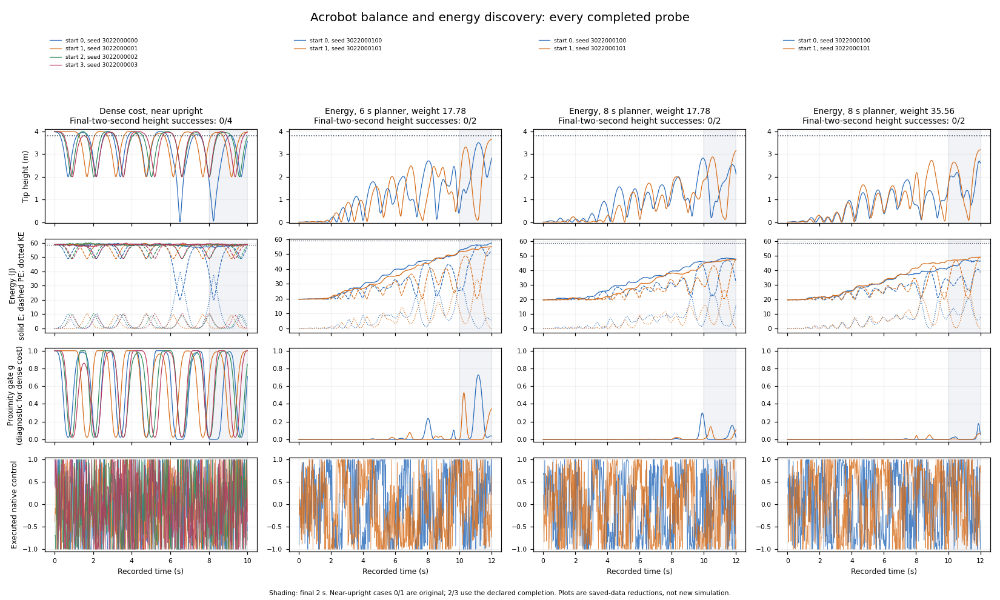

# Acrobot: energy shaping did not clear the teacher gate

**All three energy recipes failed both hanging starts; none of the six executions
reached 3.8 m. The original controller also failed all four near-upright holds.**
The declared kill rule applies: this is an Acrobot teacher-control problem, not
a learning-loop result. No policy fitting, bank admission or alternating loop ran.

The [frozen probe](acrobot_energy_discovery_protocol.md) reused the historical
energy catches, with signed squared mechanical-energy error, corrected
hanging-to-upright normalization and the proximity-weighted balance handoff.
Each energy episode ran twelve seconds; success remained height ≥3.8 m at every
final-two-second control boundary. Near-upright episodes ran ten seconds with
the unchanged original dense-cost controller.

| Recipe | Successful final holds | Peak heights, both seeds |
|---|---:|---:|
| Energy weight 160/9, six-second horizon | 0/2 | 3.504, 3.652 m |
| Energy weight 160/9, eight-second horizon | 0/2 | 2.830, 3.154 m |
| Energy weight 320/9, eight-second horizon | 0/2 | 2.693, 3.195 m |

Near upright, the longest continuous holds were **0.66, 1.28, 0.72 and 0.78 s**:
the original controller repeatedly lost height despite starting at the top.
Swing-up discovery is therefore not its only limitation. The energy recipes
pumped energy over the twelve-second window without producing capture. In the
first six-second-planner episode, terminal energy was **57.48 J** against a
58.86 J target, yet tip height was **2.818 m**, with **5.57 J** still kinetic.
Energy agreement alone does not establish the required pose or balance.

All **5,620 canonical candidate banks** recorded zero candidates satisfying the
final-two-second hold, hence zero weight on qualifying candidates. Median effective
sample size was approximately **one** in every recipe. Some six-second candidates
briefly reached almost 4 m, but none recorded sustained capture. This points to a
search/capture bottleneck; all candidate scalar summaries were saved, while only
two full candidate traces per bank can be independently reconstructed.

These observations rule out success of these finite recipes. They do not show
that energy shaping cannot work, identify a unique optimizer failure or establish
that longer horizons are generally worse. Starts, planner settings and duration
differ from the previous dense-cost qualification, so the higher observed peaks
are not an isolated causal estimate of the energy term's benefit. Historical
half-second catches also did not meet this two-second criterion.

**Next hypothesis, not launched:** local capture needs to be established separately
from pumping. The smallest discriminating control is near-upright stabilization
on this same model with a local linear-feedback positive control alongside the
unchanged MPPI controller. That would distinguish a stabilizable plant from this
planner/capture recipe's failure before another swing-up search or learning loop.

The [saved review and complete episode table](../results/acrobot_energy_discovery_001/README.md)
passed **667,386 checks**; maximum executed running-cost discrepancy was
`1.42e-14`. Exact replay of the interrupted 429-control prefix had zero error in
all six saved arrays. Only two candidate traces per bank were retained: the
review cannot certify unretained physics or the incomplete diagnostic bank.
The original recording stop and initial metadata-checker failure remain preserved.
[Accounting and recovery details](acrobot_energy_discovery_accounting.md) include
all paid work; the worker used **136.06 CPU minutes**, with no neural evaluations
or learning updates. No energy recipe qualified for the teacher gate; the loop
remains untested.
