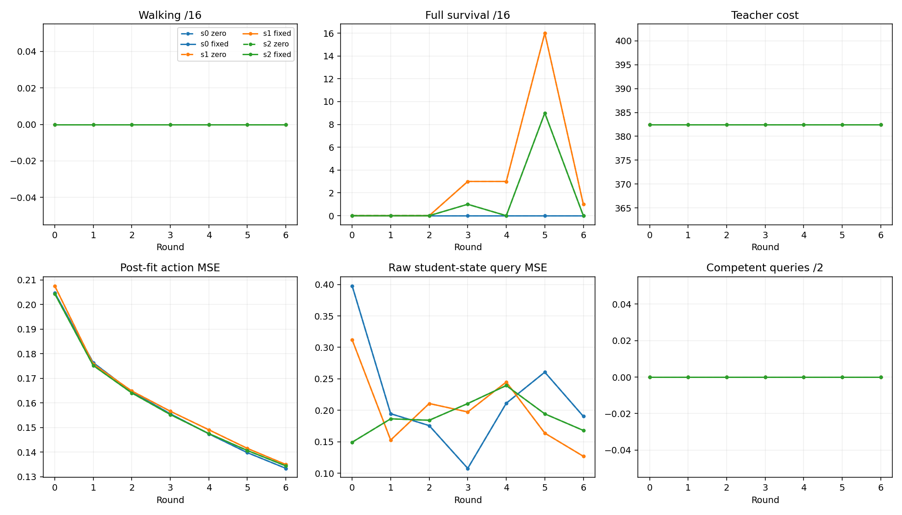
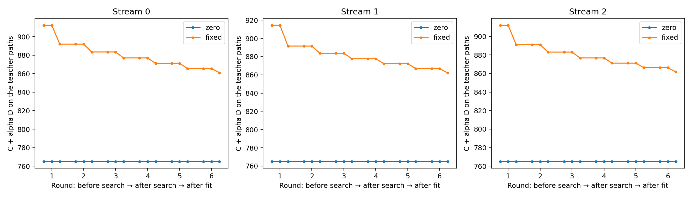

# Six-round full-trajectory PI comparison: no effective teacher adaptation

The frozen comparison completed all six rounds for three paired inherited W2
learners, with alpha=.12 versus 0. **Neither arm produced held-out walking. All
72 acquisition solves returned their unchanged input tape.** Their raw best
nominal was also that tape, so the common competence guard did not cause the
retention. The resulting data, policies, optimizer fingerprints and execution
outcomes were identical between arms at every round.

This is an optimizer limitation under the declared full-horizon allocation.
The experiment executed repeated alternation, but its trajectory block never
changed a teacher. The subsequent learning was continued cloning of the two
original competent MPC tapes. It establishes no general failure of action
consistency, no prospective teachability prediction and no convergence result.

The [derivation](full_pi_similarity_derivation.md) and
[original full-trajectory formulation](full_trajectory_pi_similarity.md) are
retained. The [pre-launch protocol](full_pi_alternating_protocol.md),
[configuration](../configs/studies/full_pi_alternating_v1.json) and implementation
were committed at `627d4329fad537e32b4662e2cebaba3896d58d17` before execution.
Workers ran an immutable archive of that commit. Additional saved-evidence
readers were committed separately at `5e2e0a2`; they changed no scientific rule.

## Execution and optimizer reconciliation

Both arms used H1000/K256 complete control sequences, the prototype's filtered
noise, annealing, ESS temperature rule and bounded weighted-mean update. The
fixed simulator start did not advance during refinement. Each acquisition used
100 passes and each diagnostic query 25, the predeclared reductions from the
prototype's 300. Both arms used the same output-only walking/cost admission
guard, historical-nominal selection and exclusion of the unscored final mean.
There was no best-sample substitution, feasible-sample mask, monotone recentering,
coefficient schedule, recipe repair or retry. The protocol lists the complete
reconciliation, including starts, RNG continuation, evidence and execution host.

Each arm fitted 250 existing Adam steps per round, preserving its Adam moments,
private minibatch RNG, policy state and planner RNG. Each next search used the
updated policy. Architecture,17 observations, normalization, six torque outputs
and direct standalone execution remained fixed. All 1,500 new updates per lineage
ran, ending at 3,500 historical-plus-new updates. No first-round benefit or
futility gate was used. Coordinator exits were `[0,0,0]`, without a stop condition.

For the chosen objective
\(J=C+\alpha D,\ D=\tfrac 12\sum_t\|u_t-\pi_\theta(h(x_t))\|^2\),
positive-alpha fixed-data MSE has the same parameter-block minimizer. Finite
clipped-gradient Adam and float 32 targets are the disclosed approximations.
The alpha 0 arm still learns although its search objective has no parameter term.
It is an uncoupled search/cloning control, not a separate equal-compute benchmark
that reallocates search expenditure to cloning or DAgger.

## Progression, including disappointing endpoints

Every entry below is shared by both arms. Walking was **0/16 in every primary
panel at every round**. Final confirmation walking and survival were 0/16 in all
three streams and both arms. The frozen walking-benefit and individual-competence
criteria therefore failed.

| Round | Reconstruction MSE s0 | s1 | s2 | Full survival /16, s0 / s1 / s2 |
|---:|---:|---:|---:|---|
|0|.204795|.207613|.204415|0 / 0 / 0|
|1|.176396|.175811|.175230|0 / 0 / 0|
|2|.164533|.164881|.164091|0 / 0 / 0|
|3|.155607|.156646|.155302|0 / 3 / 1|
|4|.147458|.149112|.147579|0 / 3 / 0|
|5|.139817|.141547|.140693|0 / 16 / 9|
|6|.133433|.134981|.134418|0 / 1 / 0|

Survival improved temporarily while walking did not. Another identical learning
block reduced reconstruction again but substantially worsened survival in s1
and s2. The round 6 policies were evaluated and retained; round 5 was not selected
as an alternative endpoint. This does not identify instability, observation
aliasing or conflicting labels as the cause.

The early-round 1–2 to late-round 5–6 reconstruction contractions were 19.85%,
18.83% and 18.92%, all below the frozen 20% threshold. Late coupled/control ratios
were exactly 1, also failing the<=.90 requirement. These are finite measured
patterns, not stationarity or convergence tests.

The [complete report](../results/full_pi_alternating_001/report_001/report.md)
and [machine-readable progression](../results/full_pi_alternating_001/report_001/summary.json)
include every arm/round, teacher cost and competence, reconstruction, raw query
disagreement, coverage, standalone cost, walking, duration and survival. The
[per-cell records](../results/full_pi_alternating_001/rounds) retain all individual
reset outcomes and both pre/post reconstruction values. The capsule preserves
all 9,000 fitting curve points losslessly, rather than selecting favorable fits.

## What failed in acquisition and diagnosis

Both original teachers remained walking for all 1,000 controls, with native costs
372.7086518178426 and 392.2748839912696. All 72 returned tapes had exactly zero
action change and zero incoming-policy objective gain. No raw-best selection
was rejected by the guard. Meaningful acquisition progress was 0/72.

Of 1,843,200 acquisition candidate trajectories, only 72 reached the full horizon:
pass 0/sample 0 in each solve, the supplied competent incumbent. Every other
candidate prefix ended early. All 7,128 later current nominals failed to survive.
An additional saved-prefix check independently verified this census; it does not
reconstruct unpreserved sample states or independently rerun all their physics.
The logs and sparse complete banks remain distinct evidence types.

The agreement term was applied: the independent audit checked the declared
Gibbs weights and objective reductions. First-update displacement norms differed
between arms in every one of the 36 paired solves (absolute norm differences
8.99×10⁻⁸–4.08×10⁻⁶). This checks application of the intervention. It did not produce
an effective change in acquired teachers. The result is specific to the frozen
100-pass recipe and starts; it is not a claim that all full-length PI methods
or all coefficients cannot progress.

There were 82 available student-state queries out of 84 planned anchors. The two
missing anchors were t100 in s2/round 2, one per arm, because the student had
already fallen. **All 82 selected query trajectories fell; qualified coverage
was 0/82.** Thus raw action MSE and same-start cost gaps are diagnostic numbers
against an unsuccessful approximate query operator, not disagreement with a
competent expert. Qualified-disagreement contraction is unassessable, not zero.

The query context was fixed in advance: actual first-primary-episode state,
warmstart and integration context at t0/t100; task-only H1000 PI for 25 passes;
the original full slot 0 template from its beginning; fresh prescribed RNG; no
policy agreement or same-clock suffix. Only t0 permits an equal-horizon paired
cost gap. Query D arrays are explicitly unmeasured placeholders. No query
action or evaluation result fed training or acquisition.

The [display supplement](../results/full_pi_alternating_001/trace_report_001/supplement.json)
contains every query's outcome/coverage, per-phase work and acquisition census.
It also links 42 same-start query/actor angle plots, with each path cropped at its
own fall and no temporal alignment. The original report's 42 source-teacher/actor
plots are **unpaired starts** and must be read as illustrations, not reconstruction
or a gait qualification rule. In both atlases q0 is root pitch and q1–q6 are the
six joint angles, in radians. All paths use actual elapsed seconds.

The joint-objective display sums both teachers; the progression teacher-cost
panel averages them. Search boundaries are flat; positive-alpha decreases come
from fitting the unchanged data. This is not evidence of useful teacher adaptation.

## Independent audit and accounting limits

The separately implemented frozen audit passed 1,944,260 checks. A separate
continuation reader passed 698 more, checking incoming/outgoing predictions,
actual updated-policy ownership, full-plan and planner-RNG continuation, query
templates, seeds and complete context ownership. Paired saved NPY members
(observations, targets, predictions and minibatch indices), policy hashes,
optimizer fingerprints, evaluations and queries were identical at all 21 paired
round/stream endpoints. These are numerical/process audits, not external peer
review or independent retraining of every Adam step.

The audit checked every closed-file binding, ledger, nominal objective,
selection, native trace outcome and observation map, plus every preserved full
sample-bank reduction and update. Independent native replay covered 4,000 teacher
controls and 200 actor controls; a separate 200-control noninitial query-context
check had exact state agreement. All unpreserved banks were not rerun. Audit
inference was 11,821,185 rows in total, with zero learning. No audit/report output was replaced: all four audit/report processes exited 0
on their first run.
One later saved-only accounting reducer failed on a baseline phase-label
assumption. Its source/failure are preserved. The corrected reducer allocates
the first reconstruction from `load_parent`, not `initial`, and exactly
reconciles every per-arm/round and shared-initialization total. An explicit
annotation erratum accompanies the unchanged original display supplement;
neither raw counts nor scientific evidence changed.
The first publication-seal census also rejected an exclusion that accidentally
matched a nested receipt. That failed manifest/receipt are preserved; the final
seal uses exact root-relative exclusions. No scientific run or audit was retried.

| New work | Scientific execution | Implementation checks | Audit, including supplements |
|---|---:|---:|---:|
|Model controls|2,368,006,000|2,000|0|
|Native controls|316,190|4,000|4,400|
|MuJoCo integration substeps|9,473,288,760|24,000|17,600|
|Neural forward rows|341,280,156|5,376|11,821,185|
|Backward rows|2,304,000|5,376|0|
|Adam steps|9,000|21|0|

Physics substeps count the .002 s MuJoCo RK4 integration calls, not internal RK4
stages or FLOPs. The separate analytical toy used 2,304 control evaluations.
Saved-only reporting/inspection/collection adds no physics, inference or fitting.
Science includes D inference in alpha 0, initialization checks, all diagnostics,
all primary panels and final confirmation. Missing queries saved work without
reallocating it. The imported three W2 parents already had 6,000 historical Adam
updates in total; those and the original MPC teacher acquisition are inherited
costs, not newly executed work or free-from-scratch results.

All scientific counter ceilings passed, with no unknown partial operations.
Coordinator monotonic execution time was 12,526.13 s (3.48 h); final seal completion
was 12,538.83 s. Recorded worker process CPU summed to 36.83 h. Peak RSS was
1.22–1.26 GiB per worker, below 6 GiB. Sealed raw payload was 25,415,594,050 bytes
(23.67 GiB), plus its small manifest and receipt, below 32 GiB. Zero GPU work.

Engineering tests ran 6 passed, then 7 passed, then 7 passed/1 deliberately skipped
previously passed native fixture. Source/dependency equivalence, native/batch
parity, precision/fall handling, exact prototype update equivalence, continuation,
failure accounting and peer-stop checks passed. Formatting/import-only checks
had recorded failures that were fixed; no scientific launch failed or retried.
The rejected remote upload transferred zero bytes and local execution was
declared before freezing.

The [accounting receipts](../results/full_pi_alternating_001/accounting) separate
worker, audit, reporting, hash/copy and saved-only inspection work. The original
audit read 50.86 GB of logical inputs, and the join audit 2.32 GB; these are application
bytes, not physical disk IO. Process receipts include startup and reporting CPU.
Fine-grained early tool/edit CPU, assistant reasoning cost, coordinator CPU,
incremental Git storage and some library/OS IO were not fully instrumented.
**An exact all-in engineering cost or its 2 h ceiling cannot be certified.** This
missing instrumentation was disclosed before launch; no labor, money, energy or
physical IO is invented from elapsed time. UTC chronology and monotonic duration
also differed; their cause is not established. Scientific work counts and finite
allocation are independently reconciled despite these accounting limitations.

## Evidence and conclusions that remain open

The [result capsule](../results/full_pi_alternating_001/README.md) publishes all
round summaries, lossless curves, figures, audits, exits and manifests. Full
states, sampled banks, weights, checkpoints, tapes and source archive remain
in the local sealed run identified by
[availability](../results/full_pi_alternating_001/external/availability.json).
No remote raw backup is asserted. Sparse full banks were frozen at 0/50/99 for
acquisition and 0/12/24 for queries; regenerated banks are not called raw evidence.

Established here: bounded repeated alternation ran correctly; competence was
protected; the PI block generated no new surviving candidate; the arms therefore
reduced to identical continued cloning; reconstruction descent did not certify
walking or stable survival. Exploratory finite patterns include the temporary
survival gains. Optimization history, observation aliasing, multiple behavior
families and execution sensitivity remain separate possible explanations for
other failures, not causes established by this comparison.

The strongest general counterexample to treating small D as a motion guarantee
remains the preserved unstable linear system: D/T≈2.63×10⁻¹¹ can produce terminal
failure. The Walker run does not estimate its closed-loop sensitivity or test
that explanation. Likewise, a score's pre-training value was not validated as a
predictor of improved standalone execution after a fixed update; post-fit MSE
and unsuccessful-query diagnoses do not supply that evidence.

The eventual standard remains successful held-out walking, equal-total-compute
cloning/DAgger comparisons, the relevant repeated joint-versus-static and
convergence/ablation pattern, and transfer where claimed. This first bounded
test establishes the optimizer/manipulation failure under its frozen recipe.
No new score, architecture, coefficient schedule or follow-up experiment was run.
