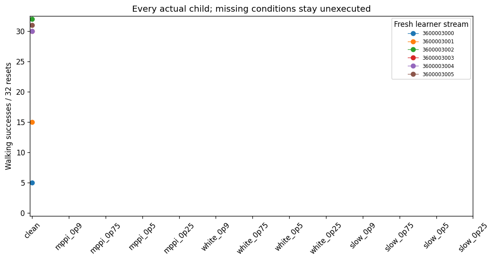
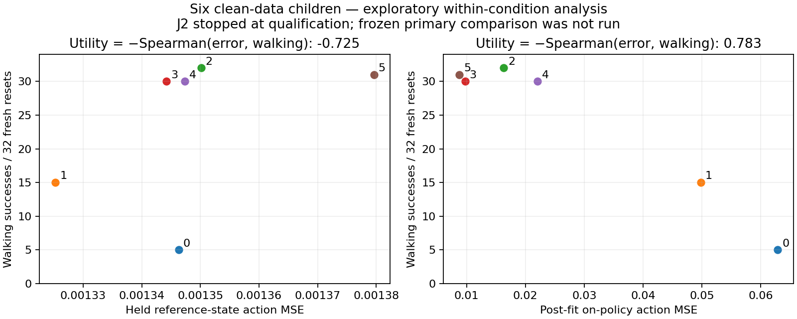

# J2.0: clean cloning varies; the frozen comparison stopped

J2.0 completed its six clean-data qualification fits and stopped under the
[frozen rule](jitter_diagnosis_j2_protocol.md). Walking counts were
**5, 15, 32, 30, 30 and 31 out of 32**, totaling **143/192**. The rule required
at least 173/192 overall and 24/32 in every stream. No jitter-label child was
fitted, and the planned primary comparison was not executed. The
[independent audit](../results/jitter_diagnosis_j2_001/audit/audit_result.json)
passed and confirms that stopping result, not a successful diagnostic test.

The six actual fits nevertheless expose useful variation under identical
clean supervision. A separately labelled **post hoc** comparison across these
six students finds that after-fitting on-policy error tracks walking much
better than held-reference-state MSE. This is a positive exploratory lead for
the user's clarified within-condition question; it is not confirmation of
J2.0's different frozen primary.

## What ran

Source `edda434a2771194163aa5be883b83f4f94d3cd56` was committed and pushed before
execution. Its read-only export binds 142 files, 3,458,233 bytes, the original
input hashes and prepared corpus. Prelaunch CI passed 1,767 tests with three
skips, one expected failure and all 57 clean-export commands. The
[capsule](../results/jitter_diagnosis_j2_001/README.md) preserves those receipts.
The unused first source export remains intact; a prelaunch correction tightened
initial context checks to raw bytes without changing scientific settings.

Each fresh width128 tanh student received the same 9,000 clean SAC-labelled rows
and 10,000 ordinary action-MSE Adam updates. Normalization came from those clean
training observations, with the same optimizer recipe and direct torque
execution. The reference is the existing SAC actor, not an assumed optimal
policy. No reference was retrained and no MPPI query was made.

All 63 held-reference replay anchors passed exact initial restoration and
`rtol=0, atol=1e-10` continuation checks. The reference walked 16/16 on each of
two new reset panels. Every child was measured on those same 32 initial
contexts, with byte-exact pairing, and on eight disjoint 100-control probe
resets. Probe and evaluation use the exact fitted checkpoint; there was no
refitting to reproduce a scalar MSE.

## Actual standalone outcomes

Walking requires all 1,000 controls and velocity MAE ≤ 0.3 m/s against 1.5 m/s.
Individual competence requires ≥15/16 walking in each panel. Full survival is
reported separately; in these 192 child evaluations every full survivor also
met walking. Different successful motion remains allowed.

| Fresh seed | Walking panels | Full survival /32 | Held clean MSE | Post-fit probe MSE | Mean paired complete-cost gap |
| --- | --- | ---: | ---: | ---: | ---: |
|3600003000|0/16 +5/16|5|0.00134634|0.06290909|+3465.29|
|3600003001|5/16 +10/16|15|0.00132529|0.04982993|+2089.35|
|3600003002|16/16 +16/16|32|0.00135013|0.01631569|−42.04|
|3600003003|15/16 +15/16|30|0.00134424|0.00974075|+169.05|
|3600003004|14/16 +16/16|30|0.00134739|0.02208936|+166.95|
|3600003005|16/16 +15/16|31|0.00137962|0.00876431|+22.75|

Seeds 3002, 3003 and 3005 meet the declared competence convention. Seed 3004 has
30/32 overall but misses it on its first panel. The paired cost gaps compare
each child with the reference on the same 32 resets; the reference was executed
once and reused across six comparisons. They include one native fall terminal
and five per missing control. Native and tail costs remain separate in the
[gap table](../results/jitter_diagnosis_j2_001/posthoc/paired_gap.json).

All six fits reconstruct held reference actions closely. These data support
variability across fresh training/reset conditions, not an isolated cause of
that variability. They do not prove that more updates alone would repair J1,
or erase the older 94/96 result on its original seeds and resets.

## Exploratory within-clean diagnosis

J2.0 planned to rank 13 conditions **within each seed**, then compare six
seed-level utilities. The parallel session's clarified proposal ranks students
**across seeds within a fixed condition**. The latter analysis below changes
the estimand and must stay post hoc. The primary sign-flip test and its p-value
remain missing.

Using all six audited clean children, average-tie Spearman correlations between
error and walking count are:

| Error measure | Correlation | Utility, negative correlation |
| --- | ---: | ---: |
|Held reference-state action MSE|+0.7247137946|−0.7247137946|
|100-control on-policy action disagreement|−0.7826908981|+0.7826908981|

The [saved calculation](../results/jitter_diagnosis_j2_001/posthoc/summary.json)
binds the passed audit and all six rows; an independent tie-aware recomputation
agrees. All 48 probes executed 100 controls. One fell on its final control; mean
probe duration was 100 for every child. Unequal prefix length therefore cannot
explain this six-case ordering. All six children had some walking, so the older
any-walking AUC cannot be estimated here.

This association does not establish that reference actions would recover the
student, identify which errors caused failure, predict a future learning
update, or generalize to MPPI-derived behavior. It measures fitted policies on
their visited states. The six cases are now development evidence, not protected
confirmation for a replacement protocol.

The clean-control gate was too restrictive for the newly clarified
within-condition question: weak students are useful diagnostic labels. It
remains enforced for J2.0. The [J2.1 review proposal](jitter_diagnosis_j2_1_proposal.md)
removes that gate only in a new design with the appropriate primary comparison.

## Cost and preservation

| Actual stage | Work |
| --- | --- |
|Worker|6 fits; 60,000 Adam updates; 15,360,000 backward rows; 15,702,957 neural-forward rows|
|Native execution and replay|189,732 controls; 758,928 physics substeps; 335 episodes|
|Worker process|94.896 s wall;91.625 s user CPU;1.090 s system CPU|
|Independent audit|7.090 s process wall; 1,526,832,387 bytes read; 344,493 functional forward rows; zero physics/gradients/updates|
|Saved report|15.166 s wall; 13,917,613 bytes read; all 60,000 curve points; zero scientific work|
|Acquisition|Zero new MPPI model controls or teacher acquisition|

The [complete accounting](../results/jitter_diagnosis_j2_001/accounting/complete_costs.json)
retains actual requests/completions, empty uncertain-work counters, qualification
costs, preparation, operator CPU, CI and known/unknown engineering costs. Both
prelaunch import failures are preserved and incurred no scientific work.
Physical disk I/O, energy, money, complete engineering labor and inherited
source/reference-training totals remain unavailable. Git chronology is not
used as a labor estimate.

The [compact capsule](../results/jitter_diagnosis_j2_001/README.md) preserves exact
metadata, lossless fitting JSON, curves, figures, audit and process exits.
Full checkpoints, Adam/RNG packages, index tapes and N+1 native contexts remain
local-only under `runs/2026-11-03_jitter_diagnosis_j2_001`; per-file locations,
sizes and SHA-256 are in its external inventory. No full remote backup is
asserted. All named study roots remain below the 4-GiB ceiling.

## Parallel context and next step

The new parallel-session context is preserved as **provisional** evidence.
Its two stability/value calibration summaries omit the raw score/survival
vectors and use the earlier ordinal rank helper, so their correlations cannot
be independently tie-corrected. The terminal-MPPI directories were initially
empty. A later recorded file snapshot contains reported teacher walking of
0/6 and 1/6 under the value-terminal variants, versus 5/6 for the baseline.
Those summaries are preserved provisionally without a full-context or actual-exit
audit. Guided child fits are absent, not zero-success trials. The separate
`posthoc_survivors.json` is not a verified reconstruction of the walking rule.

The reported stability is a finite directional-growth calculation over 0.2 s,
with teacher-derived geometry and special fall handling. It is not a verified
Lyapunov exponent, novel formulation, convergence result or teachability measure.
The proposed stability column in J2.1 needs explicit geometry, identity checks,
fall/missing handling and a finite query budget before launch.

Recommend reviewing the 40-fit, four-condition, ten-new-stream proposal. It keeps
post-fit diagnosis primary and before-update scores ungraded, treats the six
current fits as development evidence and adds stability only as exploratory
measurement. It is neither frozen nor launched. No further physics, fitting,
MPPI shaping or coupling was automatically started.
