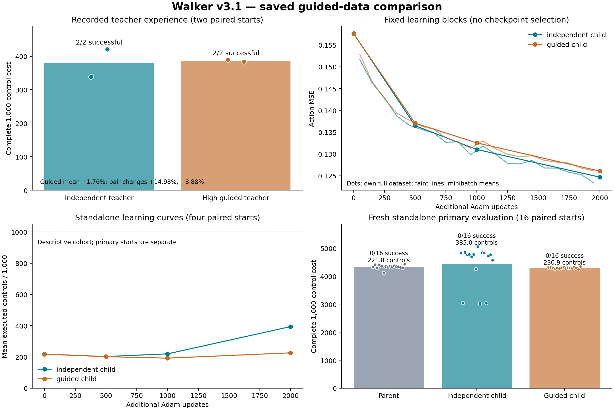

# Walker v3.1: the missing guided-data child comparison

**Scope clarification:** this result tests fixed demonstrations under the
specified fitting procedure. No weight adaptation or updated-policy acquisition
was executed. Its proposed finite outer objective was not an implemented
adaptive trajectory-optimization experiment. The separate next questions are
[student learnability](student_learnability_track_v1.md) and
[H4.1 weight backoff](adaptive_coupling_h4_1.md). H3.2 below belongs to the first
track. All numerical outcomes and frozen evidence remain unchanged; the
[previous text (external evidence)](evidence_availability.md#external-873ca93ddf37)
is preserved.

**The successful guided experience has now trained a matched child. It did not
pass the frozen standalone improvement criterion, and the loop is not closed.**
There is a small complete-cost advantage, alongside worse survival than the
independent-data child. Those effects must remain separate.

| Fresh paired primary evaluation | Task successes | Full survivals | Mean controls / 1,000 | Mean complete cost | Velocity MAE |
|---|---:|---:|---:|---:|---:|
| Unchanged Bfree 10k parent | 0/16 | 0/16 | 221.8125 | 4,337.033657 | 0.806123 |
| Independent-data child, +2k updates | 0/16 | 3/16 | 385.0000 | 4,426.789797 | 1.802361 |
| High-guided-data child, +2k updates | 0/16 | 0/16 | 230.8750 | 4,297.410410 | 0.819045 |

The independent child's three full episodes did not satisfy the velocity
criterion. It is incorrect to say all three policies fell on all starts, or
that the independent child learned the walking task. Velocity MAE is measured
on executed controls; early falls shorten that measurement, so it cannot
replace the complete task outcomes.
The [saved native details](../results/guided_data_v3_1/audit/survival_detail.json)
show mean forward velocities of −0.01646, −0.01168 and −0.01574 m/s in those
three survivals, against the +1.5 m/s target: remaining upright did not transfer
the teacher's forward locomotion. Primary terminations were 15 height/one angle
for the parent, three height/ten angle for the independent child (plus three
full survivals), and 16 height for the guided child. These are measured native
outcomes, not a unique neural explanation.

The guided child lowered mean complete cost by **0.9136% against the parent**
and **2.9226% against the independent-data child**. Both gains are below the
predeclared 5% margin. Against the independent child it also lost three full
survivals and 154.125 mean controls. Its cost was lower on 13/16 paired starts
against the parent and 12/16 against the independent child, with substantial
opposite differences on the independent child's surviving starts. No single
mean establishes dominance across these outcomes. The recorded gate failed;
confirmation and second acquisition did not run. The unchanged parent remains
the incumbent. No checkpoint was selected from the descriptive learning curves.



## What was tested

The two actual successful higher-weight guided episodes from v2 supplied all
2,000 treatment rows. Their matched independent episodes supplied all 2,000
control rows. Both arms shared the exact 4,064 discovery/re-solve rows and the
same 32 previously accepted recovery rows: **6,096 rows per arm**, with an
identical 4,096-row prefix. No new corrective acquisition, actor prefix, model
candidate labels, data filtering, observation change or controller repair was
introduced. This is different from the earlier 980-row corrective intervention.

Both children began with identical Bfree 10k weights, full Adam moments and
counters, PCG64 minibatch state, private generator, original normalization and
architecture. Both received exactly 2,000 Adam updates with batch 256, learning
rate 0.0003, mean-parameter proximity 0.01 and anchor refresh every 250 updates.
The exact shared 2,000×256 sampled-index array is retained. Checkpoints at 500,
1,000 and 2,000 updates resume the same proximal block rather than restarting it.

The seven fixed policies received four shared descriptive curve starts. The
parent and two final children then received **16 new paired primary starts**,
disjoint from the teachers, historical evaluations and curve starts. All
standalone episodes used direct policy torques throughout, without a planner,
teacher prefix or fallback. Native dynamics, clipped observations, task cost
and the 1,000-control horizon were unchanged. Success requires full survival
and velocity MAE ≤0.3 m/s. Complete cost includes the native terminal penalty
once and 5 per unexecuted control following a fall. Alternative successful
trajectories were allowed; no reference-distance criterion was used.

The [pre-launch protocol](loop_v3_saved_comparison_protocol.md), [frozen
configuration](../results/guided_data_v3_1/run/config.json),
[source seal](../results/guided_data_v3_1/run/manifest.json) and
[input seal](../results/guided_data_v3_1/run/input_manifest.json)
preserve the criterion and finite budget. The configuration SHA-256 is
`d7ec5ee6a57c42e5bd5d3d05b67af1fc7eb1b622dc7a614e8f8a9875e34f90a4`.
The input-seal SHA-256 is
`e087f8f06495ab4df0235d118eca75a4d0e51f3f1ce7c5d3b6febbabbfa448e1`.
The old action-agreement gate was not applied.

## Teacher outcomes and performance gaps

| Saved teacher | Complete successes / survivals | Mean complete cost | Mean velocity MAE |
|---|---:|---:|---:|
| Independent | 2/2 | 379.859168 | 0.144445 |
| Higher-weight guided, ρ=0.1199341983507337 | 2/2 | 386.529784 | 0.150186 |

The high guided teacher's **+1.756% aggregate cost** passed the 5% guard. Pair
0 was +14.98% and pair 1 was −8.88%. This experiment deliberately used both
actual successful guided episodes, rather than v2's unexecuted per-slot
fallback that would substitute independent data in pair 0. Both full executed
trajectories, including their differing paths and controls, remain preserved.

The corresponding student-minus-teacher mean complete-cost gaps are
**4,046.930629 for independent** and **3,910.880626 for guided**. These are
descriptive cross-cohort gaps: two recorded teacher acquisition starts versus
16 fresh student starts. They are not matched estimates of gap contraction or
evidence of convergence. Successful teachers and zero student task successes
still leave a substantial execution gap.

## Learning curves and what they establish

| Additional updates | Independent own-data MSE | Guided own-data MSE | Independent mean curve controls | Guided mean curve controls |
|---|---:|---:|---:|---:|
| 0 | 0.157639 | 0.157582 | 218.25 | 218.25 |
| 500 | 0.136474 | 0.137072 | 202.75 | 202.25 |
| 1,000 | 0.131023 | 0.132541 | 220.00 | 192.50 |
| 2,000 | 0.124680 | 0.126057 | 394.25 | 226.50 |

Both fits reduced their supplied-data error, by approximately 20.9% and 20.0%
respectively. Every curve cohort scored 0/4 task successes; the independent
2k child survived 1/4. Improved action reconstruction did not establish task
execution, and longer survival did not establish target-velocity walking.
The four-start curve cohort is descriptive, not a checkpoint-selection set.

[Every minibatch learning record](../results/guided_data_v3_1/run/learning_curves.csv),
[all cohort summaries and cross-data MSE](../results/guided_data_v3_1/run/result.json),
[plotted data](../results/guided_data_v3_1/report/plotted_data.json),
[primary per-start costs and controls](../results/guided_data_v3_1/report/primary_episodes.csv)
and an [exportable PDF figure](../results/guided_data_v3_1/figures/learning_and_outcomes.pdf)
are available.

## Formulation and prior art

The [mathematical specification](loop_v3_formulation.md) defines the complete
learner state, fixed Adam response, torque targets, direct execution controller,
teacher constraints, finite post-update objective and exact conditional
feedback. In compact notation the tested outer values are

\[
 \widehat J\!\left(\pi_{\mathcal A_{2000}
   (\theta,z,D_{\rm common}\cup D_\rho)}\right),
 \quad \rho\in\{0,\rho_{\rm high}\}.
\]

The inner MPPI bank and policy-distance candidate reweighting are unchanged.
The correction is to evaluate the two teacher data alternatives through an
actual fixed learning block before considering advancement. A confirmed guided
improvement would set the next acquisition's actor to the updated child and
its coupling to the selected ρ; a zero-coupling independent control would
remain available with an independent nominal and RNG. The implemented rule
tests the predeclared guided intervention and retains the parent if it fails;
it is not an optimizer that always deploys whichever child has the lowest cost.
Here the feedback tuple records **no advancement**, so no changed second-round
teacher was executed and no operating loop is claimed.

The [primary-source review](loop_v3_prior_art.md) finds that post-update
teaching is established. [Behaviour Distillation](https://arxiv.org/pdf/2406.15042)
optimizes supervised data by resulting policy return, and
[mirror-descent GPS](https://arxiv.org/pdf/1607.04614) already uses post-fit
global-policy performance to adapt later trajectory optimization. There is no
novelty or convergence claim here. Restricting data to successful physically
executed MPPI experience and inheriting the complete Adam state defines this
particular test, rather than a new general principle.

Our retained torque representation is a consequential departure from CIO's
state-to-state targets and one-step execution optimization. Hard forward
MuJoCo dynamics, short receding horizons, torque regression and empirical
perturbation examples also differ from its soft trajectory formulation and
analytic feedback targets. **These torque-policy results are not a failed
reproduction of CIO–GPS.** The specification and source review detail each
departure.

## Evidence audit and accounting

The [original evidence audit](loop_v3_evidence_audit.md) inspects actual pairs,
all four trajectories' full simulator snapshots, all 8,000 before/after private
planner snapshots, selected full candidate banks, checkpoints and complete
ledgers. It verifies matched full resets and the incoming learning state,
without rerunning dynamics or inference. Original runs and frozen
configurations remain unchanged. The original 41 GB model corpus remains on
the canonical host with its preserved locator; compact exports do not replace
it.

The new comparison's [independent saved-evidence audit](../results/guided_data_v3_1/audit/receipt.json)
passed **513,430 checks**, binding 172 files and 837 array fingerprints. It
reconciles the exact datasets, all six child checkpoint/Adam/RNG packages,
sampled indices, complete episodes and native costs/flags, paired starts,
4,000 curve records, gates, ledgers and work counts. It adds zero experimental
work and took 2.527 internal seconds. It verifies recorded inference/MSE and
optimizer packaging, not neural forward arithmetic or every Adam operation
by a fresh replay. Audit counts are assertions, not independent replications.

| New experimental work | Requested = completed |
|---|---:|
| Live controls | 20,029 |
| Model/planner controls | 0 |
| Physics substeps | 80,116 |
| Training forward rows | 1,024,000 |
| Full-data diagnostic forward rows | 85,344 |
| Standalone action forward rows | 20,029 |
| Total neural forward rows | 1,129,373 |
| Backward rows | 1,024,000 |
| Adam steps | 4,000 |
| Complete standalone episodes | 76 |

There were zero failed/rejected queries or measurements and zero unknown work.
The worker took **243.020944 internal seconds**, with **243.838590 external
launch seconds**. The frozen caps were 124,000 controls, 1.4 million forward
rows, 1.024 million backward rows and 4,000 Adam steps; conditional confirmation
was budgeted but not spent. Teacher experience was imported without charging
its acquisition again. The [cost receipt](../results/guided_data_v3_1/report/cost_accounting.json)
keeps inherited v1/v2 and the separate corrective study disaggregated and
counts their work once. Relevant cumulative experimental work is 154,582,044
requested controls (154,582,043 completed), 53,409,942 forward rows, 17,920,000
backward rows and 70,000 Adam steps. The one inherited reserved-but-unexecuted
control belongs to the preserved failed diagnostic harness, not this run.

The [local full-suite receipt](../results/guided_data_v3_1/report/validation.json)
records **157 passed, two skipped and one expected failure** in 3.76 seconds.
The worker preparation also retained its 30-test receipt and earlier mistyped
no-test invocation. Original-evidence audits cost 12.788 measured internal
seconds; plotting, new auditing, validation, preparation, transfers, source
review and research are separate overhead. Not all engineering/reasoning time
is instrumented. No efficiency claim is made.

Full new [raw arrays (external evidence)](evidence_availability.md#external-7c195ccdaab2),
[append-only ledger (external evidence)](evidence_availability.md#external-b1cbc1410e4e),
[supplied teacher snapshots (external evidence)](evidence_availability.md#external-dc66e5fb3cfa),
[independent final child (external evidence)](evidence_availability.md#external-a1e3b04f4b3f)
and [guided final child (external evidence)](evidence_availability.md#external-90badedcc712)
are retained alongside intermediate checkpoints and the entering parent.
The [mirror receipt](../results/guided_data_v3_1/external/mirror_receipt.json)
verifies all 173 transferred files, totaling 756,044,512 bytes, individually by
SHA-256. New full raw evidence is mirrored locally as well as preserved on
`robopil5090`; the historical large model corpus remains at its existing remote
location.

## Causal verdict and the next version

H3.1 did not meet its fixed criterion. The matched intervention identifies the
effect of these two recorded teacher datasets under this incoming learner and
2k-update schedule on the specified starts. It reveals a small guided cost
advantage and an independent survival advantage, with no successful walking
student. It does not establish that guided data are universally poor, that the
old agreement proxy was valid, that post-update teaching is ineffective in
general, or that any one neural mechanism caused failure. Teacher generality
is limited by two acquisition starts and one incoming learner; the fresh
16-start comparison is development evidence, not a population guarantee.

The next explicitly versioned, **untested and unlaunched** hypothesis is
[H3.2: clipped versus full velocity features](loop_v3_next_hypothesis_v3_2.md).
The measured observation loss and persistent torque-execution gap motivate a
single feature intervention within the same 17-input architecture and task.
They do not prove clipping caused the failure or predict that removing it
will help. Its draft requires exact full-state provenance, identical incoming
weights/Adam/RNG/normalization and targets, a separately frozen finite budget
and fresh paired starts. No critic, environment, synthetic data or additional
network is introduced. H3.1 stopped at its declared boundary; H3.2 has not been
mixed into this result.

## Reproduction

The worker and report generator are runnable. Reproduction pays new work and
requires fresh output directories. This command uses the original frozen
implementation on the canonical host; it preserves the closed run.

```sh
ssh robopil5090
TASKPY=/home/jaisel/mppi-gps/.venv/bin/python
S=/home/jaisel/mppi-gps-workspace/runs/2026-10-30_guided_data_comparison_v3_001
N=/home/jaisel/mppi-gps-workspace/runs/NEW_guided_data_comparison
"$TASKPY" -B "$S/source/scripts/diagnostics/guided_data_comparison.py" prepare \
  --out "$N" \
  --feedback /home/jaisel/mppi-gps-workspace/runs/2026-10-29_cio_feedback_v2_001 \
  --experience /home/jaisel/mppi-gps-workspace/runs/2026-10-29_walker_cio_mppi_001
"$TASKPY" -B "$N/source/scripts/diagnostics/guided_data_comparison.py" worker --out "$N"
```

Saved-data plotting and accounting, with the local evidence present:

```sh
.venv/bin/python scripts/diagnostics/report_guided_data_comparison.py \
  --run runs/2026-10-30_guided_data_comparison_v3_001 --out artifacts/NEW_saved_report
```
