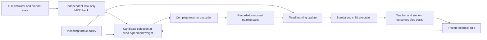

# Methods and interfaces

This is a map of the implemented research pipeline. Exact numerical recipes and frozen decisions remain in the individual protocols and capsule configurations; this overview does not redefine their criteria.

## Control and learning

The native Walker task executes six bounded torques every 0.008 seconds, for at most 1,000 controls. Walking success requires a complete episode and velocity MAE at most 0.3 m/s around the 1.5 m/s target. Complete comparison cost includes executed native cost, the native terminal charge once, and a penalty for controls left unexecuted after a fall. Survival and walking success are reported separately.

`IndependentMPPI` maintains task-only private nominal controls and RNG. At each visited state it samples the full protected bank and scores native model rollouts. `CoupledSelector` reads an immutable bank and may reweight candidates using policy agreement and action-sequence proximity. Its chosen action can change the next physical state, but it does not replace the planner's task-only private warm start or RNG. Independence is conditional on restoring identical full physical and planner state; trajectories can diverge after different actions.

The global policy maps observations to torques. Supervised fitting uses recorded executed state–action pairs, the specified initialization/normalization, and the frozen Adam/minibatch/proximal continuation. Direct torque execution departs from the paper's desired next-state/contact targets and downstream one-step optimization; see [paper mapping](paper_mapping.md) and [primary sources](loop_v3_prior_art.md).

The feedback arrow describes the intended acquisition–learning loop. It must be established by executed rounds. v3.1 did not change a weight or acquire new teachers. H4.1 changed the weight once and acquired teachers with an updated incoming policy; its children failed the advancement rule, so no second round ran.

## Three preserved studies

| Study | Manipulated variable | Learning and execution | Feedback actually tested |
|---|---|---|---|
| [v3.1](loop_v3_saved_comparison_protocol.md) | Recorded independent versus successful high-weight guided data | Identical incoming policy/Adam/RNG, equal data sizes, fixed 2,000-update children, fresh paired standalone cohorts | Recorded data usefulness only; action agreement diagnostic |
| [L1](student_learnability_protocol_l1_001.md) | Fresh clipped versus full physical-velocity feature pipeline | Matched fresh trainable parameters/private Torch stream, zero Adam, map-specific normalization, fixed 10,000 updates | Student representation/training diagnostic; no coupling adaptation |
| [H4.1](adaptive_coupling_protocol_h4_1_001.md) | Independent, fixed-high and feedback-selected half agreement weights | Updated guide; six complete teacher attempts; matched 2,000-update children; fresh paired standalone evaluation | One prospective outcome-triggered weight reduction; all children regressed |

Each study freezes seeds, parent bindings, work ceilings, teacher admission, advancement criteria and stopping rules before launch. Failed attempts remain evidence. Different successful trajectories are valid; returning to a reference path is not required by these later protocols. The [v2 algorithm](algorithm.md) retains its older local-distance recovery filter as historical context.

Teaching usefulness is measured through what a matched student executes after its fixed learning update. Current action proximity alone does not establish teachability, and post-update usefulness is an established research idea whose benefit here remains unresolved. H4.1 adjusts a scalar in existing candidate reweighting; it does not optimize through learning or introduce a new trajectory solver. [H4.2](adaptive_coupling_h4_2_hypothesis.md) proposes a different learner-response selection rule but has not run.

## Evidence and accounting

Preparation seals code, configuration and inputs. Frozen workers retain complete simulator/planner snapshots, executed pairs, checkpoints, raw model arrays and a durable query/learning ledger. Independent audits read saved evidence and recompute bindings/outcomes/accounting within their stated scope; check counts are audit assertions, not independent control trials. Model controls, live controls, forward/backward rows, Adam steps and episodes remain separate, and imported lineage is counted once. [The current report](walker_experiments_l1_h4_results.md) links complete stage and lineage accounting.

The [capsules](../results/README.md) preserve exact small records and curves. Bulk evidence and original frozen source are external to Git; [availability and limitations](evidence_availability.md) include H4.1's local-only storage. The active cleanup adds navigation, validation and compatible library boundaries without rerunning experiments or changing frozen science.
