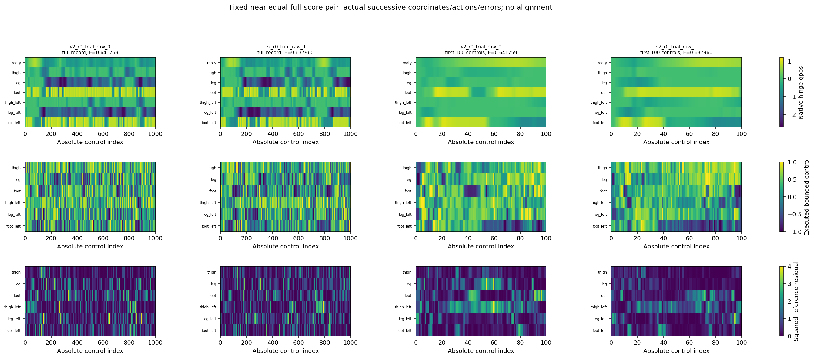

# K1.2 — actual motions differ despite close agreement averages

**Complete and independently audited.** This run reads the actual saved physical state/action sequences for all 34 K1 trajectories. The near-equal-score MPPI pair has visibly different height/joint histories. The reference shows clearer repeated local motion after startup and closer state/action returns under the frozen probe. Both sources walk, yet S1.1 still has no competent clone. These observations do not identify recurrence as the cause or remedy for failed transfer.

[Frozen protocol](motion_diagnosis_k1_2_protocol.md) · [exact recipe](../configs/studies/motion_diagnosis.json) · [capsule](../results/motion_diagnosis_k1_2/README.md) · [complete motion figures/tables](../results/motion_diagnosis_k1_2/report/report.md) · [next H5.0 proposal, unlaunched](teacher_proposal_h5_0_hypothesis.md).

## What ran

Protocol/implementation/input catalog `a77aa88` was committed and pushed before numerical decoding. The create-only frozen worker verified 16 original files, read 160 selected arrays, retained 30,070 pre-action controls and 30 real terminal states, and left four discovery endpoints missing. It checked exact source/file/array ownership, native observation/action joins and the unchanged K1/K1.1 error reductions. All nine saved policy-prediction columns were verified before selecting the fixed reference column. No model/checkpoint was loaded and no inference, integration, fitting or acquisition occurred.

The single predeclared probe compares ordered 25-control fragments on a stride 25 grid, removing clock/root-x and retaining height, seven wrapped angle differences and nine unclipped velocities at common fixed SI scales. Within comparisons require at least 100 controls of separation. Short H<25 matches remain separate. All 720,786 eligible comparisons and 17,982,374 aligned state pairs were evaluated. Complete eligible within matrices and all 561 cross-trajectory minima/diagnostics are retained; the other cross-window scores can be recomputed from the bound raw inputs and frozen source. There is no frequency estimator, time warping, fitted gait phase, recurrence threshold, weight tuning or metric sweep. R is a descriptive coordinate distance, not task value or teachability.

The [full-motion atlas](../results/motion_diagnosis_k1_2/report/full_motion_atlas.pdf) contains 34 pages, one per trajectory: every saved root/joint/velocity/action sample, first 100 controls and squared reference errors. The [derived atlas](../results/motion_diagnosis_k1_2/report/derived_curve_atlas.pdf) exposes 25-control means/extrema, which do not recover within-bin ordering. All 68 pages and four main figures were visually reviewed. No pose geometry or post-fall state was fabricated. Raw arrays remain external; clean-capsule reports regenerate summaries and copy the hash-verified original full atlas rather than claiming to rerender absent raw samples.

## Actual motion observations

In the later-independent pair, `v2_r0_trial_raw_0` stays relatively low after roughly control 200, while `v2_r0_trial_raw_1` rises through approximately 500–800 before dropping again. Both keep forward progress near the task target. Their joint trajectories and rapid torque/angular-velocity changes differ although their full conditional action errors are 0.641759262 and 0.637960496. The full-record and first 100 views preserve these differences rather than reducing them to K1.1's bin averages.

Across the atlas, MPPI maintains forward progress with changing height/posture and sharp angular-velocity/torque excursions. Reference episodes show more visibly repeated multijoint, height and control envelopes after an initial transient. These are finite trace descriptions: neither waveform appearance nor a nearest return establishes a stable periodic orbit, one attractor or a necessary walking style. There is no requirement to imitate the reference's particular motion.

The fixed probe agrees with that limited contrast:

| Recorded source | Episodes | Within comparisons per full episode | Minimum R, range across episodes | Executed-action MSE at those selected matches |
|---|---:|---:|---:|---:|
| Walking MPPI | 14 | 666 | 1.965528–3.521714 | 0.282358–0.599017 |
| Qualified reference | 16 | 666 | 0.187795–1.013648 | 0.001212–0.050672 |
| Executed random | 4 | 0 eligible | Unavailable | Unavailable |

The 30 complete episodes share duration, window count and search rule. R is nevertheless **scale-dependent and largely velocity-dominated here**; the height/angle/velocity contributions are published. A minimum over 666 comparisons is a selected local match, not an independent replication or whole-trajectory equivalence. Similar configurations with different velocities can yield large R. Static poses could also recur. Do not change the scales to manufacture a preferred interpretation or declare MPPI unlearnable.

For the predeclared near-equal MPPI pair, the best of 1,600 cross-window matches starts at 975 in the first and 50 in the second. At H=25, R=2.019449, matched action MSE=0.393540, and each fragment's conditional reference E is 0.631256/0.479638. Contributions to R² are height 0.002228, angles 0.513038 and velocities 3.562910. Thus the closest match is a local offset fragment, not equality of their entire paths, their controls or their error profiles. Full warmstart/planner state was not compared, so even small physical distance would not establish identical simulator/planner context or contradictory supervision.

All original IDs, sources, ancestry bindings, absolute starts and horizons remain available. The four random traces end after 8/26/22/14 controls and move backward/drop before termination; they cannot establish sustained recurrence. The 26-control trace contributes one full 25 window and a final one-control curve bin; the other three have separate partial comparisons. Gray later time is missing, not zero. No student-execution roster was added, and saved conditional reference predictions remain distinct from a separately executed reference rollout.

## Causal verdict and next choice

| Question | Established or supported here | Still unresolved |
|---|---|---|
| Trajectory structure | Similar episode error means conceal physically different motion histories; the reference has closer local returns under this specific probe. | Phase correspondence, long-term attractors, stable recurrence and whether any structural difference causes transfer failure. |
| Coverage | No new learner-visited states were collected or analyzed. Earlier D1 support is not competence. | Whether a fixed-label visitation intervention would improve walking; earlier corrective-data failure remains relevant. |
| Sampling frequency | All saved controls and partial tails are retained. | Which training examples are underrepresented or deserve more learning mass. |
| Consequential errors | State/action/error quantities are separated. | Causal task cost of these errors, recovery or why a particular sequence fails. D2's fixed-suffix limits remain unchanged. |
| Teacher adaptation | No new coupling mechanism ran; current selector already uses along-candidate agreement. | Whether influencing proposals rather than just the final bank improves the fixed-update child. H4.1's negative child result remains binding evidence. |

The reference's clearer repeated structure did not ensure transfer in S1.1: low reconstruction error and occasional walking in one stream still failed its competence and cross-stream benefit gates. This does not prove recurrence is irrelevant; it supplies no basis for making periodicity, spectral similarity, R or action agreement an admission test for teaching data. Different competent trajectories remain valid, and a neural policy need not have one attractor. Failed torque cloning is not a failed CIO–GPS reproduction.

**Recommend H5.0 for protocol development**, rather than defaulting to S1.2 or adding a recurrence objective. It changes one specific teacher mechanism: put the same soft policy-agreement term into an isolated guided proposal/nominal update while preserving independent discovery, then compare fixed-budget children against contemporary selector-only and independent controls. A fixed coefficient separates this from another H4.1 weight schedule. Only confirmed useful standalone learning could later change the actor field used in another actual optimization. The [proposal](teacher_proposal_h5_0_hypothesis.md) specifies variables, objective, targets, execution, controls and prospective feedback, including an equal-budget two-stream design.

S1.2 remains a legitimate fixed-reference label/distribution question. This diagnosis supplies no new student-visitation or recovery evidence making it the uniquely discriminating next experiment, and S1.2 itself would not adapt the teacher. H5.0 is an **untested recommendation**, not a positive result or cleared launch gate: the existing useful-learning prerequisite remains unmet. No new teacher, parent fit, child fit, second round, critic, representation or environment is launched automatically.

## Evidence, integrity and cost

| Scope | Actual |
|---|---:|
| Frozen scientific worker / owner | 3.072112 / 3.356566 seconds |
| Worker observed peak RSS | 102,137,856 bytes |
| Original file hash reads | 1,301,839,980 bytes |
| Worker decoder logical reads / selected decoded payload | 18,690,996 / 16,331,200 bytes |
| Source arrays / physical rows / available endpoints | 160 / 30,070 / 30 |
| Probe comparisons / aligned controls | 720,786 / 17,982,374 |
| Complete closed run | 373 files / 26,248,760 bytes |
| Compact raw export, outside Git | 6,064,785 bytes;132 arrays / 6,356,240 decoded bytes |
| Independent audit | 380,112 checks / 12.204210 seconds / 108,658,688-byte peak RSS |
| Final audit hash / original decoder / compact decoder reads | 1,368,114,173 / 247,739,332 / 6,064,811 bytes |
| Report command wall / compact logical reads | 24.209 seconds / 12,129,596 bytes |
| Report peak RSS / output bytes before receipt | 293,126,144 / 10,382,241 bytes |
| New inference, physics, gradients/Adam, MPPI, GPU, checkpoint loads | 0 each |

Worker+audit logical file reads total 2,942,449,292 bytes before separately recorded report/preflight/engineering reads. Decoded heap bytes are not additional file IO. The final audit receipt is authoritative: its earlier findings snapshot precedes a final unchanged-file rehash by 26,248,760 bytes. The independent reader reopens selected source groups rather than caching all owners, so it pays more decoder IO; that difference is charged, not hidden. Every frozen bound and the combined 8 GiB source-read ceiling passed.

The [accounting record](../results/motion_diagnosis_k1_2/accounting/accounting.json) retains exact stage receipts, source/copy sizes, preflight metadata reads, two failed shorthand path lookups and unknown preflight/tool timing. The first engineering full suite found a pre-existing exact floating subtraction assertion across a clock exponent boundary; its failure and the test-only `deadline == start + budget` correction are preserved. Production deadlines and scientific tolerances did not change. A clean export then passed **814 tests, one skip and the existing expected failure**, all 29 commands, Ruff and historical capsule/manifest checks before numerical launch. Uninstrumented editing/tool billing and global synthetic-test physics/arithmetic remain unknown, not zero.

No scientific retry was needed. The original K1/K1.1 runs, metrics, configurations, audits and archive bytes remain unchanged. Final publication validation and later overhead are recorded separately, so this frozen run and compact capsule remain immutable.
