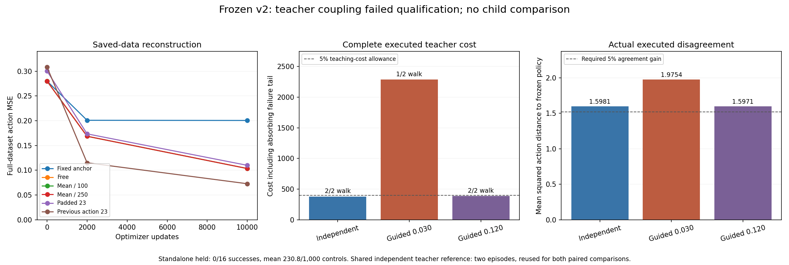

# Closed Walker v2 results

Raw `runs/` and `artifacts/` links refer to [separately preserved evidence](evidence_availability.md). Summary figures are included in Git.

**The retained policy did not qualify for standalone walking:** final held evaluation scored **0/16 successes and 0/16 full-episode survivals**, with mean **230.8125 of 1,000 controls** and complete cost **4,297.570654**. The physical run closed without a software error. No feedback child was fitted or compared.

The [closed result](../runs/2026-10-29_cio_feedback_v2_001/result.json), [frozen configuration](../runs/2026-10-29_cio_feedback_v2_001/config.json), [source manifest](../runs/2026-10-29_cio_feedback_v2_001/manifest.json) and [retained checkpoint](../runs/2026-10-29_cio_feedback_v2_001/checkpoints/final.pt) are preserved. The retained actor is the predeclared Bfree 10k policy.

## Why the teacher-data gate failed

The baseline MPPI teachers completed both walking episodes. Two fixed coupling weights were then tested on the same paired starts, without a standalone-success prerequisite.

| Executed teacher | Weight | Success / survival | Mean complete cost | Step-weighted policy disagreement | Changed decisions |
|---|---:|---:|---:|---:|---:|
| Independent MPPI | 0 | 2/2 | 379.859168 | 1.598099 | 0 |
| Lower-weight guided | 0.02998355 | 1/2 | 2,287.898334 | 1.975384 | 619 |
| Higher-weight guided | 0.11993420 | 2/2 | 386.529784 | 1.597052 | 1,283 |

The lower weight lost one walking episode and failed the cost and disagreement checks. The higher weight walked successfully on both starts. Its **+1.76% mean cost passed the frozen 5% cost guard**, and every teacher check passed except agreement: the measured reduction was only **0.0655%**, below the required **5%**.

That proxy alone rejected the higher-weight data. Both trials were therefore ineligible, and execution stopped at teacher_data_trial_gate_failed. There was no confirmation, feedback child fit or next-child comparison. **Whether these teacher data would improve a child's actual standalone performance was not tested.** Zero completed feedback rounds must not be described as a failed child comparison.

## Fitting and standalone transfer

The offline comparison used the same 4,064 labels, with zero simulated controls and no MuJoCo import. Alegacy at 2k reproduced the original v1 checkpoint hash exactly.

| Fitting arm | Full-data MSE at 2k | At 10k | Mean controls at 10k | Success / survival |
|---|---:|---:|---:|---:|
| Alegacy | 0.200917 | 0.200544 | 253.500 | 0/16 |
| Bfree | 0.168650 | 0.103482 | 227.625 | 0/16 |
| Cmean100 | 0.168651 | 0.103482 | 233.375 | 0/16 |
| Cmean250 | 0.168651 | 0.103483 | 230.250 | 0/16 |
| Dpadded | 0.173500 | 0.109939 | 133.125 | 0/16 |
| Ehistory | 0.115094 | 0.072790 | 130.500 | 0/16 |

Alegacy uses a summed weight anchor; Bfree removes it. Cmean100/250 use parameter-mean proximity with refreshed anchors and behave nearly identically to Bfree at these settings. Dpadded and Ehistory share their 23-input architecture and initialization; only Ehistory receives previous executed actions. History helped saved-data reconstruction against that capacity control, without improving survival. These errors do not establish irreducible target noise or identify the cause of falling.

The additional 2k cohorts also scored 0/16 success and survival: Alegacy averaged 266.5625 controls, Bfree 175.625. All eight fixed cohorts fell before completing the task. The [full-task plot](../artifacts/2026-10-29_v2_diagnostic_snapshot_001/mse_vs_standalone_steps_full_task.png) shows the gap to 1,000 controls; its [progress snapshot](../artifacts/2026-10-29_v2_diagnostic_snapshot_001/snapshot.json) preserves earlier ledger/log prefixes.

[Full fitting result](../runs/2026-10-29_cio_fit_v2_001/result.json), [fitting curves](../runs/2026-10-29_cio_fit_v2_001/fits/fit_mse.png), [full-data CSV](../runs/2026-10-29_cio_fit_v2_001/fits/full_mse.csv) and [zero-physics ledger](../runs/2026-10-29_cio_fit_v2_001/evidence/ledger.jsonl) remain available. The [offline audit](../artifacts/2026-10-29_v2_offline_audit_002/review.md) verifies work, ownership, 18 full-data error records and legacy reproduction without inference or optimizer replay. Its first manifest-alias failure remains preserved.

## Recovery, coverage and observations

All **32 short recovery branches stayed upright**; 28 passed the last-eight-control cost check. Only one passed the return-to-saved-trajectory distance check, admitting 32 corrective label rows. This restrictive local filter neither means that 31 branches fell nor certifies full-task recovery after a disturbance.

In the frozen clipped-observation metric, **9.006%** of Bfree diagnostic states lay outside the leave-one-trajectory-out reference threshold. Adding the 32 accepted rows changed none of their nearest-neighbor distances. This describes coverage under that representation, not causal coverage or recoverability; see [saved coverage](../runs/2026-10-29_cio_feedback_v2_001/parent_coverage.json).

The [saved observation profile](../artifacts/2026-10-29_v2_observation_profile_001/remote_output/output/profile.json) checks the four original successful teachers. At least one physical velocity was clipped by the native observation's ±10 limit in **2,359/4,000 pre-action states (58.975%)**. Recorded observations match that clipping exactly; MPPI uses full physical velocities. This measured information loss does not prove that clipping caused reconstruction error or falling.

For the next formulation, recovery should mean **completing the task after a disturbance**, rather than returning to one saved trajectory. Preserve complete executed outcomes and establish data usefulness through a matched child's actual standalone improvement. Action agreement should be diagnostic rather than substitute for that outcome. These are future requirements; no v2 criterion, controller or result has been changed.

## Auxiliary saved-plan diagnostic

A [post-hoc diagnostic](../artifacts/2026-10-29_omitted_baseline_saved_plan_diagnostic_001/receipt_001/result.json) scored 1,123 separately verified baseline means omitted from guided candidate comparison. Including that available comparator would change the first action at **517 of 3,215 recorded guided decisions**. Many changes are small: median action-change norm 0.00031034, 95th percentile 0.00599224, maximum 0.31197106.

This is a saved-path optimization omission, not an established cause of the measured control failures. No corrected controller trajectory was executed, so no repaired-controller outcome is claimed. The frozen selector and results remain unchanged. The diagnostic paid **53,687 additional neural rows and 13.638 seconds**, with zero physics, backward work or optimizer steps.

## Evidence and cost

The [saved-outcome audit](../artifacts/2026-10-29_v2_outcome_audit_001/receipt_001/receipt.json) passed **4,092,016 checks** across 150 complete episodes, hashing 475,550 datasets and checking 652,373 dataset descriptors. It added no simulation, inference, gradients or optimization. Model-trajectory contents and checkpoint/network correctness remain outside its stated scope. The [summary-plot receipt](../artifacts/2026-10-29_v2_report_001/receipt.json) also records zero experimental work.

| New v2 stage | Controls | Neural rows | Backward rows | Adam steps | Internal seconds |
|---|---:|---:|---:|---:|---:|
| Six-arm fitting | 0 | 15,433,152 | 15,360,000 | 60,000 | 630.415 |
| Physical comparison | 78,815,397 | 35,207,541 | 0 | 0 | 2,209.008 |
| Auxiliary diagnostic | 0 | 53,687 | 0 | 0 | 13.638 |
| New v2 total | 78,815,397 | 50,694,380 | 15,360,000 | 60,000 | 2,853.061 |

The physical stage comprises 78,778,992 model controls and 36,405 live controls, with no recorded query/measurement failure, rejection or unknown work. The [cost-accounting receipt](../artifacts/2026-10-29_v2_report_001/cost_accounting.json) keeps imported **v1 work separate: 51,176,593 controls, 520,433 neural rows and 1,161.884 internal seconds**. Counting v1 once gives 129,991,990 controls, 51,214,813 neural rows and 4,014.945 summed internal stage seconds. These sums exclude validation, auditing, rendering, transfer and other development overhead; no efficiency claim is made.

Physical validation passed 145 tests, with two skips and one expected stock-Gymnasium mismatch: [receipt](../artifacts/2026-10-29_v2_physics_validation_001/receipt.json). Pure fitting validation preceded new physics: [receipt](../artifacts/2026-10-29_v2_fit_validation_001/receipt.json). Earlier captured validation and incomplete initial capture limits remain in the [independent metadata review](../artifacts/2026-10-29_cio_reset_independent_metadata_audit_002/review.md) and original receipts.

The compact [executed traces](../runs/2026-10-29_cio_feedback_v2_001/exports/executed_traces.h5) are mirrored locally. The [raw-evidence locator](../runs/2026-10-29_cio_feedback_v2_001/exports/remote_evidence.json) binds the full remote HDF/ledger and compact export. Four videos render saved states with no new controls or neural rows:

- [Independent MPPI walking](../runs/2026-10-29_cio_feedback_v2_001/videos/independent_mppi_walk.mp4).
- [Higher-weight guided MPPI walking](../runs/2026-10-29_cio_feedback_v2_001/videos/guided_mppi_high_weight_walk.mp4).
- [Lower-weight guided MPPI falling](../runs/2026-10-29_cio_feedback_v2_001/videos/guided_mppi_low_weight_fall.mp4).
- [Retained standalone policy falling](../runs/2026-10-29_cio_feedback_v2_001/videos/standalone_policy_fall.mp4).

V1 remains negative at its initial transfer gate: MPPI 4/4, policy 0/16 qualification and 0/16 held, zero feedback rounds. Its [preserved report](../archive/cio_walker_v1-2026-10-29/docs/results.md) and [original result](../runs/2026-10-29_walker_cio_mppi_001/result.json) are unchanged. No population-wide, beyond-horizon ending or beneficial-feedback result is claimed.

## Closed failure diagnosis and one corrective-data intervention

The [focused diagnosis and reproduction guide](../artifacts/2026-10-29_policy_instability_diagnosis_001/README.md) reproduced the retained actor's 181-control / 1.448-second height failure in four native cases, with no differing state/action bytes. Independent MPPI completed the same reset; its first 16 successful controls did not rescue the original actor, which fell at control 54. One frozen actor-prefix-20 corrective acquisition then completed all 1,000 controls and admitted 980 actual teacher rows by the full native task outcome, without a distance filter.

The matched 2k-update children shared the original 4,064 rows, parent weights/Adam/PCG64/normalization and update budget. On 16 fresh paired starts, **parent, ordinary-data child and corrective-data child all scored 0/16 success and survival**; mean controls were 255.125, 173.9375 and 165.75. Treatment reduced local in-sample corrective MSE by approximately 63%, and both fits removed the original long straight-joint stall, without improving walking. The unique neural cause remains unresolved; no active policy patch or additional trial is supported by this test. The [saved-evidence audit](../artifacts/2026-10-29_policy_instability_diagnosis_001/final_outcome_audit_001/receipt_001/report.md) passed 383,389 checks without inference or dynamics replay; the guide records all new work and preserved failures. Earlier v2 results above remain unchanged.

Versioned figures: [focused diagnosis](figures/policy_diagnosis.png) and [matched learning curves](figures/policy_learning_curves.png).
