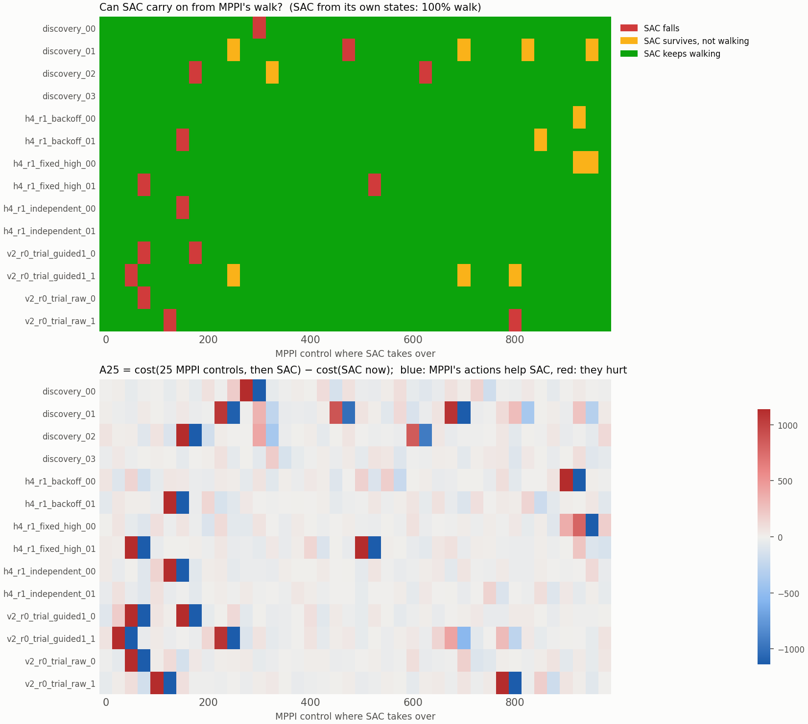

# SAC continuation map: the oracle carries on from almost all of MPPI's walks

**Current interpretation, corrected after the J1 review.** The later saved
positive control cloned SAC's own 9,000 rows into the width128 tanh student for
10,000 updates, with normalization computed from that corpus, and walked from
94/96 standing resets (30/32, 32/32 and 32/32 over three student seeds). Thus the
S1.1 failure below is not evidence that this architecture or all reference
cloning fails. Data amount, update budget and normalization differ together;
their individual effects were not isolated. The [integrated review](similarity_j1_review.md)
records these limits and the [preserved diagnostic evidence](../results/sac_diagnostics_review_001/README.md).
This correction runs no new continuation, fitting or evaluation.

**Complete, single run, no independent audit.** The SAC oracle took over from all 14 saved K1 MPPI walks every 25 controls. It kept walking from **534 of 560 states (95.4%)** and survived from 546 (97.5%). From its own states it walked from 640 of 640. Within 4 s it pulled MPPI's motion into its own gait, and how far MPPI's motion was from that gait did not predict how well SAC did. One MPPI action changed SAC's continuation no more than one random action did. At this horizon a single deterministic rollout therefore cannot say whether MPPI's action helps or hurts.

This is the protocol's **"covers all"** reading. MPPI's several gaits sit inside this oracle's region of attraction, so having several gaits is probably not what blocks cloning. No student was trained.

[Original protocol](../results/sac_diagnostics_review_001/original_docs/sac_continuation_protocol.md) · [preserved script](../results/sac_diagnostics_review_001/source/scripts/diagnostics/sac_continuation.py) · [capsule](../results/sac_continuation_001/README.md) · [post hoc analysis](../results/sac_continuation_001/posthoc_analysis.py) · [K1 results](action_compatibility_k1_results.md) · [K1.2 results](motion_diagnosis_k1_2_results.md).

## What ran

The protocol and script were committed as `18482df` before the run. Before that, only a smoke test had run, with two SAC rollouts standing in as teachers, so no MPPI result had been seen when the protocol was frozen. The run used the frozen command unchanged:

```bash
python scripts/diagnostics/sac_continuation.py --out runs/2026-11-02_sac_continuation_001
```

From each of the 560 MPPI states (14 walks × controls 0, 25, …, 975), four arms ran for 500 controls (4 s):

- `sac`: SAC alone, giving V
- `mppi1`: MPPI's action, then SAC, giving Q
- `rand1`: one uniform random action, then SAC
- `mppi25`: 25 replayed MPPI actions, then SAC

The control ran the `sac` arm from the same grid on SAC's own 16 rollouts. In total there were 2,880 rollouts and 1,417,904 simulated controls, in 105 s on one CPU.

Every number in the [post hoc analysis](../results/sac_continuation_001/posthoc_analysis.py) beyond the frozen summary is labeled **post hoc** below. That covers the noise comparison, the fall details, the standing cases, the R components, the A25 identity and the fidelity split. That analysis reads the saved arrays only.

## Fidelity

| Check | Result |
|---|---|
| Exact restores (integration state plus warm start) | 400/400 MPPI starts with saved integration state; 640/640 control starts |
| SAC replaying its own saved rollout for 25 controls, maximum state deviation | 0.0 over all 640 |
| State after 25 replayed MPPI actions vs saved state, maximum deviation (post hoc split) | 3.1e-13 exact restore; 2.5e-13 for the 4 discovery walks restored from the 19-value state |
| Replayed prefix costs vs saved costs, maximum deviation | 8.0e-14 (390 starts with saved costs and no fall) |

The protocol asked for the prefix checks split by restore type, but `summary.json` combines them; the split comes from the post hoc analysis. The approximate restore of the discovery walks made no measurable difference. SAC fell from 4 of their 160 states and from 10 of the 400 exactly restored ones, 2.5% in both groups.

## Can SAC carry on from MPPI's states?



| Start states | Survives 500 controls | Keeps walking (velocity MAE ≤ 0.3 over the last 400) |
|---|---:|---:|
| MPPI walks (560) | 546 (97.5%) | 534 (95.4%) |
| SAC's own rollouts (640, control) | 640 (100%) | 640 (100%) |

The walking runs have a median velocity MAE of 0.171 (p10 0.131, p90 0.209), so the 0.3 threshold is not close for most of them. SAC's own walking speed is 1.39 m/s, below the 1.5 target, and that accounts for most of the MAE.

| Teacher | Restore | Survives | Walks | Median R, MPPI → SAC gait | Median R, end of SAC run |
|---|---|---:|---:|---:|---:|
| `discovery_00` | 19-value | 39/40 | 39/40 | 5.41 | 0.55 |
| `discovery_01` | 19-value | 39/40 | 35/40 | 4.25 | 0.56 |
| `discovery_02` | 19-value | 38/40 | 37/40 | 4.93 | 0.66 |
| `discovery_03` | 19-value | 40/40 | 40/40 | 4.81 | 0.62 |
| `h4_r1_backoff_00` | exact | 40/40 | 39/40 | 4.71 | 0.59 |
| `h4_r1_backoff_01` | exact | 39/40 | 38/40 | 4.48 | 0.72 |
| `h4_r1_fixed_high_00` | exact | 40/40 | 38/40 | 4.54 | 0.55 |
| `h4_r1_fixed_high_01` | exact | 38/40 | 38/40 | 4.52 | 0.58 |
| `h4_r1_independent_00` | exact | 39/40 | 39/40 | 4.57 | 0.61 |
| `h4_r1_independent_01` | exact | 40/40 | 40/40 | 4.35 | 0.60 |
| `v2_r0_trial_guided1_0` | exact | 38/40 | 38/40 | 4.80 | 0.61 |
| `v2_r0_trial_guided1_1` | exact | 39/40 | 36/40 | 4.34 | 0.55 |
| `v2_r0_trial_raw_0` | exact | 39/40 | 39/40 | 4.07 | 0.54 |
| `v2_r0_trial_raw_1` | exact | 38/40 | 38/40 | 4.34 | 0.55 |

On the sampled 25-control grid, no entire source walk failed SAC continuation.
Each walk has at most two falls, and the sampled states 25 controls before and
after every fall walk on. This does not establish recovery from every state or
every possible deviation. **Post hoc:**

- 8 of the 14 falls happen within 24–36 controls of the handover and 3 more within 93.
- At 10 of the 14 fall states SAC also fell after MPPI's action and after the random action, so at those states the first action did not matter.
- The 12 survivors that did not walk are of two kinds:
  - 5 stopped and stood still (final forward speed 0.02–0.05 m/s), so SAC has a standing state it can settle into;
  - 7 walked slower than the rule allows (MAE 0.31–0.71).

## Does SAC pull the motion into its own gait?

K1.2's frozen window distance R to the nearest window of SAC's 16 rollouts (25-control windows starting at control 100 or later):

| Window | Median | p10 | p90 |
|---|---:|---:|---:|
| MPPI's own motion at the handover | 4.53 | 2.51 | 6.59 |
| Last 25 controls of SAC's run from an MPPI state | 0.59 | 0.28 | 1.10 |
| Last 25 controls of SAC's run from its own state, other rollouts only (control) | 0.59 | 0.25 | 1.15 |

Wherever SAC starts, it ends in its own gait, as close to its other rollouts as they are to each other. **Post hoc:** 97.7% of MPPI's R² comes from velocities, 2.3% from angles and almost none from height. Forward speed is not the cause: MPPI walks at 1.48–1.53 m/s against SAC's 1.39. The difference is in the joint and body angular velocities, the fast part of MPPI's motion. SAC discards it and keeps walking.

How far MPPI's motion was from SAC's gait does not predict how well SAC continues (Spearman between R and the `sac` arm's cost: 0.06). Taking over from MPPI does cost something. In walking runs from MPPI states, SAC's median cost per control is 0.45; from its own states it is 0.39.

R is a descriptive, velocity-dominated coordinate distance, as K1.2 warned, not a measure of task value or teachability.

## Does MPPI's action help or hurt?

On the 540 states where none of the one-action arms fell (**post hoc** except the A1 row, which the protocol defines):

| Cost difference over 500 controls | Median | Median absolute | p10 | p90 | Negative |
|---|---:|---:|---:|---:|---:|
| A1 = MPPI's action, then SAC − SAC | 0.9 | 20.5 | −41.6 | 44.0 | 48% |
| One random action, then SAC − SAC | −3.7 | 23.8 | −39.8 | 41.0 | 54% |
| MPPI's action − random action | 2.8 | 24.7 | −46.6 | 43.8 | 47% |
| A25 = 25 MPPI actions, then SAC − SAC (532 states with no fall in either arm) | −5.6 | 34.4 | −72.5 | 77.0 | 54% |

A walking continuation costs about 225 over 500 controls. Any single first action, MPPI's or random, moves that by about ±20–40, and the sign is a coin flip. The A1 and random-action differences share part of their noise through the common `sac` run (Spearman 0.41). One deterministic 500-control rollout is too sensitive to rank one action. The protocol expected that A1 might be uninformative because single actions are too small to matter. The outcome here is the opposite: every single action moves the cost by about the same large amount.

Survival flips are few and balanced:

| Arm | Rescues a SAC fall | Breaks a SAC survival |
|---|---:|---:|
| MPPI's action (`mppi1`) | 4 | 2 |
| Random action (`rand1`) | 4 | 5 |
| 25 MPPI actions (`mppi25`) | 14 | 14 |

A25 holds no evidence beyond the `sac` arm. Replaying 25 MPPI actions lands exactly on the next grid state, so the `mppi25` arm from control t is SAC from control t + 25, shortened by 25 controls. **Post hoc:** `mppi25` survival equals the next state's `sac` survival at 546/546 states, and the red–blue pairs in the lower panel of the figure are each fall seen twice. This followed from the design and should have been noticed before the freeze.

**Critic.** SAC's own twin critic rates MPPI's action below SAC's action at 84% of the 14,000 MPPI rows (median advantage −7.4 in SAC's reward units, p90 +2.6). That is expected for a critic whose actor is trained to maximize it. Its rank agreement with −A1 is 0.04, but since A1 is at noise level here, this does not test the critic.

## Reading

Both rates clear the protocol's ≳90% mark, so this is the **"covers all"** reading. SAC carries on from MPPI's walks wherever they are, without needing their fast joint-velocity content. Its few failures are single moments, not whole walks or stretches, and how far a state is from SAC's gait does not predict them. On Walker, the idea that "the oracle owns one gait and MPPI's other gaits are off its map" finds no support from this oracle.

The protocol's reading for this outcome points back to fitting and to torque
attenuation (K1: clone |u| ≈ 0.30 against MPPI 0.44). Cloning reconstructs MPPI's
torques better than chance yet falls (K1). Students cloned from this same
reference's own data reconstructed its held actions closely (MSE about 0.01) yet
walked in only 5 of 96 episodes, all in one stream (S1.1). That historical result
remains unchanged. The later positive control's 94/96 standing walks shows that
reference cloning can succeed with the width128 student under a different
9,000-row/10,000-update, corpus-normalized recipe. The two results do not isolate
why S1.1 failed, and the earlier generalization that even a single gait cannot be
cloned should not guide current experiment selection.

For the matching question in the 2026-11-02 field note, two things follow:

1. A policy can absorb MPPI's high-frequency differences under feedback. The part worth matching is therefore what keeps the closed loop recoverable, not per-step torques. This is an interpretation, not something this run tested.
2. Continuation compatibility `A(s,u)` cannot be estimated from one deterministic rollout per action at this horizon. It needs averaging over perturbed rollouts, a shorter horizon or a learned value function. That is in line with Kendall's advice to use "the value function not policy rollouts" to judge where a policy can cope.

## What this does not show

- It describes one deterministic SAC checkpoint and one draw of random actions, not RL policies in general.
- It trains no student. Whether a student could learn from MPPI's states with SAC's actions, or from SAC's continuations, is untested.
- R is velocity-dominated. A different scale could rank windows differently, and nothing here was rescaled.
- Single-rollout advantages are noise-limited, so "MPPI's action neither helps nor hurts" means "no detectable effect", not "zero effect".
- There was no independent audit, unlike K1 and K1.2.

## Evidence and cost

| Item | Value |
|---|---|
| Frozen protocol and script | `18482df` |
| Inputs | K1 `reference.pt` (sha256 `174e9886…`), K1 `raw.h5` (`2b73fc8e…`), 14 teacher files; full hashes in [capsule.json](../results/sac_continuation_001/capsule.json) |
| Rollouts / simulated controls | 2,880 / 1,417,904 (4 substeps each) |
| Critic evaluations | 28,000 rows × 2 networks |
| Wall time | 105 s scientific, 108 s with startup, one CPU |
| Outputs | `results.npz` (93 MB, local only, sha256 `36c99bc7…`), `summary.json` and `continuation_map.png` (copied into the capsule) |
| New MPPI queries, fitting, optimizer steps, GPU | 0 each |
