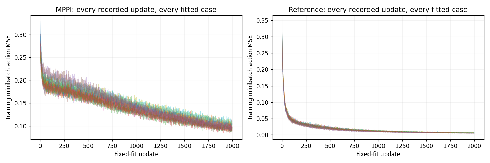
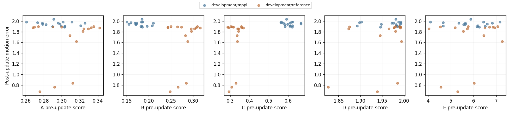

# J1.0: useful development evidence, unidentified protected comparison

Scientific execution, independent audit, scientific admission, repaired
rendering/reporting and compact evidence collection closed successfully for
scientific source `8c678e507dad1e22708f02a121886d7951d1da44`. The worker status is
`CLOSED_DEVELOPMENT_VARIATION_INELIGIBLE`, its predictive objective is unmet, and
the protected test was never opened. This is a closed finite diagnostic result,
with the original publication failure retained. Git publication is tracked
separately from execution and evidence closure.

The [frozen protocol](similarity_j1_protocol.md),
[implemented formulation](similarity_j1_formulation.md),
[cost accounting](similarity_j1_costs.md) and
[verified compact capsule](../results/similarity_j1/capsule.json) preserve the
experiment and its limits.

The central finding is that this development benchmark did not supply the
variation required to test a useful pre-update similarity score. All 16 children
taught by independent MPPI failed every standalone walking evaluation, and their
same-start motion errors had standard deviation **0.03849315344778441**, below
the frozen **0.1** gate. The protected comparison is **unidentified**. This is not
evidence that no candidate beats action MSE, and development-only fits cannot be
presented as a protected prediction result.

## What was actually run

Eight fresh development source groups each supplied one 1,000-control
independent-MPPI trajectory and one 1,000-control reference trajectory from the
same exact initial context. Here **reference** means an existing independently
trained SAC walking actor, executed to label its own visited states. It does not
mean an optimal policy or supervision on student-deviation states.

Within each group, two fresh width128 torque-policy initializations were each
cloned into a matched MPPI/reference contrast. Each contrast preserved identical
incoming tensors, normalization, empty Adam, private/global RNG and the same
2,000-by-256 minibatch-index stream. Each child received 1,000 unique recorded
state/action rows and exactly 2,000 updates of ordinary action MSE. The reference
was not retrained. Architecture, execution controller and planner parameters
were fixed.

The resulting **32 development learning cases** comprise 16 MPPI-data children
and 16 reference-data children, each tested on 16 fresh paired standalone resets
and one separate same-start reproduction rollout. The eight source groups are
the independent acquisition units; two initializations and repeated resets do
not create additional independent teachers. The run preserved 592 complete
actual trace records, including acquisition, replay, incoming, reproduction and
standalone executions. No post-fall simulator state was fabricated.

The five pre-update candidates were action MSE; a fixed five-control smoothed
action MSE; a development-fitted affine state-explained proxy with residual
weight two; synchronized incoming-policy motion distance; and standardized
joint observation/action sliced-Wasserstein occupancy distance. These were
diagnostic scores. They never entered acquisition, actor fitting or action
execution. All candidates shared the same learning outcomes and the same
one-scalar prediction capacity.

## Complete development outcomes

Walking requires survival through all 1,000 controls, or eight seconds, and mean
absolute forward-speed error at most 0.3 m/s against the 1.5 m/s target. Survival
alone is retention. Exact trajectory reproduction has additional frozen
angle/velocity/height/progress requirements and is a separate outcome.

| Outcome | MPPI source/data | SAC-reference source/data |
| --- | ---: | ---: |
| Teachers walking / acquired teachers | 8/8 | 8/8 |
| Teachers with full survival | 8/8 | 8/8 |
| Mean teacher complete task cost | 392.9332 | 543.7309 |
| Fitted children / actual source groups | 16 / 8 | 16 / 8 |
| Standalone walking episodes | **0/256** | **35/256** |
| Standalone full-survival episodes | 2/256 | 38/256 |
| Mean actual standalone controls | 139.9297 | 329.9141 |
| Mean standalone complete task cost | 4,754.4020 | 3,725.9462 |
| Mean standalone native task cost | 454.0505 | 375.5165 |
| Mean standalone absorbing-tail cost | 4,300.3516 | 3,350.4297 |
| Children with any standalone walking | 0/16 | 8/16, across six groups |
| Best child standalone walking | 0/16 | 6/16 |
| Same-start walking rollouts | 0/16 | 3/16 |
| Same-start full-survival rollouts | 1/16 | 3/16 |
| Exact full-window reproductions | 0/16 | 0/16 |
| Mean same-start motion error | 1.9476854 | 1.6395505 |
| Mean same-start child complete cost | 4,703.9010 | 3,710.0171 |
| Mean paired same-start cost gap, child minus teacher | **+4,310.9678** | **+3,166.2861** |

Reference demonstrations produced more walking after the matched fitting
procedure, but no child approached the 15/16 individual-competence convention.
The MPPI-data children did not walk; their two full-survival episodes are
retention outcomes. Teacher and standalone cost means expose a large remaining
transfer gap, but use different reset panels and are descriptive. The final two
rows instead compare each child's separate reproduction rollout with its own
teacher from the identical restored context. Those are paired complete-cost
gaps, including each fall's native terminal charge once and five per unexecuted
control. They remain large and positive for both sources.

All three reference-data children that walked from the teacher's start failed
the reproduction angle limit: joint-angle RMS was 0.3601, 0.2892 and 0.4288 rad
against 0.25 rad. One also exceeded the 0.5 m final-progress limit. Their walking
remains valid. A different successful gait is allowed; reproduction is not a
competence requirement.

The incoming actors were measured from acquisition starts, not on a complete
matched standalone reset panel. Consequently these data do not isolate the
absolute standalone effect of fitting from a no-update control. They do support
the matched MPPI-versus-reference demonstration comparison under this learner.

Every curve contains all 2,000 stochastic minibatch measurements. These are fit
curves, not held-out reconstruction or standalone competence measurements.

## What the score experiment established

The MPPI development stratum had zero walking successes, so every candidate used
the same frozen constant walking probability, `0.5/257 = 0.0019455253`, with zero
slope and an explicit degenerate-label flag. Its motion variation also failed
the predeclared gate. Execution therefore stopped before protected acquisition,
learning, score prediction errors or the simultaneous confidence-bound test.
Missing protected errors, rankings and bounds remain missing, not zero.

For context only, the incoming-policy action-MSE mean was 0.29456 on MPPI
demonstrations and 0.30585 on reference demonstrations, while reference-data
children walked more often after learning. This source-level descriptive
contrast shows why present action agreement is not a sufficient learning
outcome. It does not validate another candidate or identify the cause of failed
MPPI transfer. Reference outcomes cannot be pooled into the primary MPPI stratum
afterward to manufacture the required variation.

These are development-only descriptive joins. The protected score comparison,
its errors and simultaneous bounds were not executed.

The planning assay preserved 208 bounded decisions at four predeclared contexts,
including eight original replay/observer checks. All 208 final selector banks were retained; 204 decisions additionally retained instrumented pass/innovation arrays. Four unwrapped decisions are the observer-equivalence controls, rather than missing weight arrays being interpreted as zeros. Changing carried versus zero
nominal controls changed selected first actions in all 12 paired nominal
contrasts; mean six-action squared changes ranged from 0.13996 to 0.68830.
Private innovation streams also produced variation. These observations establish
dependence on planner context under this assay, not irrelevant noise or a
causal explanation of cloning failure. Four local empirical fits had full
17-dimensional design rank; two were locally flat and the other two had held
action RMSE 0.07117 and 0.12683. They are finite local sensitivity measurements,
not optimal feedback gains or proof of learnability.

The independent auditor checked all 32 checkpoint/tape/Adam/RNG joins and all
64,000 recorded learning points without repeating actor fitting or physics.
A/B/D/E used independent score oracles; C, development prediction fitting and
bootstrap arithmetic reused declared pure formulas. A passed audit certifies
the saved measurements and bounded negative/ineligible result, not the
similarity objective.

## Publication and preserved evidence

The original frozen `render_001` failed because saved C1 terminal flags use a
one-byte integer codec while the atlas boundary required booleans. Its actual
child and coordinator exited nonzero. The preserved atlas receipt records
**zero frames, restores, forwards, neural rows, physics and Adam updates**. The
generic failed-process uncertainty flag remains recorded. This is a publication
adapter failure, separate from scientific execution and audit.

A separate create-only [publication repair](../results/similarity_j1/publication_repair_002/execution_001/repair_result.json)
decoded only valid `uint8` zero/one terminal flags into booleans, leaving the
frozen scientific source, raw arrays, checkpoints and outcomes unchanged. Its
actual parent/render/report exits passed, as did compact collection and local
checksum verification. The failed original atlas remains under
[failed_render_001](../results/similarity_j1/failed_render_001/result/atlas_receipt.json).

The completed atlas contains **96 actual traces and 8,498 frames**: 16 teachers,
16 incoming policies, 32 same-start reproductions and the first predeclared
standalone reset of each child. All 512 final standalone traces remain in raw
evidence. Rendering used original XML geometry in an explicitly labeled
**kinematic schematic**, with 8,498 separately counted offline position forwards
and zero new controls, physics, neural rows or Adam updates. Contact onsets,
partial intervals, flicker and falls remain unfiltered. Frame/control timestamps
are explicit; there are no physical post-fall states or terminal display holds.

The verified capsule contains **209 files, 36,102,352 bytes**:

- [Compact evidence and provenance](../results/similarity_j1/capsule.json) and
  [external raw-evidence locations](../results/similarity_j1/external_evidence.json).
- [Five-score/rejected-candidate table](../results/similarity_j1/report/score_table.csv.gz)
  has five candidates plus four rejected rows; [all 32 measured cases](../results/similarity_j1/report/cases.csv.gz)
  and [160 score/outcome pairs](../results/similarity_j1/report/score_outcome_pairs.csv.gz)
  retain every development join. Protected prediction errors and bounds are blank.
- [Every recorded learning point](../results/similarity_j1/report/learning_curves.csv.gz),
  [learning curves](../results/similarity_j1/report/learning_curves.png),
  [score versus motion](../results/similarity_j1/report/scores_vs_motion.png), and
  [score versus walking](../results/similarity_j1/report/scores_vs_walking.png).
- The 32 original per-fit `learning_curve.json.gz` files under
  `run/worker/fits/`, retaining exact original-byte hashes and all 2,000 points
  per case. Compression is lossless; no curve was thinned.
- [Atlas receipt](../results/similarity_j1/atlas/result/atlas_receipt.json),
  [saved HTML index](../results/similarity_j1/atlas/result/index.html),
  [report receipt](../results/similarity_j1/report/report_receipt.json) and
  [collection closure](../results/similarity_j1/collection_exit.json).

The HTML index's full videos, scalar arrays and per-trace figures remain at the
explicit remote locations in the external-evidence index; they are not embedded
in the compact Git capsule. The compressed tables/curves retain original hashes
and can be decoded into fresh replay directories. Missing protected cases,
parents, source groups and prediction comparisons are **unexecuted under the
frozen stop**, not lost evidence. Learning curves are stochastic minibatch fit
measurements, not full-corpus reconstruction or walking scores.

The worker used 101,746,176 model controls and 161,551 native controls, totaling
407,630,908 physics substeps; 16,553,551 forward rows, 16,384,000 backward rows
and 64,000 Adam updates. The separate audit read 6,578,843,849 saved-source bytes
and performed 169,551 forward rows, with zero new physics or Adam updates.
See the [cost table](similarity_j1_costs.md) for phase wall/CPU scopes, engineering
failures and remaining unknown accounting fields.

## Causal verdict and next step

Independent MPPI discovery remained competent. This fixed-width action learner
still failed to execute MPPI demonstrations as standalone walking, while
reference demonstrations yielded partial transfer. The prospective similarity
comparison did not become identifiable on its frozen primary development
stratum. No candidate-selection claim, adaptive coupling result, new guidance
mechanism or convergence claim follows.

The next step is the separately versioned [J1.1-B benchmark-repair proposal](similarity_j1_1_proposal.md)
addressing incoming learner states and a matched no-update control, with its own
finite budget and variation gate. It proposes fresh `3500…` seed roles rather than
repurposing J1.0's unopened `3400…` protected panel. It is a proposal, not an
automatically launched experiment. Architecture changes and MPPI behavior-family
shaping remain separate hypotheses.

## Fixed-role visual evidence

The original first teacher, incoming learner and updated MPPI-data child were selected by role before outcomes. Their exact synchronized joint/contact/control plots are preserved as [teacher](figures/similarity_j1/teacher.png), [incoming](figures/similarity_j1/incoming.png) and [child](figures/similarity_j1/child.png), with [byte bindings](figures/similarity_j1/manifest.json). They illustrate these particular executions; they do not replace the complete96-trace atlas or the592 actual saved traces. The [learning curves](../results/similarity_j1/report/learning_curves.png) show training-minibatch MSE for all 32 fits; the [walking plot](../results/similarity_j1/report/scores_vs_walking.png) is development-only and makes the absent MPPI walking variation visible.
