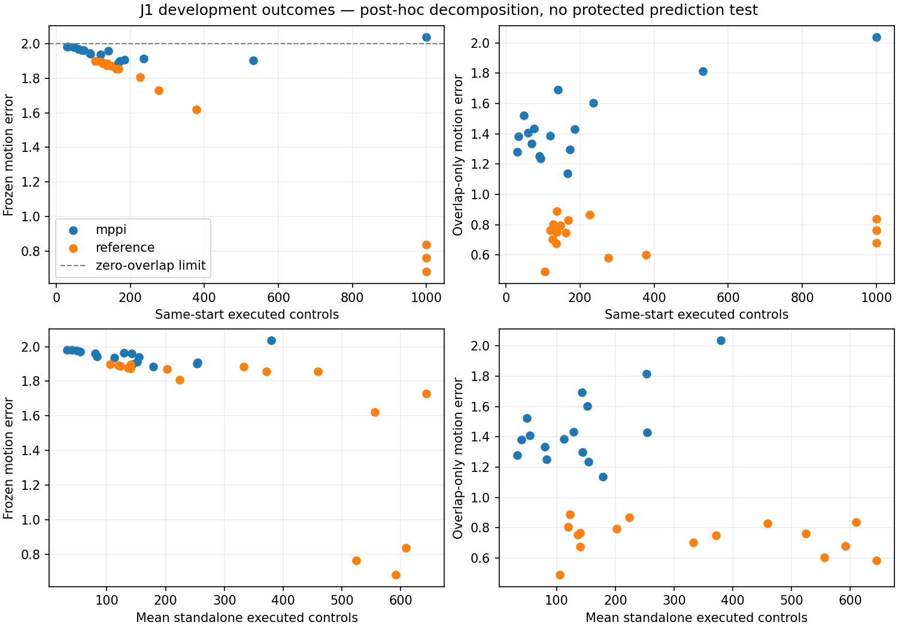

# J1 evidence review: repair the benchmark before another learning run

J1.0's scientific result remains closed: 16/16 teachers walked, MPPI-data
children walked 0/256 standalone episodes, reference-data children walked
35/256, and the protected similarity comparison never opened. The previous
[J1.1-B recommendation](similarity_j1_1_proposal.md) is **suspended**. No new
fitting, evaluation, MPPI acquisition or coupling is authorized by this review.

The immediate work reconciles saved evidence from the main checkout and the
separate `sac-continuation` worktree. That evidence was not all represented in
the maintained project summary when J1 was designed. Its preservation is not a
retroactive claim that those diagnostics had J1's prospective protocol, complete
run bindings or independent audit.

## Evidence that changes the interpretation

| Saved record | Observation | What it supports and what remains unresolved |
| --- | --- | --- |
| [J1.0](similarity_j1_results.md) | MPPI-data walking 0/256; reference-data walking 35/256; best child 6/16 | This 1,000-row/2,000-update source contrast had incomplete transfer. No candidate's protected predictive advantage was tested. |
| [Positive-control summary](../results/sac_diagnostics_review_001/runs/2026-11-02_student_positive_control_001/summary.json) | Width128 SAC clones walked 30/32, 32/32 and 32/32: 94/96 total | The existing width128 architecture can clone this reference under a 9,000-row/10,000-update, corpus-normalized recipe. Data size, updates and normalization differ from J1 together; their effects are not isolated. |
| [Jitter summary](../results/sac_diagnostics_review_001/runs/2026-11-02_jitter_tolerance_001/summary.json) | At nominal signal share 0.9, white-label jitter gives 51/96 walking, MPPI-derived jitter 32/96 and slow jitter 0/96; clean labels give 94/96 | This supplies an existing controlled-label diagnostic benchmark. It does not prove that MPPI's state-dependent actions are irrelevant noise or that a particular MPPI fine-tuning outcome is inevitable. |
| [On-policy disagreement summary](../results/sac_diagnostics_review_001/runs/2026-11-02_on_policy_disagreement_001/summary.json) | Reported strong separation uses the fitted student's visited states | This is an execution diagnostic measured after learning. Its reported AUC is not evidence that a pre-update score predicts what a fresh student will learn. |
| [Earlier consistency summary](../results/sac_diagnostics_review_001/runs/2026-11-02_mppi_consistency_001/summary.json) | Carried-versus-fresh mean action shift 0.254471; carried sampling spread 0.022672 | Planner memory dependence was already observed. The earlier assay changed pass count with the nominal and used smooth-MPPI sources; J1's matched-pass factorial supplies a more controlled replication. |

The [preservation capsule](../results/sac_diagnostics_review_001/README.md)
retains original scripts, summaries and available figures without replacing the
original worktree or rewriting historical results. Its saved-only review must
be distinguished from a full audit of the original scientific executions.
Preservation covers its explicitly manifested snapshot roster, not every later
file or ongoing edit in that worktree.
The [reanalysis summary](../results/sac_diagnostics_review_001/reanalysis/summary.json)
contains the independently recomputed arithmetic and explicit original-evidence
limitations.

The positive control corrects the earlier maintained
[SAC-continuation interpretation](sac_continuation_results.md). S1.1's 5/96
reference-data walking result remains a valid result for its retained actors.
It no longer supports a general claim that reference cloning fails with this
network. Equally, the positive control does not establish that J1 would succeed
merely by increasing updates: it changes corpus size and normalization too, and
its smooth-MPPI-data clones still failed. A capacity intervention is not needed
to explain the existence of successful reference clones.

The jitter arms are fresh fits to perturbed labels, not continued training of
competent parents. They therefore do not establish catastrophic forgetting from
an MPPI update. Signal share 0.9 specifies a nominal pre-clipping variance ratio,
not a ten-percent action-amplitude perturbation; clipping changes the final
label distribution. The white-versus-slow contrast at that level is useful
diagnostic evidence, while the original two-level `timing_matters` gate and
pre-training label-measure gate both remained false. Preserve those negative
readings alongside the individual condition results.

## Separate walking, observed duration and motion

J1's frozen same-start motion error combined observed divergence and a missing
suffix. For horizon \(H=1000\), common executed length \(n\), and mean observed
capped four-component squared error \(\bar e\), it is

\[
M^2=\frac nH\bar e+4\left(1-\frac nH\right).
\]

Here the four components are relative progress, height, wrapped joint angles and
velocities, with the original scales and component caps. When the observed
error is near four, changing duration barely changes this combined value. A
short fall tends toward \(M=2\); a surviving child whose synchronized motion
diverges by a similar amount can receive a similar or worse value. This
explains compression in the realized J1 outcomes. It is not a theorem that the
formula can never vary or that the 0.1 gate was mathematically impossible.

Keep the frozen endpoint and its failed gate intact. A separately labelled
post hoc diagnostic should report:

- Walking under the unchanged speed-and-survival criterion.
- Actual controls and seconds observed, terminal-fall status and right censoring
  at the 1,000-control horizon. A full survivor has no measured fall time.
- Overlap-only synchronized motion error \(M_{\rm overlap}=\sqrt{\bar e}\),
  its individual components and common-prefix length, without a missing-tail
  contribution. Different prefix lengths remain a comparability limitation.
- Native cost, absorbing-tail cost and complete cost separately. A large tail
  fraction describes the accounting convention, not an additional physical
  control consequence measured after falling.

No motion diagnostic fabricates post-fall observations or makes returning to a
teacher's particular gait a walking requirement. A changed gait may walk
competently while failing synchronized reproduction. Overlap-only errors do
not become new prospective primary endpoints for J1, and no development result
opens its protected panel retroactively.

The executed [saved-only supplement](../results/similarity_j1_review_001/README.md)
joins all 32 cases in [cases.csv](../results/similarity_j1_review_001/cases.csv)
and retains exact calculations in [summary.json](../results/similarity_j1_review_001/summary.json).
Its source read was 4,501,588 bytes and its recorded wall time was 9.726906
seconds, with zero physics, neural inference or actor updates.
The separate [duration extension](../results/similarity_j1_review_001/duration_extension/episodes.csv)
adds all 544 episode records using the frozen 0.008-second control interval:
512 standalone episodes contain 472 falls and 40 right-censored survivors;
32 reproduction episodes contain 28 falls and four right-censored survivors.
Fall time is missing for censored survivors. Its
[receipt](../results/similarity_j1_review_001/duration_extension/receipt.json)
records another 4,501,588 bytes read and 0.428315 seconds, again with zero new
scientific work. The [extended case table](../results/similarity_j1_review_001/duration_extension/cases.csv)
retains the four individual observed-prefix component means.

| Saved J1 measure | MPPI-data children | Reference-data children |
| --- | ---: | ---: |
| Mean standalone controls per child, range | 32.6875–379.4375 | 105.4375–644.0625 |
| Frozen same-start motion error, range | 1.884415–2.036536 | 0.679967–1.898720 |
| Overlap-only same-start motion error, range | 1.138113–2.036536 | 0.489299–0.889029 |
| Absorbing-tail / complete cost, same-start reproduction | 86.0124% | 90.5993% |
| Absorbing-tail / complete cost, standalone reset panel | 90.4499% | 89.9216% |

The tail fractions divide aggregate tail cost by aggregate complete cost in the
stated panel. In particular, the review's approximately 86% figure applies to
MPPI-data same-start reproduction, not the standalone panel or all children.
MPPI children did vary in observed standalone duration by a factor of 11.608,
despite all failing walking. Their frozen motion standard deviation remains
0.03849315344778441; the new overlap-only values do not overwrite it.

Saved score-versus-duration correlations are useful checks for overlooked
variation. They remain descriptive: J1 has only eight MPPI acquisition groups,
each with two learner streams. A small set of weak or inconsistent correlations
does not establish universal score failure, and 16 children are not 16
independent teacher acquisitions. Any rank statistic must handle ties correctly
and state whether the outcome is episode-level or child-level.

For the 16 MPPI-data children, saved pre-update scores versus mean standalone
controls give Spearman correlations A 0.291176, B 0.408824, C 0.108824,
D -0.176471 and E -0.029412. These do not supply a protected comparison or
establish that duration could never be predicted. In particular, a positive
correlation for an error score is opposite to the simple lower-error/longer-life
expectation. The supplement preserves all values without selecting a new winner.

## Planner memory and jitter address different questions

J1's carried-versus-zero nominal manipulation intentionally changes the
planner's starting plan. It shows dependence on memory at matched physical
states and optimization settings. It does not identify which part of that
memory is useful task structure and which part carries earlier random
innovations. Memory dependence is compatible with residual update noise.

The saved [update-noise A](../results/sac_diagnostics_review_001/runs/2026-11-02_update_noise_a_001/summary.json)
and [B](../results/sac_diagnostics_review_001/runs/2026-11-02_update_noise_b_001/summary.json)
diagnostics use a different, match-only objective. In the mode supplied with a
walking clone's exact future plan at every decision, including the unperturbed
nominal sample produced 3/3 walking; the same variant using its own plan produced
0/3. This isolates a useful update diagnostic under that intervention. It does
not by itself establish why ordinary task-cost MPPI demonstrations resist
cloning, or show that one-step planner answers are universally useless.

## Score timing determines the claim

J1 asked for scores available before a specified learner update. Teacher-state
agreement against the incoming actor meets that timing. Agreement between a
fitted actor and the reference on that actor's later visited states is available
only after fitting and execution. It may explain failures or diagnose current
closed-loop competence, but it is not the same prediction problem.

The strong saved on-policy separation is a lead requiring its own declared
purpose and confirmation. Reusing those observed students or reset outcomes to
select a score and then calling them held out would invalidate that
confirmation. Additional jitter-derived conditions share clean reference data,
student seeds and resets; those dependencies must remain grouped. Survival-only
prediction is partial progress and must not be reported as walking prediction.

The saved reanalysis treats a student with at least one walking success out of
32 resets as a positive and a student with zero successes as negative. Across
39 fitted students there are 10 positives and 29 negatives. Its descriptive AUC
is **0.9448275862068966** for offline action MSE and **0.996551724137931** for
the 100-control standing-start on-policy error. This permissive binary label
means any walking, not competence. Neither AUC is an independent confirmation.

The original rank helper broke ties by arbitrary ordering. Average-rank
Spearman recomputation gives the following score-versus-walking-rate values;
lower error is expected to associate with more walking.

| Post-fit error measure | Tie-corrected Spearman correlation |
| --- | ---: |
| Offline action MSE | -0.6946414 |
| On-policy, 100 controls from standing | -0.7601885 |
| On-policy, 25 controls from standing | -0.6575816 |
| On-policy, 100 controls from mid-stride | -0.7157431 |
| On-policy, 25 controls from mid-stride | -0.6972791 |

The strongest absolute-correlation advantage over offline MSE is about 0.06555,
below the original 0.15 rule; the original `predicts_walking=false` reading
remains. Refits were matched to saved scalar MSE within `1e-6`, rather than to
saved complete checkpoints: their exact tensors and optimizer/RNG histories
were not preserved for that comparison. This further limits the evidence to a
post-fit diagnostic. Original summaries and their original rank values remain
preserved; corrections must be published alongside them rather than replacing
their bytes.

The next benchmark should therefore be designed only after the saved-only
review establishes which outcomes and pre-update measurements are actually
available. A prospective comparison could reuse existing teacher corpora and a
qualified reference-cloning recipe, with equal budgets and fresh learner
streams. It would still require a separately reviewed protocol, a genuine
pre-update score definition, no-update controls where update gains are claimed,
and confirmation units disjoint from score selection. This review does not
freeze or launch that experiment.

## Cost and chronology

J1 spent 99,170,304 of 101,746,176 model controls on demonstration acquisition,
about 97.5%. The scientific worker used approximately 50.3 minutes on the
recorded machine; its independent audit used approximately 18.7 seconds.
These are different resources and neither should substitute for the other.

The previous result's commit at 20:30 and J1's final correction at 23:38 establish
roughly three hours and eight minutes of elapsed chronology. They do not measure
active engineering labor or identify how much elapsed time each workflow
requirement caused. The original publication and Linux memory-accounting fixes
are real overhead and remain recorded in [J1's accounting](similarity_j1_costs.md).
Complete engineering wall/CPU and monetary totals remain unknown where no
receipt exists. A saved-only review avoids new physics, inference and actor
updates; it still consumes I/O, arithmetic, storage and engineering time.

## Current decision

Preserve the separate diagnostic evidence, correct the current summaries and
complete the saved-only outcome/score review before paying for another learner
or teacher. Keep J1's original protocol, gate, failures and protected namespace
unchanged. J1.1-B is suspended, and no coupling, architecture comparison,
filtering rule, new critic or automatic follow-up is launched.
