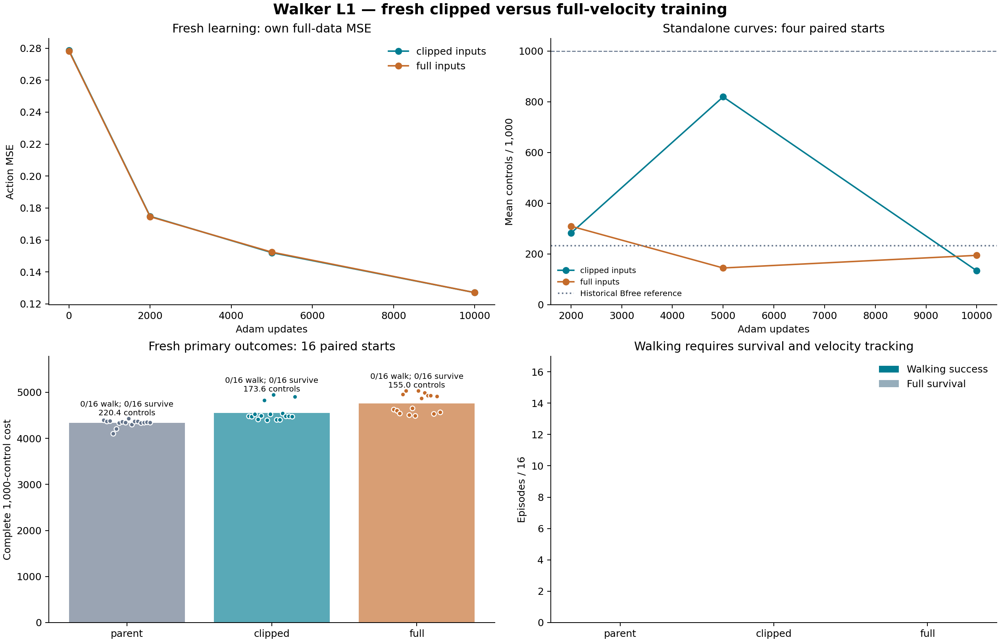

# L1.001: fresh training did not establish competent walking

Both fresh 10,000-update students scored **0/16 walking successes and 0/16
full survivals** on the predeclared paired primary starts. Full physical
velocities did not improve this student training pipeline at its fixed budget.
This is a representation/learning diagnostic, not an adaptive-coupling result.

| Primary policy | Walking success | Full survival | Mean controls / 1,000 | Complete cost | Executed-control velocity MAE |
|---|---:|---:|---:|---:|---:|
| Original Bfree reference | 0/16 | 0/16 | 220.4375 | 4,334.903417 | 0.785802 |
| Fresh clipped inputs, 10k | 0/16 | 0/16 | 173.5625 | 4,547.869041 | 0.997975 |
| Fresh full velocities, 10k | 0/16 | 0/16 | 155.0000 | 4,761.772611 | 1.474918 |

The reference is the historical model, not an initializer of either fresh arm.
The full-input child averaged 18.5625 fewer controls and 213.903570 higher
complete cost than its fresh clipped control. Neither arm qualified for
confirmation. No checkpoint or normalization was selected after outcomes.

The [frozen protocol](student_learnability_protocol_l1_001.md) used exactly the
same 6,096 underlying physical states and torques in both arms, including the
64 separately identified hypothetical re-solves and 32 actual recovery rows.
Native clipped features reproduced the original supplied matrix byte-for-byte;
3,443 rows changed when full velocities were retained. Both networks had equal
fresh trainable parameter bytes and private generator state, zero initial Adam,
the same PCG64 minibatches and exactly 10,000 updates. Normalization was fitted
from each arm's training matrix only, with the same rule and 0.05 scale floor.
Architecture, torque targets, optimizer settings and native task were fixed.
Both declared deployment feature matrices were retained and independently
verified against actual full pre-action states; native environment observations
remained clipped in both arms.

This removes H3.2's inherited-network/Adam continuation issue. Map-specific
normalization still changes learning geometry. The result concerns these
representation/training pipelines at one initialization and budget, not pure
information content or a general impossibility of learning walking.

| Updates | Clipped own-data MSE | Full own-data MSE | Clipped curve controls | Full curve controls |
|---|---:|---:|---:|---:|
| Initial | 0.278632 | 0.278261 | — | — |
| 2,000 | 0.174795 | 0.174560 | 282.00 | 309.50 |
| 5,000 | 0.152066 | 0.152392 | 819.00 | 144.75 |
| 10,000 | 0.127067 | 0.127074 | 133.75 | 194.50 |

The four-start curve cohorts all scored 0/4 walking successes. The clipped 5k
policy survived 3/4, but those three runs had mean forward velocities −0.04549,
−0.04710 and −0.02420 m/s against the +1.5 m/s target. They remained upright
without walking; this was not a missed successful checkpoint. Its later fixed
10k endpoint lost survival despite reducing action MSE. The full-input policy
had no curve survivals. Action reconstruction and closed-loop control remain
distinct outcomes.

Native primary terminations were 15 height/one torso-angle for the reference,
13 height/three angle for clipped, and eight height/eight angle for full.
These are measured outcomes, not an isolated neural explanation. Velocity MAE
uses executed controls and therefore does not replace full-horizon success or
the complete cost's terminal and absorbing-tail accounting.

The [independent saved-only audit](../results/student_learnability_l1/audit/receipt.json)
passed **724,743 checks**, binding 180 files and 989 array fingerprints in
2.364469 seconds. It checked physical provenance, both feature maps and norms,
fresh initialization, checkpoint/Adam/RNG/anchor packaging, all 20,000 curve
points, actual declared deployment features, complete native costs/flags,
paired full resets and all metered work. No dynamics, neural inference or Adam
arithmetic was replayed. Reported MSE remains bound saved evidence, not new
inference. [Native details](../results/student_learnability_l1/audit/native_detail.json)
preserve the survival and termination distinctions.

| New paid work | Requested = completed |
|---|---:|
| Live controls | 17,245 |
| Planner/model controls | 0 |
| Physics substeps | 68,980 |
| Training forward rows | 5,120,000 |
| Full-data diagnostic rows | 54,864 |
| Standalone forward rows | 17,245 |
| Total forward rows | 5,192,109 |
| Backward rows | 5,120,000 |
| Adam steps | 20,000 |
| Complete episodes | 76 |

All failed/rejected/unknown counters were zero. Runtime was 328.194760 internal
seconds and 329.316896 external launch seconds. The unused conditional
confirmation was budgeted but not spent. Export, transfer, audits, tests,
plotting and engineering are separate overhead; no efficiency claim is made.
The [stage accounting](../results/student_learnability_l1/report/cost_accounting.json)
charges no inherited acquisition a second time.

The complete [run result](../results/student_learnability_l1/run/result.json),
[configuration](../results/student_learnability_l1/run/config.json),
[input seal](../results/student_learnability_l1/run/input_manifest.json),
[per-update curves](../results/student_learnability_l1/run/learning_curves.csv),
[full raw arrays (external evidence)](evidence_availability.md#external-bf2922342a3a),
[ledger (external evidence)](evidence_availability.md#external-9c0595a52141),
[plotted data](../results/student_learnability_l1/report/plotted_data.json)
and [PDF figure](../results/student_learnability_l1/figures/learning_and_outcomes.pdf)
are preserved. The [mirror receipt](../results/student_learnability_l1/external/mirror_receipt.json)
verifies all 178 files totaling 692,793,577 bytes by individual SHA-256.

Configuration SHA-256:
`f7690040384185d2395b0565bb7053c4277ca7b9b45b8c711cfe76189ccb9e4d`.
Input-seal SHA-256:
`3c5e9ae72f8e2a1e8cb87f0afbc1d79cd560539d34da3dc4c2611e20d0e71710`.

No feature from this result was introduced into H4.1. The coupling comparison
keeps its declared clipped-input updated learner, so representation and weight
adaptation are not changed together. These torque-policy failures do not
constitute a failed reproduction of CIO–GPS's state-to-state formulation.

For exact replay, copy only the sealed source, inputs, input checkpoint,
configuration and manifests into a fresh directory, then run its frozen worker
once. Reusing these seeds is an exact replay, not new held evidence. Calling
`prepare` after this closed study intentionally refuses its already-used seeds;
a new scientific replication needs a separately versioned seed/configuration
freeze. See the [artifact reproduction guide (external evidence)](evidence_availability.md#external-6120d21270bd).
