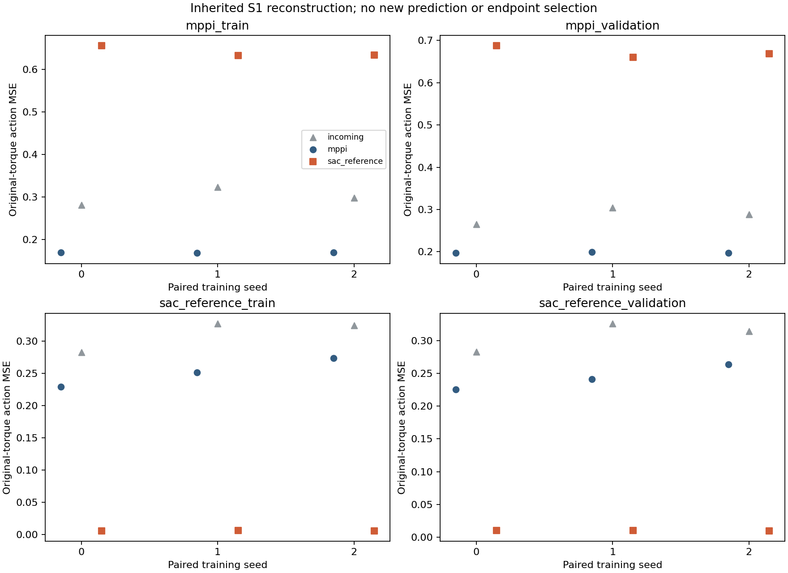
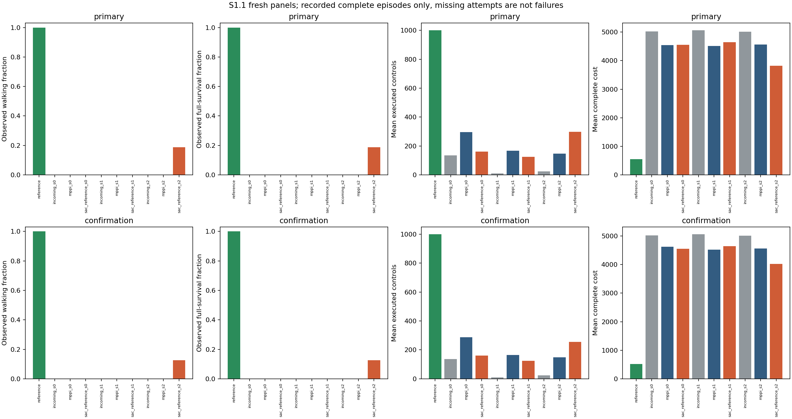

# S1.1: accurate reference reconstruction did not yield reliable student walking

**Completed and independently audited.** All 320 fresh native episodes and 321
setup/episode mirror exchanges completed. The final saved-only audit passed
**4,239,909 checks**, binding 3,836 files and 3,613 retained arrays in
12.361947 seconds, with zero new inference, physics or optimization.

The first two checker attempts remain preserved as failed. `audit_001` stopped
because JSON serialization sorted actor-map keys; `audit_002` checked all native
episodes before a journal comparison mistakenly required labels added only to the
later result descriptor. The canonical fixes join through the frozen actor order
and compare the six actual publication fields; strict roster, per-ordinal native
ownership, reset, receipt, ACK, cumulative-budget and journal-chain checks remain.
[Both failed receipts and checker versions](../results/student_source_s1_1/audit_history/)
remain distinct from the [passing third audit](../results/student_source_s1_1/audit/receipt.json).
No frozen worker bytes, scientific criteria or outcomes changed, and no scientific
call was repeated to resolve these metadata-checker errors.

The competent reference walked on 16/16 primary and 16/16 confirmation resets.
Every incoming student and MPPI-data child had zero walking and full-survival
successes. Reference-data stream 2 walked on 3/16 and 2/16; streams 0 and 1 had
zero successes and fell earlier on average than their matched MPPI-data children.
The source-benefit screen failed on both panels, and no student met the ≥15/16
per-panel competence criterion. This is a completed fresh evaluation of the same
S1 fits, not a learning update or acquisition–learning round.

[Execution protocol](student_source_s1_1_execution_protocol.md) ·
[historical proposal](student_source_s1_1_protocol.md) ·
[portable evidence](../results/student_source_s1_1/README.md) ·
[full report and tables](../results/student_source_s1_1/report/report.md) ·
[independent audit](../results/student_source_s1_1/audit/receipt.json) ·
[original interrupted S1](student_source_s1_results.md).

## Frozen comparison

S1 fitted three paired width-128 tanh torque students on each of two fixed sources:
4,000 successful MPPI state–action rows or 4,000 actions executed by the qualified
SAC reference on its own states. Each source has 2,000 held rows. The targets,
17-dimensional clipped features, shared MPPI-training normalization, paired
initialization/ Adam/RNG ownership, batch size 256, learning rate 0.0003, gradient
clip 0.5 and fixed 2,000-update endpoint remain unchanged. Reference actions were
not used to relabel MPPI states. The source contrast changes visitation, gait,
reset contexts, torques and controller history jointly.

S1.1 copied the exact nine incoming/final student packages and reference, with
policy, normalization, optimizer and private RNG payloads intact. It performed
zero fitting, reconstruction inference, GPU work or MPPI search. The same ten
actors executed all 16 primary seeds (1270000000–1270000015) and all 16 confirmation
seeds (1280000000–1280000015), unconditionally. Each episode permits 1,000 native
CPU controls / 8 seconds. These are new resets for the same three training streams,
not new training replications. All source/input/ checkpoint and runtime pins are
in the [frozen configuration](../results/student_source_s1_1/run/config.json).

## Inherited reconstruction and learning curves

These are original S1 CUDA reconstruction measurements, not new S1.1 predictions:

| Actor | MPPI train | MPPI held | Reference train | Reference held |
|---|---:|---:|---:|---:|
| `incoming_s0` | 0.28175897 | 0.26519929 | 0.28275361 | 0.28291579 |
| `incoming_s1` | 0.32345321 | 0.30467552 | 0.32739874 | 0.32586757 |
| `incoming_s2` | 0.29825259 | 0.28798256 | 0.32429702 | 0.31403586 |
| `mppi_s0` | 0.16944156 | 0.19686610 | 0.22916272 | 0.22562050 |
| `mppi_s1` | 0.16825107 | 0.19958229 | 0.25151602 | 0.24115574 |
| `mppi_s2` | 0.16935076 | 0.19745218 | 0.27412423 | 0.26358451 |
| `sac_reference_s0` | 0.65526363 | 0.68719776 | 0.00601341 | 0.01006065 |
| `sac_reference_s1` | 0.63314605 | 0.65976372 | 0.00627916 | 0.01060311 |
| `sac_reference_s2` | 0.63366768 | 0.66843515 | 0.00605255 | 0.00987238 |

Values are mean squared torque error over the indicated fixed split. Lower
own-source error concerns different states and targets across the two arms; it
does not alone establish that one algorithm's behavior is universally easier to
clone. The reference-data children reconstruct their own held trajectories with
MSE 0.00987–0.01060, versus MPPI children at 0.19687–0.19958 on their own held
trajectories. This large reconstruction difference coexists with the weak native
transfer below.

[Learning curves](../results/student_source_s1_1/report/learning_curves.png),
[all four splits](../results/student_source_s1_1/report/fitting.csv),
[individual trajectory errors](../results/student_source_s1_1/report/trajectories.csv)
and [ordered 100-control error bins](../results/student_source_s1_1/report/reconstruction_control_bins.csv)
retain all streams and teachers. Portable 100-update loss bins cover every original
update; min–max shading is minibatch spread, not uncertainty. The full six curves
remain external.

 Reconstruction used float32 CUDA batches of 1,024 with float64
residual arithmetic; deployment used CPU batch-one execution. No extra CPU
reconstruction was run, so this study does not isolate backend arithmetic or
normalization conditioning as causes. Historical CPU W2 is not a matched control.

## Standalone outcomes

Walking requires all 1,000 controls and velocity MAE≤0.3 m/s around 1.5 m/s. Full
survival and walking are separate outcomes, even though their observed counts
coincide here. Mean velocity MAE uses each episode's actual executed prefix.
Complete cost includes the frozen absorbing penalty for missing controls; lower
cost and longer retention are therefore not independent evidence of walking.

### Primary

| Actor | Walking /16 | Full survival /16 | Mean controls | Complete cost | Velocity MAE (m/s) |
|---|---:|---:|---:|---:|---:|
| `reference` | 16 | 16 | 1000.0000 | 545.1812 | 0.240069 |
| `incoming_s0` | 0 | 0 | 134.9375 | 5026.0070 | 2.360316 |
| `mppi_s0` | 0 | 0 | 296.4375 | 4540.9637 | 1.687384 |
| `sac_reference_s0` | 0 | 0 | 160.3750 | 4558.2459 | 0.873002 |
| `incoming_s1` | 0 | 0 | 9.0000 | 5062.8378 | 2.722827 |
| `mppi_s1` | 0 | 0 | 166.5000 | 4514.7362 | 0.864140 |
| `sac_reference_s1` | 0 | 0 | 125.0625 | 4647.2803 | 0.834815 |
| `incoming_s2` | 0 | 0 | 24.0000 | 5015.0478 | 2.070827 |
| `mppi_s2` | 0 | 0 | 147.6875 | 4564.0178 | 0.816361 |
| `sac_reference_s2` | 3 | 3 | 297.0625 | 3823.5189 | 0.602469 |

### Confirmation

| Actor | Walking /16 | Full survival /16 | Mean controls | Complete cost | Velocity MAE (m/s) |
|---|---:|---:|---:|---:|---:|
| `reference` | 16 | 16 | 1000.0000 | 516.5572 | 0.224695 |
| `incoming_s0` | 0 | 0 | 135.8125 | 5023.9656 | 2.355291 |
| `mppi_s0` | 0 | 0 | 286.9375 | 4624.1098 | 1.788143 |
| `sac_reference_s0` | 0 | 0 | 160.5625 | 4556.1026 | 0.886554 |
| `incoming_s1` | 0 | 0 | 9.0000 | 5062.8753 | 2.719587 |
| `mppi_s1` | 0 | 0 | 164.6875 | 4521.4007 | 0.866644 |
| `sac_reference_s1` | 0 | 0 | 125.1250 | 4649.0902 | 0.846203 |
| `incoming_s2` | 0 | 0 | 24.0000 | 5015.1227 | 2.072060 |
| `mppi_s2` | 0 | 0 | 148.1875 | 4562.6290 | 0.818073 |
| `sac_reference_s2` | 2 | 2 | 254.2500 | 4022.9321 | 0.605869 |

The two panels make the limitation concrete. Reference-data stream 2 has some
successful closed-loop walking, but most of its resets still fail. Streams 0 and
1 obtain low reference-state error without a walking or full-survival success;
their mean executed controls regress relative to the matched MPPI-data children.
The reference control remains far ahead of every child. There is no reliable
competent-student positive control under this fixed fitting recipe.

## Paired source decisions and teacher–student gaps

Differences below are reference-data child minus MPPI-data child within the same
original training stream and fresh reset panel. Positive cost gain means a lower
complete cost; the walking gate does not use cost as a substitute.

| Panel | Stream | Walking gain | Survival gain | Mean-controls difference | Complete-cost gain (%) |
|---|---:|---:|---:|---:|---:|
| primary | 0 | +0 | +0 | -136.0625 | -0.3806 |
| primary | 1 | +0 | +0 | -41.4375 | -2.9358 |
| primary | 2 | +3 | +3 | +149.3750 | +16.2247 |
| confirmation | 0 | +0 | +0 | -126.3750 | +1.4707 |
| confirmation | 1 | +0 | +0 | -39.5625 | -2.8241 |
| confirmation | 2 | +2 | +2 | +106.0625 | +11.8286 |

Both panels retain no walking-count or full-survival-count regression in any
stream, but only stream 2 gains at least two walking successes. The frozen screen
requires that gain in at least two streams: `positive_pairs=false`, so
`confirmed_walking_benefit=false`. This is not merely a narrow aggregate cost
miss. Streams 0 and 1 fall earlier, and none of the three reference-data students
meets the separate competence threshold.

Matched fresh reference gaps are child minus reference on exactly the same 16
resets. The reference panel is one shared control, not three teacher replications:

| Panel | Reference-data stream | Walking / survival count gap | Mean-controls gap | Complete-cost gap | Velocity-MAE gap |
|---|---:|---:|---:|---:|---:|
| primary | 0 | -16 / -16 | -839.6250 | +4013.0647 | +0.632933 |
| primary | 1 | -16 / -16 | -874.9375 | +4102.0991 | +0.594746 |
| primary | 2 | -13 / -13 | -702.9375 | +3278.3377 | +0.362399 |
| confirmation | 0 | -16 / -16 | -839.4375 | +4039.5454 | +0.661859 |
| confirmation | 1 | -16 / -16 | -874.8750 | +4132.5330 | +0.621509 |
| confirmation | 2 | -14 / -14 | -745.7500 | +3506.3749 | +0.381174 |

[Complete matched gaps](../results/student_source_s1_1/report/matched_reference_gaps.csv)
also retain native/raw/terminal/absorbing components. Historical MPPI source
teachers walked on 4/4 training and 2/2 held episodes, at mean costs 401.9525 and
379.8592. Historical reference teachers likewise walked on 4/4 and 2/2, at mean
costs 537.5841 and 471.4526. Their
[own-source teacher–student gaps](../results/student_source_s1_1/report/teacher_student_gaps.csv)
are descriptive and unpaired with these fresh resets. No new MPPI teacher was
acquired, so no fresh matched MPPI-teacher gap is available. The fixed 2,000-draw
crossed training-stream/reset bootstrap describes the same three saved fits;
frames and resets are not additional training replications.

## What “along the trajectory” already means

At each MPC decision, candidate \(k\) has its own simulated states
\(s^k_0,\ldots,s^k_H\), controls \(u^k_h\), and pre-action observations
\(o^k_h=\phi(s^k_h)\). The existing selector scores

\[
A_k(\theta)=\sum_{h=0}^{H-1}m^k_h
  \|u^k_h-\pi_\theta(o^k_h)\|_2^2,
\qquad
S_k=J_{\rm task}(u^k)+\frac{\eta_u}{2}\|u^k-U_{\rm ref}\|_2^2
  +\frac{\alpha}{2}A_k(\theta).
\]

The mask admits supported finite healthy prefixes; the first fall-causing action
is included and later post-fall actions are excluded. Independent MPPI generates
the bank without a policy argument. Guidance reads that bank afterward, verifies
synthesized means on their own simulated states and executes only the first
torque before replanning. Agreement therefore already extends along each finite
candidate, but remains an additive present-policy torque error, without
post-update learning feedback or consequence-based temporal weights.

For one fixed executed trajectory, the recorded reconstruction diagnostic is

\[
E_\tau(\theta)=\frac{1}{6N_\tau}\sum_{t=0}^{N_\tau-1}
  \|u_t-\pi_\theta(o_t)\|_2^2.
\]

On identical unmasked rows the planner's sum is \(6N_\tau E_\tau\); its masks and
short horizons must be respected before making that conversion. The separate
episode-average sum of six torque-square errors has another factor-six reduction.
S1's actual training minimizes the uniformly sampled row/action MSE, with parameter
proximity zero. Whole-trajectory diagnostics and ordered error bins do not turn
that row loss into sequential control optimization. Standalone execution instead
uses \(s_{t+1}=f(s_t,\pi_\theta(\phi(s_t)))\), at states reached by the student's own
previous actions. Its executed actions are not expert labels on those states.

[K1](action_compatibility_k1_results.md) already contains the successful
MPPI/reference/random trajectory comparison against untrained/cloned/reference
policies. Its exact trajectory matrix and temporal profiles remain available;
S1.1 does not replace that comparison or choose a score to force a desired ranking.
Early large errors, temporal consequences, support drift, hidden planner context
and normalization remain distinct candidate explanations. Current-policy agreement
does not establish post-update teachability. The torque controller also differs
from CIO's state-to-state targets and downstream execution controller: these
results are not a failed reproduction of CIO–GPS. See [methods](methods.md) and
the [paper mapping](paper_mapping.md).

## Preservation and cost accounting

Each setup/episode Meter was closed and fsynced before its create-only receipt,
then copied and hash-verified on the Mac before the worker accepted its ACK and
continued. This yielded 321 closed packets. The same-boot owner and worker exits
are present. The final local and worker catalogs are byte-identical: 2,223 files,
2,764,317,907 bytes. Raw arrays, ledgers, checkpoints and full curves stay outside
Git, indexed by the [full file catalog](../results/student_source_s1_1/external/full_run_file_manifest.json)
and [external registry bindings](../results/student_source_s1_1/external/registry_index.json).

| Work scope | Actual recorded amount | New S1.1 ceiling |
|---|---:|---:|
| New episodes / checkpoint loads | 320 / 10 | 320 / 10 |
| New native controls / policy forward rows | 74,714 / 74,714 | 320,000 / 320,000 |
| New physics substeps | 298,856 | 1,280,000 |
| New fits / Adam updates / backward rows / reconstruction forwards | 0 / 0 / 0 / 0 | 0 / 0 / 0 / 0 |
| New GPU work / MPPI model controls / teacher acquisition | 0 / 0 / 0 | 0 / 0 / 0 |
| Summed new closed Meter elapsed time | 642.822993 s | Included in owner deadline |
| New worker elapsed time, including ACK waits | 1,100.369290 s | 3,600 s |
| ACK wait, already included above | 445.511680 s | ≤60 s per packet within deadline |
| One-shot owner elapsed time | 1,101.630568 s | 3,600 s |
| Mac coordinator elapsed time | 1,107.981612 s | 3,630 s engineering ceiling |
| Mirrored closed packet bytes / summed copy time | 2,663,436,886 / 331.195266 s | Separate off-host engineering |

Overlapping clocks are not added into a lifetime wall total. The worker file census
includes inherited copied evidence as well as new output; it is not newly collected
scientific data alone. Inherited S1 fitting remains 12,000 Adam updates, 3,072,000
backward rows and 3,180,000 forward rows. The old interrupted native ledger prefix
records 55,607 controls and 55,608 forward rows, with final wall/snapshot totals
unknown and an unresolved unrecorded tail. Keep these four scopes separate; do not
charge inherited fitting twice or set the old unknown tail to zero. Audit, export,
test, transfer, copy, plotting and publication costs are separate engineering
evidence, with no efficiency claim. Full cost components and receipts are in the
[report accounting](../results/student_source_s1_1/report/cost_accounting.json) and
[engineering accounting](../results/student_source_s1_1/accounting/engineering_accounting.json).

The [original S1](student_source_s1_results.md) remains interrupted with its failed
postmortem audit: 187 of 195 ledger-declared complete episodes verified, eight
claims lacked full arrays, and a partial attempt retained only 19 of 22 steps.
Its two reported student walking successes remain unverified. The fresh stream-2
successes here are new outcomes and do not retrovalidate those missing old rows.
Fresh testing followed observed documentary primary declarations; it is not a new
training replication or retroactive confirmation of the original screen. Both
attempts and both audit histories remain preserved.

## Causal verdict and next emphasis

These particular reference-data fits
show much smaller own-source reconstruction error and occasional walking in one
stream, but no confirmed source benefit or reliable student competence. Two
reference-data streams lose retention against their MPPI-data counterparts. The
reference itself remains competent on both fresh panels. Thus successful teacher
experience and low teacher-state MSE have not supplied a robust walking student
under this fixed learner and budget. This neither proves policy-class incapacity
nor identifies multimodality, distribution shift, clipping, optimizer budget or
backend arithmetic as the unique cause.

The literature supports keeping these measurements distinct. Avé et al.'s
[continuous-policy compression](https://pmc.ncbi.nlm.nih.gov/articles/PMC11314760/)
changes collection and distributional targets using refreshed replay; its §6.3
does not verify the specific attribution “return falls while fitting loss improves.”
The [SPID author version](https://openreview.net/notes/edits/attachment?id=W49Fb6So1X&name=pdf)
uses mixed visitation, teacher-value feedback and symbolic regression, with no
Walker experiment; exact equivalence to the supplied hash URL was not established.
[SAC v2 §7.1](https://arxiv.org/pdf/1812.05905v2) evaluates mean actions, so stochastic
training alone does not imply deterministic cloning must fail.
[Agarwal et al.'s PSM](https://arxiv.org/pdf/2101.05265) recursively compares states
using actions and future transition coupling; it is not a universal trajectory
ranking or teachability certificate. None supplies an algorithm ranking, novelty
claim or justification to add components to this frozen study.

The immediate priority is the user's narrower **fixed-reference, individual-
trajectory comparison**, using preserved K1 scores and ordered errors before any
algorithm comparison or new learning intervention. The
[updated K1 analysis](action_compatibility_k1_results.md) makes within-source
variation explicit: all 14 retained MPPI trajectories walked for 1,000 controls,
yet their error under the same reference varies from 0.607808 to 0.713856.
Within the four original discovery trajectories, the range is 0.093681; the two
later-independent trajectories differ by only 0.003799. The reference-self zeros
are a consistency control. Random-action traces end after 8–26 controls and must
not be treated as matched-duration trajectory sums. These existing scores vary;
they do not certify teachability or make a less aligned successful gait wrong.
Inspect individual trajectories and their existing temporal/actuator profiles,
retain source/ancestry and duration, and identify what remains missing before
proposing a changed score or intervention. An algorithm sweep is not the current
priority.

**S1.2 remains only a conditional future candidate, not the selected next
protocol:** fixed-reference supervision on student-visited states might improve
walking relative to an equal-size teacher-visitation control. The low own-source
error/deployment gap motivates a question, not a diagnosis of covariate shift.
The [earlier corrective-data experiment](loop_v3_evidence_audit.md#what-the-prior-corrective-test-establishes)
already admitted 980 successful MPPI labels after an actor prefix, reduced local
fitting error, and still produced zero walking/full-survival successes on 16 fresh
resets. Simply adding corrective data is therefore not an established solution.
A future reference-visitation test would need to distinguish the fixed label
function and visited-state distribution with matched row/update budgets, preserve
failures, and establish whether its off-reference labels actually help. Reference
walking on its own states does not certify recovery labels elsewhere. Such a
discriminating design, finite costs, gates, new replications and stopping rule must
be reviewed after the existing trajectory diagnosis. No new acquisition, relabels,
critic, transport loss, representation change, algorithm comparison or follow-up
has been selected or launched.

S1.1 changed no agreement weight and trained no updated actor. The earlier
[H4.1 outcome-triggered weight-backoff experiment](adaptive_coupling_h4_1.md) remains
a separate negative coupling result. No new MPPI acquisition or second useful
acquisition–learning round occurred here; the loop remains open.

Frozen new configuration SHA-256:
`2fa20b855c44d0430c39b8a57c083b83450be5d248517490b5bdb1dc0f376c1d`.
Input seal SHA-256:
`171df69988cc5d14b68b04f73161c84d14d7969c812d7ddebf7fca0576986c2b`.
Saved worker result SHA-256:
`16873d4337777bd49f2dc657692e2a6e1bf28c014bbcf54965031cd87fcb8ee4`.
