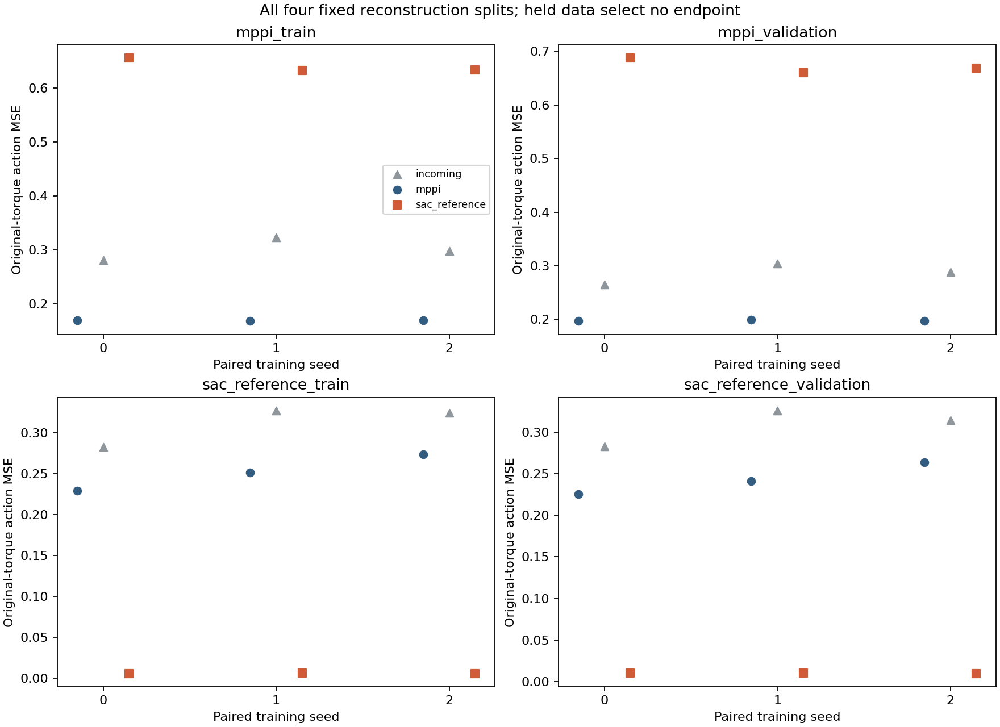
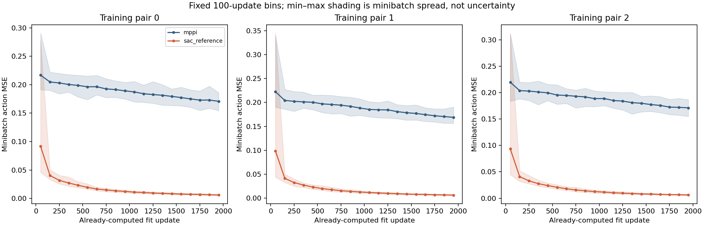
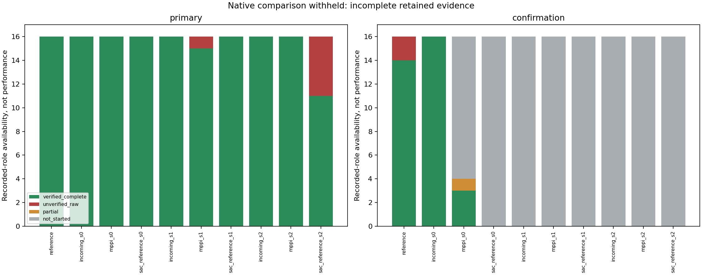

# S1: demonstrated-behavior source comparison

**S1 did not complete, and its native-evidence integrity audit failed.** All six
fixed 2k fits closed successfully. Reference-data reconstruction is much more
accurate on its own recorded experience, but the host rebooted during confirmation
and the native HDF5 was truncated. Of 195 documentary episode-completion records,
187 could be independently verified and eight could not. That retained subset
cannot replace the planned 320-attempt comparison. No native source ranking,
confirmed benefit, child-competence or loop-closure verdict is assigned.

[Authorized execution protocol](student_source_s1_execution_protocol.md) ·
[Original proposal](student_source_s1_protocol.md) ·
[Evidence capsule](../results/student_source_s1/README.md) ·
[Explicit forensic report](../results/student_source_s1/report/report.md) ·
[Failed postmortem audit](../results/student_source_s1/audit/receipt.json) ·
[Prelaunch CPU CI](https://github.com/jaiselsingh1/mppi-gps/actions/runs/41263346552).

## Fixed intervention and execution

S1 changes the source of executed demonstrations while retaining the current
17→128 tanh→128 tanh→6 tanh direct-torque student, with 19,590 parameters. MPPI uses
the exact W2 training and validation containers. Reference behavior uses the first
four specified complete K1 reference episodes for training and the next two for
held measurements. Each source supplies 4,000 training and 2,000 held rows.

| Source | Training episodes | Held episodes | Historical complete teacher cost, train / held |
|---|---|---|---:|
| MPPI | `discovery_00..03` | `v2_r0_trial_raw_0..1` | 401.952501 / 379.859168 |
| Reference behavior | `k1_primary_reference_00..03` | `k1_primary_reference_04..05` | 537.584063 / 471.452615 |

All twelve original teacher episodes walked and survived for 1,000 controls. Their
different historical task costs do not make these corpora matched-reset controls.
Source means across all six historical episodes are 394.588057 for MPPI and
515.540247 for reference behavior. The original MPPI discovery endpoint/integration
omissions remain missing; none was reconstructed.

Targets are actions actually executed on each source's own pre-action observations.
Reference predictions at MPPI states are not substituted as labels. Both arms use
the exact shared W2 normalization fitted only on original MPPI training rows; no
per-source or held-data refit occurs. These previously examined development holdouts
provide no gradients and select no checkpoint.

Three fresh paired initializations each fit both sources once. Within a pair, the
saved initial-state receipts record matching parameter, empty-Adam, RNG and private
generator fingerprints. Both arms consume the same saved PCG64 index stream, with
replacement over their own 4,000 rows. Adam uses batch 256, learning rate 0.0003,
gradient clipping 0.5, zero parameter proximity and the fixed 2k endpoint. Complete
optimizer/RNG checkpoints and full per-update curves are retained. There is no 10k
continuation or selected seed.

Fitting ran on the RTX 5090 using Python 3.11.16 and Torch 2.10.0+cu128, CUDA 12.8,
float32, deterministic algorithms and TF32 disabled. Both source arms are new fits
on this backend; historical CPU W2 students are context, not matched controls.
All six fits finished before native CPU evaluation began. Deployment is direct
policy torque without a planner, prefix, fallback or critic.

The frozen reconstruction panel uses CUDA batches of 1,024; direct execution uses
CPU batch-one predictions. No additional CPU reconstruction forwards were performed.
Both source arms share this same fitting/evaluation arrangement, but reconstruction
versus deployment differences cannot by themselves isolate backend rounding,
conditioning or execution sensitivity.

## Reconstruction after the fixed update

Action MSE is the float64 mean squared residual over all six original torque
components. Fitting retains the existing float32 target conversion. Every incoming
and final student predicts all four fixed splits once; no new inference is used to
construct this table from the closed fit result.

| Pair | Actor | MPPI train | MPPI held | Reference train | Reference held |
|---|---|---:|---:|---:|---:|
| 0 | Incoming | 0.281759 | 0.265199 | 0.282754 | 0.282916 |
| 0 | MPPI-data child | 0.169442 | 0.196866 | 0.229163 | 0.225621 |
| 0 | Reference-data child | 0.655264 | 0.687198 | 0.006013 | 0.010061 |
| 1 | Incoming | 0.323453 | 0.304676 | 0.327399 | 0.325868 |
| 1 | MPPI-data child | 0.168251 | 0.199582 | 0.251516 | 0.241156 |
| 1 | Reference-data child | 0.633146 | 0.659764 | 0.006279 | 0.010603 |
| 2 | Incoming | 0.298253 | 0.287983 | 0.324297 | 0.314036 |
| 2 | MPPI-data child | 0.169351 | 0.197452 | 0.274124 | 0.263585 |
| 2 | Reference-data child | 0.633668 | 0.668435 | 0.006053 | 0.009872 |

Equal-stream MPPI-child MSE is 0.169014 on MPPI training and 0.197967 on MPPI held
experience. Reference-data children reach 0.006115 on their own training and
0.010179 on their own held experience. Their MPPI-held error is 0.671799, while
MPPI-data children score 0.243454 on reference-held experience.

This establishes a pronounced difference in reconstruction under the same student,
normalization and fixed update procedure. The two own-source errors concern
different states and labels; their contrast does not isolate a causal property of
the data. Strong reference reconstruction is not yet a walking result, and poor
cross-source agreement does not rank task competence. The shared MPPI normalization
and finite update budget remain part of the intervention's conditions.

All six original 2,000-update JSON curves remain external. The capsule's 120 fixed
100-update bins retain all 12,000 recorded updates, with each source-file hash and
bin count preserved. Shading is minibatch min–max spread, not a confidence interval.

## Closed fit-phase work

| Work | Recorded fit phase | Study ceiling |
|---|---:|---:|
| Adam updates | 12,000 | 12,000 |
| Backward rows | 3,072,000 | 3,072,000 |
| Fitting forward rows | 3,072,000 | Included in 3,500,000 total |
| Four-split diagnostic forward rows | 108,000 | 108,000 |
| Total fit-phase forward rows | 3,180,000 | 3,500,000 across both phases |
| Fit-phase native/model controls | 0 / 0 | 320,000 / 0 across both phases |

The saved fit body wall time is 91.308455 seconds; its meter reports 91.312274
seconds. All requested neural/backward/Adam work completed, with zero reported
failed/rejected measurements, physical queries or unknown-partial work in this
phase. These times are not a CUDA-versus-CPU efficiency comparison. Native work,
forensic recovery, transfers, reporting, audits and inherited evidence costs remain
separate from these closed-fit counters.

## Interrupted native evaluation: evidence availability, not a smaller experiment

The frozen design required both 16-reset panels for all ten actors: three incoming
students, six final children and the unchanged reference. A source benefit requires
the frozen walking-count screen on both panels; individual provisional competence
requires at least 15/16 walking on each. The reboot prevented the complete planned
320-attempt roster from closing. The original evaluation `result.json` and external
owner exit remain absent; the separately labelled interruption summary replaces
neither. Missing or administratively censored attempts are not completed failures.

| Evidence class | Count | Meaning |
|---|---:|---|
| Planned native attempts | 320 | Fixed unconditional two-panel roster |
| Surviving `episode_complete` ledger claims | 195 | Documentary worker records |
| Independently verified complete episodes | 187 | A nonrepresentative retained subset |
| Complete-episode claims without full raw verification | 8 | Outcomes remain unverified |
| Partial attempt | 1 | Final task outcomes unknown |
| Roles not started in the durable record | 124 | Not imputed as failures; unknown unrecorded tail remains separate |

The eight unavailable complete-episode groups are `primary_mppi_s1_07`,
`primary_sac_reference_s2_11..15`, and `confirmation_reference_00..01`.
The ledger reports two primary walking successes for reference-data seed 2, but
**both are among its five unverified groups**. They are not established student
walking results, a verified 2/16 panel rate or evidence of class capacity. The
verified student subset contains no walking success, but its selective missingness
does not establish population failure or a source comparison.

The ledger also reports reference walking on 32/32 attempts. Only 16 primary and
14 confirmation reference episodes were independently verified: 30 individual
walking outcomes, with two unverified claims. S1 does not assert a newly verified
32/32 result. The reference's earlier K1 qualification remains separate evidence.

The partial attempt is `confirmation_mppi_s0_03`: the ledger records 22 native
controls, while only the first 19 have complete numerical verification. Their
observed native cost is 61.160363. Walking, full survival, terminal complete cost
and subsequent behavior remain unknown. No fall or missing-controls penalty is
invented for an interruption.

The forensic report exports individually verified outcomes as a **subset**, all
195 ledger episode claims with verification labels, the eight unverified claims,
12 verbatim worker actor-panel summaries and every planned role separately. These
are not pooled into source performance estimates. Native comparison plots, cost
rankings, teacher–student gaps, competence flags and final bootstrap intervals are
withheld. Historical source-teacher outcomes remain available and unpaired with
fresh students; no fresh matched MPPI-teacher episodes were collected.

## Preservation, failed verification and bounded reconstruction

The original evaluation HDF5 is 1,761,491,166 bytes; its stored EOF requires
1,761,505,518 bytes, a deficit of 14,352. Original bytes were hashed and preserved.
A separately labelled copy was zero-extended for forensic reading. Padding is not
recovered information: only directly referenced arrays with matching saved shape,
dtype and SHA-256 were accepted. The recovery copy never replaced the original.

The [postmortem findings](../results/student_source_s1/audit/findings.json) retain
the failed criterion: not every declared complete episode could be fully verified.
Its receipt remains **failed**. A bounded saved-query reconstruction attempt stopped
at the first missing episode, `primary_mppi_s1_07`, where the sole action-input group
for query `q000026723` is unavailable after 117 of 160 query pairs. The other seven
episodes were not attempted. No simulator or policy was rerun, no missing values
were fabricated, and no audit threshold was relaxed.

The [original full-run audit receipt](../results/student_source_s1/full_audit/receipt.json)
and failed scoped audit are preserved independently of the forensic display. The
display requires an explicit `--display-failed-audit` flag. Its receipt records
`audit_passed: false`; producing readable artifacts does not promote integrity.
Full-source display verifies all 195 episode and 12 panel claim records against the
original ledger, not merely a ledger filename/hash. Portable display verifies the
canonical source-bound report receipt and capsule hashes.

## Cost accounting and scientific verdict

| Work | Closed fit / durable recorded prefix | Frozen ceiling |
|---|---:|---:|
| Adam updates | 12,000 | 12,000 |
| Backward rows | 3,072,000 | 3,072,000 |
| Forward rows, fit plus durable evaluation records | 3,235,608 | 3,500,000 |
| Native controls reported complete in durable ledger | 55,607 | 320,000 |
| Recorded native physics substeps | 222,428 | 1,280,000 |
| Evaluation checkpoint loads | 10 | 10 |
| New teacher episodes / MPPI model controls | 0 / 0 | 0 / 0 |
| Combined observed worker-time lower bound | 1,097.309664 s | 3,600 s |
| Final wall / snapshot totals | Unknown / unknown | Not replaced by zero |

These native counters describe the durable ledger, not full numerical verification
of every reported control. The unrecorded tail is unresolved and unquantified even
though no registered requests remain pending. There is no exact all-work total or
efficiency claim. The postmortem audit took 7.638702 seconds with zero new physics,
neural inference or optimizer steps. Engineering, recovery, transfer, validation and
reporting work are accounted separately; unavailable original overhead is unknown.

The [original-run file catalog](../results/student_source_s1/external/full_run_file_manifest.json)
binds 328 files and 2,067,119,147 bytes. Large curves, raw arrays, ledgers, checkpoints
and the recovery copy remain outside Git. The capsule retains exact small evidence,
the failed receipts, source-bound ledger claims, loss bins and explicit forensic
scope; clean-export rendering still requires the failed-audit display flag.

**Established:** the fixed fitting procedure reconstructs the selected reference
behavior much more accurately on its own recorded train/held states than the MPPI
procedure reconstructs its selected MPPI experience. This is conditional on these
different corpora, common normalization, finite budget and CUDA backend.

**Unresolved:** whether the source change improves standalone walking, which
property of the source matters, and how learning should change subsequent MPPI.
The missing native evidence is neither a negative scientific source verdict nor
a positive learning control. It does not establish robust student competence,
representation incapacity, a failure of CIO–GPS reproduction or a closed loop.

No automatic S1 retry or S2 intervention has been launched. Completing or replacing
the interrupted comparison requires a separately versioned, authorized protocol;
the old monotonic deadline cannot be resumed across the reboot.

Frozen source/configuration checkpoint: `8182926`. Config SHA-256:
`e2925d34f24f81d1f2cb33a17b41b20a3f927bce5c598f62d913311e4ab8a877`.
Input-seal SHA-256:
`fbeedbbea78a02806b442f1c61f6369694b8bc7613a64d0fe2c81af35c8a0e10`.
The exact closed fit evidence is local at
`runs/2026-10-31_student_source_s1_001/fit_result.json`, with six original JSON curves,
checkpoints and the fit ledger alongside it. The original interrupted native
evidence and all previous runs remain preserved.

Engineering validation passed **479 tests**, with one documented skip and one
expected failure; Ruff and formatting also pass. A clean export without ignored
evidence directories passed all 18 test, capsule-inspection and saved-report
commands. These engineering checks do not turn either failed scientific audit
into a pass. [Exact validation receipts](../results/student_source_s1/accounting/publication_validation/receipt.json)
and [portable-render hash parity](../results/student_source_s1/accounting/publication_validation/portable_render_parity.json)
are retained in the capsule.
