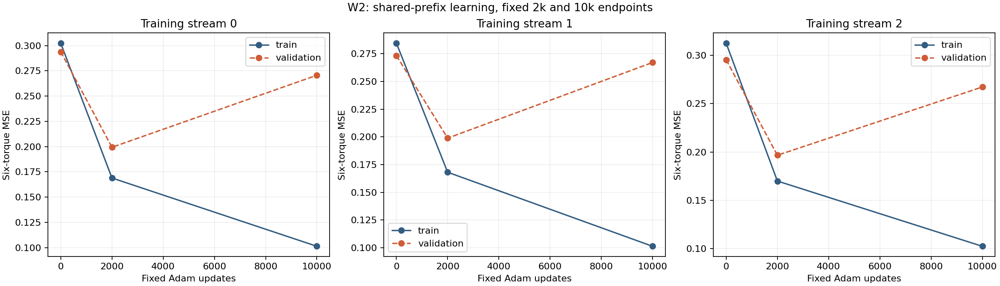

# W2: confirmed retention and cost improvement, without walking

**Execution complete; independent audit valid.** Deploying the fixed 2k checkpoint instead of continuing to 10k improved control retention and complete cost in every one of three fresh training streams, on both primary and confirmation panels. Held-trajectory error also improved. Every endpoint nevertheless walked on **0/16** resets and achieved full survival on **0/16**, on each panel. This is confirmed partial retention, not competent walking or a closed MPPI–policy loop.

[Protocol](student_update_w2_protocol.md) · [exact capsule](../results/student_update_w2/README.md) · [generated report](../results/student_update_w2/report/report.md) · [all episodes](../results/student_update_w2/report/episodes.csv) · [independent audit](../results/student_update_w2/audit/receipt.json).

## One shared stream per seed

W2 used the exact W1 corpus/container bytes: 4,000 original executed training rows and 2,000 later independent validation rows, excluding the 64 hypothetical and 32 recovery examples. Features, original torque labels, training-only normalization and optimizer settings were unchanged. Both endpoint policies used the same `17→128 tanh→128 tanh→6 tanh` class and normalization buffers.

Three fresh initialization/minibatch seeds each trained once to 2k. The complete checkpoint was saved and actually reloaded, with policy, optimizer and private RNG fingerprints equal before and after. That same stream continued for exactly 8k more updates. The original 2k actor/state remained frozen for evaluation. Total training was **30,000 Adam steps**, not redundant independent 2k and 10k fits.

The endpoints, fresh reset roles, separate screens, confirmation trigger and finite budgets were fixed at commit `5c3241e` before predictions. All learning finished before simulator construction. There was no checkpoint selection, additional teacher, input/target/optimizer intervention or trajectory-optimization change.

## Standalone outcomes

These are equal-training-stream means. Each endpoint within each stream received 16 paired primary resets and 16 disjoint paired confirmation resets. All six endpoints received confirmation under the frozen trigger; no favorable seed alone was selected.

| Panel | Updates | Mean controls | Complete cost | Velocity MAE (m/s) | Walking / full survival, each stream |
|---|---:|---:|---:|---:|---|
| Primary | 2,000 | 236.458333 | 4431.956520 | 1.140209 | 0/16 / 0/16 |
| Primary | 10,000 | 121.395833 | 4817.838525 | 1.869225 | 0/16 / 0/16 |
| Confirmation | 2,000 | 232.916667 | 4409.341049 | 1.082637 | 0/16 / 0/16 |
| Confirmation | 10,000 | 109.875000 | 4888.485543 | 2.051371 | 0/16 / 0/16 |

The 2k endpoint retained **115.0625 additional controls** on the primary panel and **123.0417** on confirmation. These correspond to about 0.92 and 0.98 additional seconds before failure, still far from full 1,000-control / 8-second survival. Every curve and endpoint episode fell; all 228 outcomes remain in evidence.

| Stream | Primary controls 2k / 10k | Confirmation controls 2k / 10k | Primary cost 2k / 10k | Confirmation cost 2k / 10k |
|---|---:|---:|---:|---:|
| 0 | 257.2500 / 170.0625 | 244.0625 / 137.3125 | 4432.089994 / 4581.892474 | 4396.123807 / 4733.831297 |
| 1 | 183.8125 / 54.5000 | 182.2500 / 55.0625 | 4434.642578 / 5082.045555 | 4437.743600 / 5082.932594 |
| 2 | 268.3125 / 139.6250 | 272.4375 / 137.2500 | 4429.136988 / 4789.577546 | 4394.155740 / 4848.692739 |

Mean paired relative cost reductions were 7.84% primary and 9.73% confirmation. Relative retention gains average 126.90% and 135.74%, but brief 10k baselines magnify those ratios, especially stream 1. Absolute controls above are the more practical scale. Episode medians were 228.5 versus 102 controls in primary and 218 versus 64 in confirmation. Velocity MAE improves overall, but not in every individual comparison: stream 0 primary MAE was slightly worse at 2k.

## Reconstruction and the frozen decisions

| Stream | Training MSE 2k / 10k | Held-trajectory MSE 2k / 10k |
|---|---:|---:|
| 0 | 0.168904 / 0.101301 | 0.199324 / 0.270631 |
| 1 | 0.168124 / 0.101298 | 0.198896 / 0.267127 |
| 2 | 0.170027 / 0.102590 | 0.196685 / 0.267240 |

Training MSE means were **0.169019 versus 0.101730**: the earlier checkpoint reconstructs fitted targets worse. Held-trajectory means were **0.198302 versus 0.268332**, a mean paired relative reduction of **26.10%** at 2k. Diagnostic scores retain the original float64 targets; fitting uses the unchanged float32 conversion. Validation supplied no gradients, normalization statistics or endpoint choices and remains previously examined development evidence.

The validation screen passed. Retention and cost screens passed on primary and confirmation, so their separate confirmed-benefit fields are true. The walking-gain screen failed on both panels and every competence flag is false. Longer execution did not improve the full-survival count, and it did not become walking.

[Raw checkpoint metrics](../results/student_update_w2/report/fitting.csv), [per-trajectory errors](../results/student_update_w2/report/trajectories.csv), [standalone curves](../results/student_update_w2/report/standalone_curves.png) and [300 fixed 100-update loss bins](../results/student_update_w2/learning/binned_learning_curves.csv) retain the whole fixed experiment. The loss bins cover all 30,000 update records; minibatch min–max shading is not a confidence interval. Six original full per-update fit JSONs remain external with hashes.

## Complete cost is related to retention

Complete cost includes the fixed penalty of 5 per missing control after a fall. The cost and retention gains therefore are not independent corroborations of recovered gait. The post-closure accounting identity is

\[
\Delta C_{complete}=\Delta C_{without\ absorbing\ tail}-5\Delta N,
\]

where differences are 2k minus 10k and both policies fell. Primary retained controls reduce the absorbing tail by 575.31 cost units while non-tail sums increase 189.43, yielding the observed 385.88 complete-cost reduction. Confirmation gives −615.21 in tail cost and +136.06 in non-tail sums, for −479.14 total. Non-tail sums span different executed durations and are not per-step comparisons. The frozen objective legitimately favors retained controls, but this accounting does not demonstrate walking.

All six source teachers walked and survived for 1,000 controls. Training-teacher mean cost was 401.952501; validation-teacher mean 379.859168. Their six-episode mean is 394.588057. The primary student-minus-teacher mean gap is 4037.368463 at 2k versus 4423.250468 at 10k; confirmation gaps are 4014.752992 versus 4493.897486. These historical-teacher/fresh-student gaps are **descriptive and unpaired**. The endpoint contrast uses paired new reset contexts and accepts different successful paths.

## Uncertainty and causal verdict

The [frozen crossed bootstrap](../results/student_update_w2/report/descriptive_bootstrap.json) resamples three paired training streams and a shared reset panel, preserving both endpoint columns. Descriptive percentile intervals for additional controls are **81.29–142.28 primary** and **94.01–147.19 confirmation**; cost differences are **−644.00 to −114.50** and **−645.12 to −276.56**. These are three-stream development intervals, not population guarantees. The four training and two validation teacher trajectories are not resampled. Frames, endpoints and reset episodes are not additional independent training runs; all-zero walking intervals do not prove identical underlying success probabilities.

The controlled extra 8k updates caused a reproducible deterioration in held-trajectory reconstruction and deployment retention in these streams while improving fitted reconstruction. This supports the narrow fixed-budget intervention and is consistent with overspecialization to the training corpus. It does not establish validation error as the causal mediator, an optimal stopping duration, contradictory demonstrations, a capacity limit or successful adaptive coupling. Residual fitting errors remain substantial at both endpoints.

**Close W2 with partial retention and cost benefits, and continued walking failure.** No controller is promoted as walking competent. No new intervention, teacher acquisition or follow-up experiment was launched. Other unresolved optimization, coverage, target and execution-sensitivity questions remain separate research decisions.

## Evidence, costs and validation

Frozen implementation: `5c3241e550245479d77bd1ed71cf90467b4e9c48`. Config SHA-256 `58e38a13f08c6c003970cddf51ce268f994a8182b14d2be997f0f28a8c7d4bf9`; input-seal SHA-256 `c9ebdeac1ab7fa1a252176d271513c27c98a79bcb9fab87dacf14ed5e1c1c19e`. Exact actor/Adam/RNG checkpoints and before/after reload receipts remain bound in the result and audit.

| Work | Actual | Frozen ceiling / reservation |
|---|---:|---:|
| Forward rows | 7,772,824 | 8,250,000 / 7,962,000 |
| Backward rows | 7,680,000 | 7,680,000 |
| Adam updates | 30,000 | 30,000 |
| Live controls | 38,824 | 230,000 / 228,000 |
| Native physics substeps | 155,296 | 912,000 maximum roster |
| Episodes | 228 | 36 curve + 96 primary + 96 confirmation |
| Actual 2k checkpoint reloads | 3 | 3 |
| New teacher/model-rollout controls | 0 | 0 |

One worker completed with no retries, failed/rejected requests or unknown partial work. The 6,000 prefix updates are already included in the total 30,000, not charged twice. Worker wall time was 109.320 s; external launch 110.292 s. [Full accounting](../results/student_update_w2/accounting/engineering_accounting.json) includes per-operation work/times, the cost-tail decomposition, engineering tests/reports/audits and explicit unavailable overhead. No efficiency advantage is claimed from early falls or row counts.

The independent saved-only audit passed **1,701,135 checks**, binding 256 files and 2,529 arrays in 5.056 s, with zero new neural, simulator or optimizer arithmetic. It independently reconciled exact W1 corpus reuse, sampler streams, checkpoint/Adam/RNG/reload ownership, predictions, native outcomes/reset pairing, separate frozen gates and work. It did not replay networks or optimization. A separate saved-only review reproduced the report and all bootstrap outputs. Prelaunch validation passed **375 tests, one skip and one expected failure**, plus Ruff; CPU CI for the preregistration also passed. The [final clean export](validation/student_update_w2_2026-10-31/README.md) again passed 375 tests / one skip / one expected failure and all six capsule inspections/report renders.

The full run is **local-only**, 247 files and **1,496,794,451 bytes** at `/Users/jaisel/Documents/mppi-gps/runs/2026-10-31_student_update_w2_001/`. [Full manifest](../results/student_update_w2/external/full_run_file_manifest.json) gives exact hashes. Large raw arrays, ledgers, nine checkpoint/optimizer packages, three full index tapes and six fit JSONs remain outside Git and the vault. Original discovery's missing endpoint/warmstart/integration fields remain explicit; none was reconstructed. All previous runs, capsule bytes and historical manifests remain preserved.
