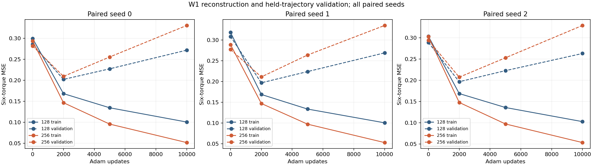

# W1: wider students fit better, generalize worse and still fail walking

**Execution complete; independent audit valid; the width intervention failed its standalone improvement screen.** Increasing both tanh layers from 128 to 256 reduced training MSE by 47–49% in all three seed pairs. Held-trajectory MSE increased 22–25%. All six final policies walked on 0/16 primary resets and survived on 0/16. The wider policy fell sooner and had higher mean complete cost in every pair.

[Preregistered protocol](student_width_w1_protocol.md) · [exact capsule](../results/student_width_w1/README.md) · [generated report](../results/student_width_w1/report/report.md) · [all episode outcomes](../results/student_width_w1/report/episodes.csv) · [independent audit](../results/student_width_w1/audit/receipt.json).

This was one width intervention under a fixed learning budget. It was not a new coupling mechanism or a repetition of the [K1 dataset-by-policy diagnostic](action_compatibility_k1_results.md). It does not establish that trajectory diversity caused cloning failure or that the torque-policy results reproduce CIO–GPS.

## Matched comparison and frozen endpoint

Both widths used the same 4,000 executed original-discovery rows for fitting and 2,000 later independent executed rows for validation. The 64 hypothetical and 32 recovery examples were excluded. Source arrays, targets and ancestry were bound to the K1 seals; no exact state, observation or action overlap exists between splits in float64 or float32. Normalization used training rows only and was identical across arms.

There were three fresh paired initialization/sampler seeds and six fits. Each received 10,000 Adam updates, batch 256, learning rate 0.0003, gradient clipping 0.5 and zero parameter proximity. Within a pair, minibatch indices were identical; different widths have different initial tensor shapes and functions under the same fan-in initialization rule. All six fits completed before constructing the simulator. No new teacher, critic, environment, activation or input-map intervention was introduced.

The fixed decision endpoint was 10,000 updates. Updates 0, 2,000 and 5,000 were descriptive checkpoints; none was selected after seeing validation or execution. Every checkpoint received four curve resets. All six final policies received 16 separate, paired primary resets. The confirmation trigger was false, so the reserved all-six confirmation panel did not run.

## Final measurements

MSE divides summed six-torque squared residuals by `6N`; diagnostic residuals use original float64 targets, while fitting uses the shared float32 conversion. Lower cost and MSE are better; higher controls and success counts are better.

| Pair | Width | Train MSE | Held-trajectory MSE | Walking / survival | Mean controls | Complete cost |
|---|---:|---:|---:|---:|---:|---:|
| 0 | 128 | 0.100483 | 0.271658 | 0/16 / 0/16 | 166.3125 | 4478.035650 |
| 0 | 256 | 0.051552 | 0.330501 | 0/16 / 0/16 | 79.8750 | 4945.936232 |
| 1 | 128 | 0.100333 | 0.268815 | 0/16 / 0/16 | 208.1875 | 4853.852914 |
| 1 | 256 | 0.052737 | 0.334836 | 0/16 / 0/16 | 101.6250 | 5000.151369 |
| 2 | 128 | 0.102806 | 0.263257 | 0/16 / 0/16 | 116.0625 | 5035.718730 |
| 2 | 256 | 0.053482 | 0.329237 | 0/16 / 0/16 | 73.3125 | 5038.143309 |

Equal training-seed means are train MSE **0.101207 versus 0.052590**, validation MSE **0.267910 versus 0.331525**, complete cost **4789.202431 versus 4994.743637**, and controls **163.5208 versus 84.9375** for 128 versus 256. The primary velocity MAE means are 1.674682 versus 2.181642 m/s. These averages summarize three trained policies per width, not 48 independent training replications.

The mean of paired relative training-MSE reductions is **48.04%**. Mean held-trajectory MSE increases **23.76%**. The wider policy's complete cost increases by **10.45%, 3.01% and 0.048%** in the three pairs; mean paired relative increase is 4.50%. All three mean-control differences are negative.

Frozen screen F, reconstruction benefit, **passed**. Validation guard G **failed**, so their joint fitting screen failed. The task screen **failed**: there was no walking gain, no positive mean cost gain and no control-duration nonregression. No policy approached the 15/16 qualification trigger. These are the original screening conventions, not revised thresholds.

## What the learning curves add

For every fit, training MSE decreased across recorded checkpoints, while validation MSE was lowest at the recorded 2k point and rose through 5k and 10k. Width-128 mean validation MSE was 0.198480 → 0.224591 → 0.267910; width-256 was 0.209202 → 0.257374 → 0.331525.

Every one of the 96 descriptive curve episodes also failed walking and full survival. The 2k checkpoint retained more controls than 10k in all six fitted streams, but had lower complete cost in only four of six. Thus the curves motivate an update-budget question; they do not establish that an earlier checkpoint solves control, and they were not used to replace the frozen 10k endpoint.

[All checkpoint reconstruction](../results/student_width_w1/report/fitting.csv), [trajectory/actuator errors](../results/student_width_w1/report/trajectories.csv), [standalone curves](../results/student_width_w1/report/standalone_curves.png), and [600 fixed 100-update bins](../results/student_width_w1/learning/binned_learning_curves.csv) are retained. The binned stochastic-loss plot covers all 60,000 saved updates; its min–max shading is minibatch variation, not a confidence interval. All 18 original per-update fit records remain in the full external evidence manifest.

## Teachers, gap and uncertainty

All six source teachers walked and survived for 1,000 controls. Training-teacher mean cost was 401.952501 and validation-teacher mean cost was 379.859168. Their mean velocity MAEs were 0.153544 and 0.144445 m/s. No teacher outcome was discarded and no teacher was reacquired.

The six-teacher mean cost was 394.588057. Descriptive student-minus-teacher gaps are therefore 4394.614374 for width 128 and 4600.155580 for width 256. These gaps use different historical teacher and fresh student reset contexts; they are **unpaired**. The paired causal comparison is between widths on the same new reset panel. Different successful trajectories would have been accepted.

The frozen 2,000-draw [crossed seed/reset bootstrap](../results/student_width_w1/report/descriptive_bootstrap.json) preserves both width columns and shared reset contexts. Its descriptive percentile interval for mean paired relative cost gain is approximately **−10.35% to +0.03%**; it includes zero despite negative observed seed means. The interval for the control-duration difference is **−118.96 to −44.25 controls**. Only three training pairs are available; teacher trajectories are not resampled. All-zero observed walking intervals do not prove equal population success probabilities. No significance or population-coverage claim is made.

## Causal verdict and one next hypothesis

This particular widening intervention improves empirical action reconstruction under the fixed procedure but worsens held-trajectory transfer and does not repair standalone behavior. That is evidence against simply increasing width as the walking fix. It is not a general impossibility result for the 128 class, a proof that representational capacity is irrelevant, or a causal attribution to incompatible demonstrations.

The intervention includes width-dependent initialization and more arithmetic per update. Coverage, objective/optimization, finite data, action ambiguity and closed-loop distribution sensitivity remain competing explanations. The stronger fit is still imperfect: width-256 training RMS torque error is about 0.23 per scalar, and validation RMS about 0.58. The result does not show nearly exact imitation failing solely from tiny execution errors.

Recommend only **[W2: fixed 2k versus 10k update budgets at width 128](student_update_w2_hypothesis.md)**, with fresh paired seeds and reset panels and all other settings fixed. This is motivated by the observed validation/retention curves, not a claim that 2k is optimal or that early stopping produces walking. W2 remains a hypothesis requiring its own finite protocol. No W2 fit, new acquisition or coupling round was launched.

## Evidence, cost and engineering validation

Frozen implementation commit: `55da84852296edb0f0ee914a473baae92d3f61de`. Config SHA-256: `1cbfa968a3d24bf35b731eb3d4fea451f5b4f06fd4635dc4ae487098fe4e9ebc`. Input-seal SHA-256: `c2d7b1e2666e761f4ac87d187bf238ff638c3d2994db9a8f00c39255f4778da7`. Result SHA-256: `3c1fe6903f7298a28161c22d6aa9c311c2150d835881c1cbb7e8872fab84ebe0`.

| Work | Actual | Frozen ceiling / roster |
|---|---:|---:|
| Forward rows | 15,528,507 | 18,000,000; 15,792,000 reserved |
| Backward rows | 15,360,000 | 15,360,000 |
| Adam updates | 60,000 | 60,000 |
| Live controls | 24,507 | 300,000; 288,000 reserved |
| Native physics substeps | 98,028 | 1,152,000 maximum roster |
| Episodes | 192 | 288 including conditional confirmation |
| Model-rollout controls / new teachers | 0 | 0 |

There was one worker and no retry, failed/rejected query or unknown partial work. Every task failure is retained. Worker wall time was 102.297 s; external launch 103.300 s. The 128 and 256 networks have 19,590 and 71,942 parameters; equal rows/updates do not match compute. [Accounting](../results/student_width_w1/accounting/engineering_accounting.json) reports per-width metered call times, work and engineering overhead without an efficiency claim.

The independent audit passed **1,784,504 checks**, binding 253 files and 2,163 arrays in 5.414 s with zero new inference, physics or optimization. It independently reconciled metrics, source lineage, full sampler streams, checkpoints/Adam/RNG ownership, complete native outcomes, reset pairing, conditional gates and work. It did not replay neural predictions or optimizer arithmetic. A separate saved-only review reproduced the report scalars and frozen bootstrap.

The full local prelaunch suite passed **339 tests, one skip and one expected failure**. Linux CI then caught an overly broad serialized-file-hash test: tensor/RNG hashes matched, while the Mac checkpoint ZIP hash differed. The [preserved failure and correction](../results/student_width_w1/history/ci_portability_fix.json) scope that container hash to its bound build and retain portable semantic/payload/continuation checks. This is a post-run test-only correction; frozen scientific source, configuration, inputs and results were unchanged. The [final clean-export validation](validation/student_width_w1_2026-10-31/README.md) passed 340 tests, one skip and one expected failure, all five capsule inspections/report renders and Ruff. An intermediate formatting failure and its correction are also retained there.

Full run evidence is **local-only**, 244 files and **1,081,903,391 bytes**, under `/Users/jaisel/Documents/mppi-gps/runs/2026-10-31_student_width_w1_001/`. The [complete file manifest](../results/student_width_w1/external/full_run_file_manifest.json) provides exact hashes. All 24 checkpoint/optimizer packages, raw predictions, paired indices, full simulator states/warmstarts/integrations, ledgers and per-update fit JSON remain outside Git and the vault. Original discovery's missing terminal/integration context remains missing; it was not reconstructed.
