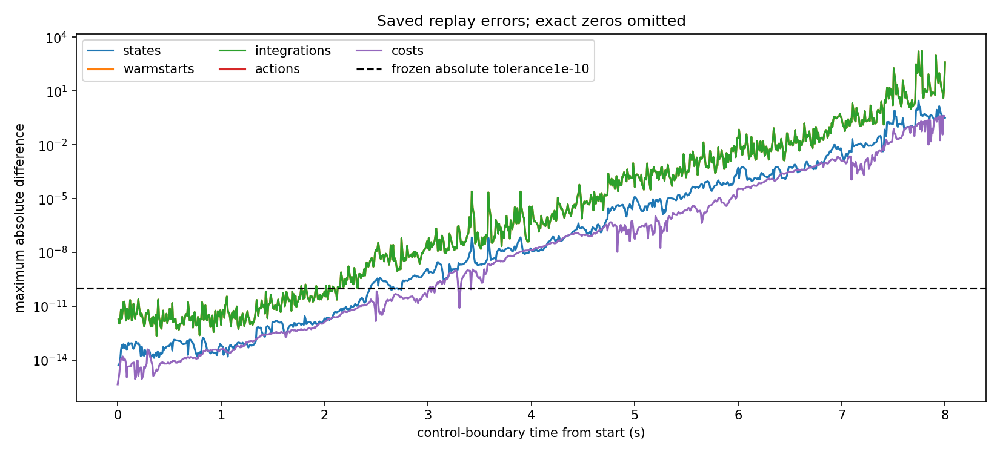

# P1.0 — audited prerequisite stop; similarity comparison untested

The [fixed-alpha full-trajectory comparison](trajectory_pi_p1_protocol.md) was
implemented, validated, committed and published as `211891d`. Execution on
`robopil5090` stopped at its first physical prerequisite. **No alternating round,
PI refinement, standalone policy evaluation or learning update ran.** The
reconstruction-score hypothesis remains untested.

The input review missed an important provenance distinction: the selected H4
trajectories originated on macOS ARM, while the new worker uses Linux x86. Their
complete contexts were available, but this did not establish full-horizon
cross-host reproducibility. The frozen replay gate caught the problem before
research execution; its tolerance and inputs remain unchanged.

## What was actually executed

P0 restored teacher slot 0's complete initial state, warmstart and integration
context, then executed its 1,000 recorded float64 controls. Initial context and
all controls matched exact bytes. State discrepancies began at about `5.33e-15`,
crossed the frozen `1e-10` tolerance at boundary 306, and reached 2.878281.
Warmstart/integration discrepancies crossed the tolerance at boundary 222.
The full-context replay check failed; all seven remaining prerequisites stayed
**NOT_RUN**. Teacher slot 1 was never replayed.

| Saved trajectory | Controls | Walking / survival | Velocity MAE | Native task cost |
|---|---:|---|---:|---:|
| Original teacher slot 0 | 1,000 | yes / yes | 0.1454553 | 372.7086518 |
| Paid Linux replay | 1,000 | yes / yes | 0.1473451 | 376.5714060 |

These are two executions of one control sequence, not independent task
replications. The replay's cost is about 1.04% higher. This is an exact-replay
prerequisite failure; teacher walking did not fail.

[Six joint-angle traces](../results/trajectory_pi_p1_001/analysis/replay/joint_angles.png),
[boundary curves](../results/trajectory_pi_p1_001/analysis/replay/boundary_differences.csv)
and the [saved-only numerical report](../results/trajectory_pi_p1_001/analysis/replay/replay_report.json)
preserve the observed path. There are no learning curves or policy outcomes to
report; the original empty learning/progress outputs are retained in the capsule.

## Audit, costs and causal limits

The independent audit returned **PASS_STOPPED**, with 44,627 checks and 7,485
file bindings. It certifies preserved failure and reconciled stopping/accounting.
It does not validate the failed replay or establish a result about the score.
A separate [read-only closure review](validation/full_pi_loop_2026-11-03/stop_audit_review/review.md)
reconciled all 2,008 P0 ledger events. No unresolved entered call or retry was found.

| New work | Actual |
|---|---:|
| Native controls / physics substeps | 1,000 / 4,000 |
| Complete-context restores / external `mj_forward` calls | 1 / 1 |
| PI passes / model controls | 0 / 0 |
| Policy forward rows / backward rows / Adam updates | 0 / 0 / 0 |
| P0 internal wall / CPU seconds | 4.624 / 1.777 |
| Entire remote lifecycle wall / process-tree CPU seconds | 10.763 / 4.030 |
| Independent audit internal wall / CPU seconds | 1.053 / 1.051 |
| Sampled peak remote tree memory | 317,202,432 bytes |
| Remote storage, before the size-observation receipt | 402,391,999 bytes |

Times are nested: P0 and audit are already included in the remote lifecycle.
Storage includes the complete source export and transfer archive. Preparation,
transfer, local plotting, engineering validation and reused lineage costs remain
separate in [work accounting](../results/trajectory_pi_p1_001/accounting/work_summary.json).
Physical disk traffic, billed money and cumulative CPU for every repeated
engineering smoke check were not measured; they are explicitly unknown.

Saved-data inspection found identical XML bytes, task settings and the twelve
inspected Python physics/cost/accessor function ASTs. Original integration
contexts confirm float64 physical actions. The initial errors and subsequent
growth are consistent with numerical amplification across platforms. **This
does not uniquely establish its cause**: native arithmetic, compiled-model
options and original binary details remain incompletely bound. See the
[source review](validation/full_pi_loop_2026-11-03/replay_source_review.md).
Previous D2 replays used different Linux-origin trajectories and do not certify
these H4 inputs.

The finite comparison therefore has no verdict on whether fixed
`C + 0.12 D` helps an alternating loop. Equal-compute cloning/DAgger, CIO ablation
patterns, competent held-out standalone walking and a second body remain untested.

The single recommended next experiment is [R0.1, origin-host replay](trajectory_pi_replay_r0_1_proposal.md).
It is proposed for review and has not launched. Recurrence stays stopped;
`sac-continuation` and `ciogps` were not edited or merged.

The [portable capsule](../results/trajectory_pi_p1_001/README.md) and
[external evidence index](../results/trajectory_pi_p1_001/external_evidence.json)
bind the failed outputs, raw trace, ledgers, unchanged parents and frozen source.

## Implementation and publication validation

The initial full repository run passed 1,899 tests with three documented skips
and one expected failure. The frozen research export passed all 128 new P1 tests
without ignored evidence directories. After the stop, a separate clean tracked
export passed 157 saved-report/inspection/CLI regression tests, capsule hashes,
historical manifests, documentation links and report rendering. Ruff checks and
formatting pass. The [publication receipt](../results/trajectory_pi_p1_001/accounting/publication_validation.json)
records the commands and costs. Post-stop source changes concern read-only
reporting/navigation; the executed optimizer, learner, preflight, native worker,
coordinator and auditor remain unchanged from `211891d`.
