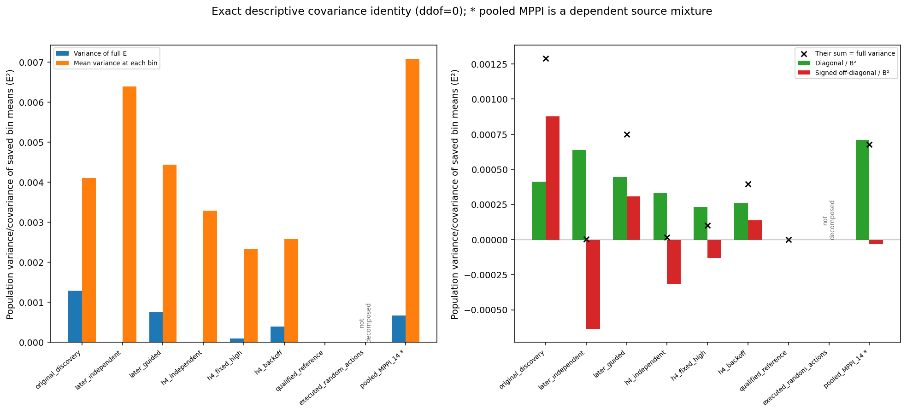

# K1.1 — whole-trajectory agreement conceals some opposing local differences

**Complete saved-data analysis; independently audited.** All 34 trajectories, 30,070 recorded control rows, 304 ordered bins and 204 actuator entries reconcile. Close whole-trajectory scores can conceal different temporal error profiles. This does not establish gait phase, recurrence, consequential timestamps, student teachability or a useful change to MPPI.

The [protocol](trajectory_review_k1_1_protocol.md) and [recipe](../configs/studies/trajectory_review.json) were committed and pushed as `e73cc5b` before launch. One frozen worker ran; there was no inference, physics, fitting, checkpoint load, raw-array read or acquisition. The [capsule](../results/trajectory_review_k1_1/README.md) contains exact inputs, source, result, seven CSVs, four figure pairs, both audit attempts and both report versions. [Ordered-bin table](../results/trajectory_review_k1_1/report/ordered_bins.csv), [all individual trajectories](../results/trajectory_review_k1_1/report/trajectories.csv) and [signed pair differences](../results/trajectory_review_k1_1/report/two_trajectory_differences.csv) retain original identities and order.

## What changed in the evidence

The actor and the K1 metric are unchanged. For recorded states, \(E_i=(6N_i)^{-1}\sum_{t,j}[u_{itj}-\pi_{\rm ref,j}(o(x_{it}))]^2\). Each full trajectory has ten equal 100-control bins \(q_{ib}\). K1.1 retains their order and uses the population identity

\[
\operatorname{Var}_i(E_i)=\frac{\sum_b\operatorname{Var}_i(q_{ib})}{100}
 +\frac{\sum_{b\ne c}\operatorname{Cov}_i(q_{ib},q_{ic})}{100}.
\]

The clearest example is the **later-independent pair**, in original first-minus-second order. Their full means are 0.641759262 and 0.637960496: a difference of only **0.003798767**. Their signed bin differences are:

| Controls | Difference in bin E |
|---|---:|
| 0–100 | +0.221493 |
| 100–200 | +0.102840 |
| 200–300 | +0.115402 |
| 300–400 | +0.050162 |
| 400–500 | −0.146524 |
| 500–600 | −0.218200 |
| 600–700 | +0.094583 |
| 700–800 | −0.288457 |
| 800–900 | +0.134933 |
| 900–1000 | −0.028244 |

Opposing differences cancel in the mean. The diagonal contribution is 0.000639270 and the off-diagonal contribution is −0.000635662, leaving full-mean variance 0.000003607657. These are squared-error-summary identities over **two trajectories**, not independent bins or task replications.

Cancellation is source-dependent:

| Source | Trajectories | Full E spread | Diagonal contribution | Signed off-diagonal | Full-mean variance |
|---|---:|---:|---:|---:|---:|
| Original discovery | 4 | 0.093681 | 0.000411090 | +0.000878514 | 0.001289605 |
| Later independent | 2 | 0.003799 | 0.000639270 | −0.000635662 | 0.000003608 |
| Later guided | 2 | 0.054797 | 0.000443519 | +0.000307150 | 0.000750669 |
| H4 independent | 2 | 0.007783 | 0.000329175 | −0.000314032 | 0.000015143 |
| H4 fixed-high | 2 | 0.020028 | 0.000233199 | −0.000132922 | 0.000100276 |
| H4 backoff | 2 | 0.039806 | 0.000257774 | +0.000138360 | 0.000396134 |
| Pooled MPPI, descriptive mixture | 14 | 0.106048 | 0.000707908 | −0.000032036 | 0.000675872 |

The pooled MPPI mean E is 0.644604245. Its mean between-trajectory variance at each bin is 0.007079080. Averaging ten bins reduces variation, but a universal negative-covariance explanation would be wrong: discovery, guided and backoff have positive off-diagonal terms. See [all covariance entries](../results/trajectory_review_k1_1/report/bin_covariance.csv) and [group reductions](../results/trajectory_review_k1_1/report/groups.csv).

All six actuator errors and their shares are retained on a common scale. The saved fixed reference emits larger mean absolute actions on these MPPI states than the recorded MPPI actions: approximately 0.646–0.687 versus 0.425–0.461. Its marginal saturation fractions are approximately 19.4–27.8%, versus MPPI's 1.45–4.25%. These observations describe different conditional outputs; they do not show that saturation caused errors or falls. Signed residuals and error conditional on saturation are not available in these scalar summaries. [Actuator table](../results/trajectory_review_k1_1/report/actuators.csv) and [separate marginals](../results/trajectory_review_k1_1/report/marginals.csv) preserve all records.

The 16 reference-self comparisons remain exactly zero, including every bin. The four random trajectories retain their actual 8/26/22/14-control lengths and partial first bins; no post-fall values or balanced variance decompositions are invented. \(D=6NE\) is duration-dependent: short random sums cannot be compared as if they represented 1,000 controls. All 14 MPPI trajectories have recorded walking success. There is no within-MPPI walking-failure contrast here, and no new standalone student evaluation.

## Scope and causal verdict

| Status | Conclusion |
|---|---|
| Established | Some close full means conceal large, oppositely signed local differences; all original bindings, rows and reductions reconcile. |
| Supported within this assay | Temporal averaging and covariance explain the small full-score spread of the later-independent and H4-independent pairs algebraically. |
| Unresolved | Whether the motions contain shifted similar subsequences, different coordination, transitions, recurrence or consequential action errors; whether any pattern predicts a fixed-update child's walking. |
| Not established | That periodic gait is necessary, that earlier times deserve larger weights, that a new similarity metric is required, or that any guidance coefficient would help learning. |

Kendall's clarification matters: repeated gait is one possible Walker-specific factor, not a general requirement. Nonperiodic behavior and different successful gaits remain valid. Short repetition would not prove a stable limit cycle; a neural policy need not have one attractor. Inspect actual saved motions and synchronized state/action sequences before interpreting phase or recurrence. Spectral similarity alone would not establish coordination, recovery, competence or teachability. This run reads saved error bins, not those motion arrays.

The central goal remains **teacher adaptation followed by useful student learning and another actual acquisition round**. Current agreement already follows each candidate's own states; H4.1 already changed its weight and produced walking teachers whose children regressed. K1.1 does not improve that mechanism. [S1.1](student_source_s1_1_results.md) still has no confirmed source benefit or competent child, and original S1 remains interrupted. The next [S1.2 hypothesis draft](student_visitation_s1_2_hypothesis.md) separates a fixed labeling function from the visited-state distribution. It is not authorized for launch. It explicitly retains the previous corrective-data failure and defines how useful learning would gate a later coupling protocol.

## Integrity and costs

| Work scope | Actual |
|---|---:|
| Frozen scientific analysis attempts | 1, complete |
| Saved inputs | 9 files / 8,328,586 bytes |
| Worker arithmetic / owner elapsed | 0.042964 / 0.142802 seconds |
| Worker observed peak RSS | 64,880,640 bytes |
| Exact closed run, source and inputs included | 12,984,938 bytes |
| New inference / physics / optimizer / MPPI work | 0 each |
| New raw-array reads / checkpoint loads / GPU operations | 0 each |
| Independent audit attempts | 2; first failed, second passed |
| Successful audit | 34,849 checks / 313 bound files / 0.205886 seconds |
| Report renders | 2; both retained |

The first audit failed after 2,201 checks because the checker assumed symmetric K1 primary/confirmation JSON layouts. The original confirmation object is already a reference summary. The correction was separately tested, committed/pushed as `3dcec36`, and exported create-only; it changes no input, science gate or tolerance. The original checker, failed receipt and cost remain preserved. The first report's cumulative title overlapped; a two-line presentation fix produced report002. All seven CSVs and report text are byte-identical across reports, with no scientific rerun. Only the cumulative PNG changes; other PDF differences are timestamp metadata.

The [accounting record](../results/trajectory_review_k1_1/accounting/accounting.json) separates preparation, worker, failed/passed audits, both reports, source publication, transfers and engineering command receipts. Inherited K1 stage A/B counters are retained separately: 288,188 neural rows, 38,966 native controls and 155,864 physics substeps; they were not paid again. Historical teacher discovery, reference training and student fitting remain in their original ledgers, not a fabricated total. Synthetic test arithmetic/physics counts and uninstrumented development/tool billing are unknown, not zero. There is no efficiency claim.

Prelaunch clean-export validation passed **695 tests, one skip and one expected failure**, plus all 24 CLI/inspection/report checks. The checker correction adds nine schema/gate cases. Ruff and historical capsule/manifest checks pass. Final publication validation is recorded separately so the frozen analysis and capsule remain immutable.
