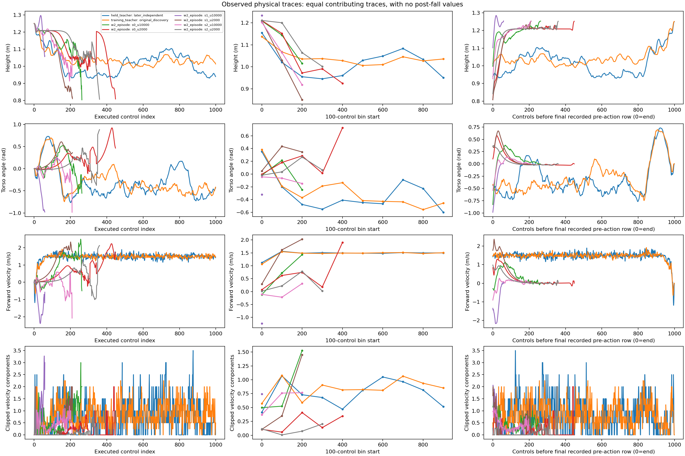
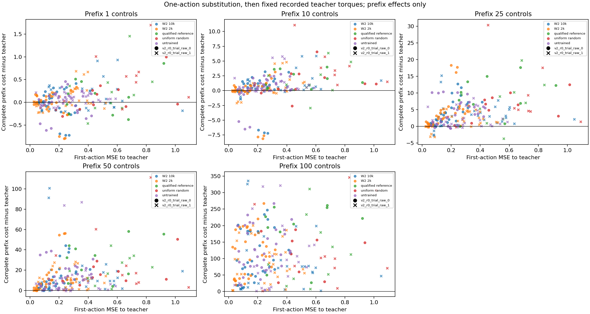

# D1/D2: support drift and action consequences do not yet explain failed transfer

**Completed and independently audited.** D1 reused all declared K1/W2 experience.
All 20 unmodified D2 continuations matched their recorded states, warmstarts,
integration arrays and native costs with maximum error **zero**. All 240 branches
completed their declared stopping logic. No policy was fitted or promoted; there
was no new network inference, MPPI query or trajectory-optimization mechanism.

[Frozen protocol](transfer_diagnosis_d1d2_protocol.md) ·
[exact result capsule](../results/transfer_diagnosis_d1d2/README.md) ·
[generated report and complete tables](../results/transfer_diagnosis_d1d2/report/report.md) ·
[independent audit](../results/transfer_diagnosis_d1d2/audit/receipt.json) ·
[next S1 proposal — unlaunched](student_source_s1_protocol.md).

## Established starting point

[K1](action_compatibility_k1_results.md) already supplied the requested successful
MPPI/reference/random trajectories by untrained/cloned/reference policies comparison.
The reference's action-MSE ordering is self < MPPI < random. Failing clones agree
with MPPI better than the competent reference does. D1 preserves that metric and all
nine policies; it does not search for a score that produces a preferred ranking.

[W2](student_update_w2_results.md) found confirmed partial retention and complete-cost
benefits at 2k relative to exact continued 10k training. Every endpoint still had
zero walking and full-survival successes on both panels. Those are **imported W2
outcomes**, not new standalone evaluations in D1/D2. Its original learning curves
and historical teacher–student gaps remain available there; those teacher/fresh-
student gaps are descriptive and unpaired.

## D1: support is informative but cannot certify competence

The saved-only analysis completed **69,701 support queries**: 4,000 LOTO calibration,
2,000 held teacher, 33,631 final W2 student, and 30,070 K1 rows. It retains all 192
final W2 episodes, every declared physical trace, 306 trajectory-policy scores and
36 endpoint/teacher reconstruction records. No frame or policy was selected by a
new outcome. Original discovery self-matches are labelled in-sample; separate LOTO
training records provide the held-trajectory context.

The original-normalization LOTO 95th-percentile standardized RMS threshold is
**0.8601479856552903**. Only **0.45%** of the two held independent teachers' rows exceed
it. The qualified SAC reference's own successful trajectories have **13.89%** above
threshold. This metric describes distance from the MPPI training sample; it is not
a universal competence or recovery gate.

| W2 point | Mean controls | Whole-trace outside (%) | Recorded first-100 outside (%) |
|---|---:|---:|---:|
| Stream 0, 2k | 250.66 | 9.00 | 0.00 |
| Stream 0, 10k | 153.69 | 15.76 | 9.70 |
| Stream 1, 2k | 183.03 | 6.06 | 0.00 |
| Stream 1, 10k | 54.78 | 61.87 | 61.87 |
| Stream 2, 2k | 270.38 | 4.99 | 0.00 |
| Stream 2, 10k | 138.44 | 29.61 | 19.14 |

Each row covers 32 existing W2 episodes (16 primary +16 confirmation). Percentages
average episode fractions equally; they are not pooled frame fractions. First-100
uses only recorded controls when an episode ends earlier. All recorded first-100
portions of the 2k cohorts are inside this threshold despite their walking failure.
Substantial errors already exist on teacher observations; this is not evidence of
almost-perfect imitation undone solely by tiny off-distribution mistakes.

Outside-threshold occupancy often increases near failure. The last-25 fractions
range from 44.38–79.63% for the 2k points and 70.25–100% for the 10k points. That
association may include effects of losing balance. Scalar 17D proximity, clipping,
contact/phase differences and hidden planner context limit interpretation; being
inside the threshold is not proof of sufficient coverage or correct supervision.

The generated report includes absolute-control, 100-control-bin and time-to-end
views, contributor counts, recorded-row versus equal-trace frequency summaries,
and original teacher-state residuals. Post-fall physical values are missing, never
padded. Source distributions and unequal durations remain visible.

## D2: causal single-action effects under a fixed continuation

Both eligible later-independent teachers supply ten frozen anchors each. All 20
unmodified 100-control continuations passed before any of the 220 substitutions.
Saved predictions supply every policy action; one private random stream supplies
the 20 random actions. Checkpoints and predictions are bound by exact source rows,
observation bytes, file/array hashes and policy identities.

Changing one action changes subsequent outcomes under the same 99 recorded teacher
torques. Every substituted branch had a positive 100-control complete-prefix cost
increase relative to its unmodified replay. Some earlier prefixes improve; the full
five-horizon results retain those signs instead of selecting one favorable horizon.

| Example at the 20 common anchors | First-action MSE | Mean 100-control cost increase | Falls within window |
|---|---:|---:|---:|
| Stream 2, 2k | 0.193185 | 99.1185 | 9/20 |
| Stream 2, 10k | 0.265709 | 90.9037 | 6/20 |
| Qualified reference action | 0.518774 | 152.5175 | 10/20 |
| Uniform random action | 0.593817 | 126.0650 | 9/20 |

Stream 2's 10k point has larger action MSE but a smaller mean cost increase here,
while W2's paired standalone result favors 2k retention. Thus this assay is not a
validated ranking of whole-policy execution or post-update teaching usefulness.
The reference row does **not** contradict its qualified walking: after its first
action, these branches execute the old teacher's torques, not reference feedback.

These are 100-control-prefix costs, not complete 1,000-control task costs. The
tables retain native/non-terminal running cost, the once-only native fall terminal
and the five-per-missing-control absorbing tail separately. Early termination
affects both cost and available physical observations. Twenty anchors belong to
two trajectories; they are not 20 independent task replications.

## Causal verdict and next hypothesis

| Status | Finding |
|---|---|
| Established | K1's requested agreement comparison is complete; agreement does not rank competence. |
| Established | Recorded student support distances differ by endpoint and increase near many failures. |
| Established within D2 | One substituted action causally changes later outcomes under the retained teacher tape. |
| Not established | Coverage drift causes cloning failure; nearest-neighbor support establishes control sufficiency. |
| Not established | Action MSE, early clock time or D2 cost deltas are useful training weights or teaching scores. |
| Unresolved | Whether this student/fitting procedure can acquire a competent demonstrated behavior, and which source properties prevent MPPI transfer. |

The next proposed [S1 source comparison](student_source_s1_protocol.md) holds the
128-tanh student, incoming normalization/optimizer/RNG state and fixed learning
budget constant, comparing equal successful **executed reference-behavior** and
MPPI corpora. This is an untested learning positive control, not oracle relabelling
of MPPI states, an importance-weighting method or a new MPPI–GPS formulation. It
does not isolate multimodality, and a reference-data clone alone would not license
MPPI coupling. S1 remains unlaunched and unregistered pending review.

No coverage acquisition, OT loss, critic, feature change, learning update or new
coupling round follows automatically. The torque-controller findings do not
constitute a failed reproduction of CIO–GPS's state-to-state execution formulation.

## Accounting, preservation and validation

| New work | Actual | Frozen ceiling |
|---|---:|---:|
| D1 support queries | 69,701 | 75,000 |
| D1 worker wall / peak memory | 2.230 s /139,296,768 B | 1,200 s /1 GiB |
| D2 branches / exact restores | 240 /240 | 240 /240 |
| Native controls / physics substeps | 21,938 /87,752 | 24,000 /96,000 |
| D2 worker wall | 228.137 s | 2,400 s |
| New forwards / backward rows / Adam / model controls | 0 /0 /0 /0 | 0 /0 /0 /0 |
| Failed/rejected/unknown native work; retries | 0 /0 /0; 0 | No retries |

The worker completed once; external launch wall was **230.657 s**. Baseline work is
included, not hidden or charged twice. The independent saved-only audit passed
**1,061,961 checks**, binding 531 files and 289,363 arrays, in **38.328 s**. It separately
recomputed 69,701 support queries and checked native recorded arithmetic without
new simulator, network or optimizer calls. Assertion counts are not experimental
replications. [Accounting](../results/transfer_diagnosis_d1d2/accounting/engineering_accounting.json)
separates new research, inherited lineage, auditing, rendering, preparation/copies,
validation and unavailable overhead; no computational-efficiency claim is made.

Prelaunch source/protocol commit **95f0a55e490204f9ca898b6f8891c56e95e7a824** was pushed
before launch and passed locked CPU CI. Clean-export validation passed **414 tests,
one documented skip and one expected failure**, plus Ruff, formatting, metadata and
documentation checks. Post-launch reporting adds only hash-bound portable derived
curves; it changes no frozen worker, score, input, gate or result. Final publication
validation passed **417 tests, one skip and one expected failure**. All seven
capsules passed clean-export inspection; all nine portable PNGs and the temporal,
contributor and frequency tables match the full render byte-for-byte.
[Publication validation](validation/transfer_diagnosis_d1d2_2026-10-31/README.md)
records the receipts and the separate post-launch reporting scope.

Full immutable run: **544 files, 898,176,991 bytes**, at
`runs/2026-10-31_transfer_diagnosis_d1d2_001` locally and under
`/home/jaisel/mppi-gps-workspace/runs/` on `robopil5090`. Independent full-file hashing
on both hosts produced identical manifest bytes, SHA-256
`fc00cc88696494923586e9fc54f44ed8fd31e18dcf456b389995c6ff0c2556d0`.
The [complete file manifest](../results/transfer_diagnosis_d1d2/external/full_run_file_manifest.json)
and [mirror receipt](../results/transfer_diagnosis_d1d2/external/mirror_receipt.json)
describe availability. Large native arrays, checkpoints, ledgers, full row tables
and the 87 MB detailed audit-array registry remain outside Git. Original parent
and frozen-source bytes are preserved. The separate
[artifact manifest](../results/transfer_diagnosis_d1d2/external/artifact_file_manifest.json)
binds full reports and audit outputs, including the omitted registry.
