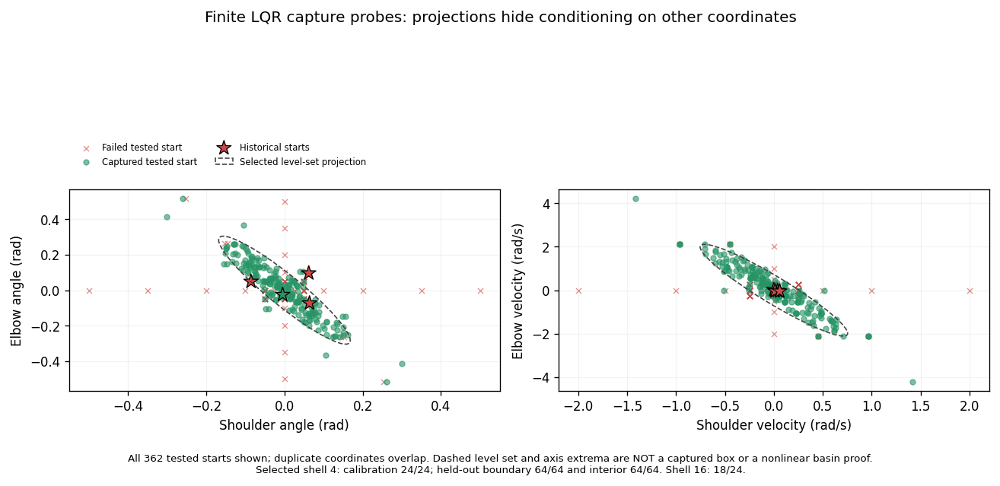

# Acrobot transient–join–attractor study

**The staged study closed at the teacher gate: adaptive-ESS MPPI held from 0/4 near-upright starts and reached the locked LQR join region from 0/2 hanging starts.** The local fixed-point controller was confirmed on 128/128 held-out local probes. Final saved review passed **79,612 checks**. Fresh teacher qualification was not triggered; no learning loop ran. Exact payloads, [complete accounting](complete_accounting.json) and a publication hash manifest accompany the result.

| Piece | Evidence currently preserved | Status |
|---|---|---|
| Period-one upright controller | [original native result](run/lqr/result.json), [original gains](run/lqr/lqr.json) | 362 finite native probes completed; original finalization failed and remains failed |
| Local join region | [separate recovery result](run/recovered-lqr/result.json), [authoritative locked gains and region](run/recovered-lqr/lqr.json), [verification](run/recovered-lqr/verification.json), [all probe rows](run/recovered-lqr/episodes.csv) | Saved recovery passed 10,703 checks, zero repeated physics |
| Cost-spread diagnosis | [20-bank temperature review](temperature_saved/report.md), [all banks](temperature_saved/banks.csv), [figure](temperature_saved/figure.png) | Fixed λ3 median ESS1.0058; existing adaptive helper reaches ESS32 |
| Adaptive-ESS near-upright controller | [Exact result](run/near/result.json) | 0/4 holds; ESS32 reached in every bank |
| Swing-up to the locked controller | [Exact result](run/swing-development/result.json) | 0/2 joins; both full 600-control failures retained |
| Fresh teacher qualification | [Stage closure](receipts/stage_closure.json) | Not triggered; zero paid qualification work |

The [complete episode table](episodes.csv), [planner-bank table](planner_banks.csv),
[compact independent audit](independent_audit_summary.json) and [saved report](saved_review_report.md)
cover all completed stages. Near-upright temperatures ranged from **34.61 to 156.86**;
swing-up temperatures ranged from **2.83 to 72.93**. Both achieved ESS32 to numerical
precision. The changed weights did not produce a successful teacher.

The two swing-up executions briefly reached **3.836 m and 3.902 m**, with longest
height intervals **0.12 s and 0.18 s**, yet neither entered the verified join level.
No LQR suffix was activated. This isolates the observed stage failure to reaching
the local attractor's entry region; it does not test learning or claim that the
hybrid would fail after a valid join.

The upright LQR controller captured **1/4 historical near-upright starts**. Its frozen shell procedure selected `rho = 0.11064310893419543` (four times the linear unsaturated level), followed by **128/128 held-out boundary/interior captures**. This is finite empirical evidence for a local join region, not a nonlinear invariant-set proof.

The level-set coordinate projections are ±0.16817 and ±0.30421 rad, and ±0.75407 and ±2.11314 rad/s. **These are projections of a correlated ellipsoid, not a jointly captured box or independent per-axis capture limits.** All single-shoulder-velocity marginal probes from ±0.05 rad/s upward failed; the complete marginal successes and failures are retained in [the descriptive summary](lqr_figures/summary.json). Raw angles remain raw in the evidence; the locked controller wraps local angle errors.

The [historical-start figure](lqr_figures/historical_lqr.png) and [PDF](lqr_figures/historical_lqr.pdf) show all four original starts, including saturation and the three failed captures. The preferred figures are saved-data rendering version002; the original001 files remain outside Git with hashes. Version002 displays physical actuator torque `2u` Nm; it changes no measurements or physics.

## Supported implementation and source identities

The [general formulation](../../docs/transient_attractor_formulation.md) maps the Walker machinery to transient, basin-entry join and locked fixed-point/periodic attractor. The native stage driver is [acrobot_attractor_study.py](../../src/gps/mppi_gps/acrobot_attractor_study.py); [controller orchestration](../../src/gps/mppi_gps/acrobot_attractor_controller.py) reuses stock MPPI, complete-context recording and the optional post-action stop hook. [The pure LQR module](../../src/gps/mppi_gps/attractor_lqr.py) supplies the period-one controller and explicit local-coordinate convention. These active files can subsequently change; the worker executed its own immutable source export.

Worker source is `a12b207924aec6215abf5577c47726b9a5dc1ba4`, configuration SHA `cadb5c1594d4a0977f03d8a0ee8979cd22dd98f6ec28e2ac9da886c006887405`. Its [source manifest](worker_source_manifest.json) and exact per-part inputs are retained. Saved-only recovery source is independently frozen under [recovery-support-source/](recovery-support-source/manifest.json), from the `d1b6b0d` support commit; it does not modify the scientific worker.

## Failure preservation and availability

The original native LQR stage tried to create `lqr.json` again at finalization, raising `FileExistsError` after all probes completed. Its original `STOPPED_INVALID_EXECUTION` result, early gain file, complete arrays and paid work remain unchanged. The separate `recovered-lqr` certificate derives the selected local controller from preserved outputs, rechecks source, costs, outcomes and accounting, and repeats no native physics. Both result scopes remain explicit.

The original native stage paid 181,000 executed controls and 49 verification controls, or **362,098 physics substeps**, with 26.1443 internally measured CPU seconds. The recovery cost 1.483945 complete child CPU seconds; both saved-data figure versions are separately charged. These are component costs; the final staged verdict is teacher-gate failure. All native and support costs are separated in [complete accounting](complete_accounting.json).

[Exact external locations, byte sizes, checksums and availability](external_evidence.json) keep bulk H5 arrays, full journals and small counterfactual arrays outside Git. Compact copied bytes are listed in [the preparation copy receipt](preparation_exact_copy_receipt.json). The temperature helper's inner output-manifest snapshot preceded final stdout closure; its [outer final manifest](temperature_saved/final_manifest.json) explicitly records that stdout-only change and binds the closed outputs. No numerical result or source changed.

The generic inspector's `run/{config,result,inputs,environment}.json` aliases are
byte-exact copies of the **last swing-development worker only**; they do not
represent total study work. Its `run/launch.json` is that worker's exact launch.
The original LQR failure, recovery, near-upright stage and all support costs remain
separate. Final review source is frozen under [full-review-source/](full-review-source/manifest.json)
(commit `b9fd7fbfa8422bbe78b85f27a1d80cc4c54cef07`); its full audit stays external.
The [closure copy receipt](closure_exact_copy_receipt.json) verifies the final exact copies.

The [paired controller figure](controller_comparison.png) and [PDF](controller_comparison.pdf) show every historical/new near-upright trace and both old/new energy transients. [Its summary](controller_comparison_summary.json) preserves minimum V/rho, physical outcomes, costs and the fact that no LQR suffix was activated. See the [main result](../../docs/acrobot_attractor_results.md) and [accounting appendix](../../docs/acrobot_attractor_accounting.md).
