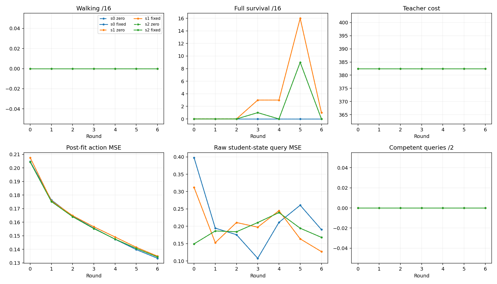

# Frozen six-round comparison: negative result

The alpha=.12 and alpha=0 arms completed all six rounds for all three paired
W2-u2000 lineages. All 72 acquisition solves retained the original competent
input tapes. Paired data, policy hashes, optimizer fingerprints and outcomes
matched at every round. Final walking was 0/16 on every primary and confirmation
panel. Temporary survival gains regressed at the frozen final endpoint.

Read the [interpreted result](../../docs/full_pi_alternating_results.md),
[pre-launch protocol](../../docs/full_pi_alternating_protocol.md) and
[preserved derivation](../../docs/full_pi_similarity_derivation.md).

This is an optimizer/manipulation failure under the frozen full-length PI
allocation. It does not establish a universal failure of action consistency,
the cause of execution failures, prospective teachability, or convergence.
No alternate score, architecture, coefficient schedule or follow-up was run.

## Complete evidence in this capsule

- [Every arm/round table and original angle atlas](report_001/report.md), with
  [machine-readable progression](report_001/summary.json).
- [Individual reset and query outcomes](rounds): all 42 baseline/round cells.
- [Original fitting records](fits): all 36 fits, losslessly gzipped, including
  all 9,000 new update-curve points.
- [Original scalar PI histories](searches): all acquisition and available
  diagnostic-query passes, losslessly gzipped. [Selections](selections) are
  declared scalar projections; full contexts stay in the external raw run.
- [Frozen independent numerical audit](audit_001/audit.json): 1,944,260 checks;
  [separate continuation audit](join_audit_001/audit.json): 698 checks. No fits
  were rerun. [Saved-prefix audit](accounting/prefix_audit_receipt.json) checked
  every acquisition prefix length without physics or inference.
- [Work rollup](accounting/accounting_rollup_receipt.json), including exact
  per-arm/round and shared-initialization counts; original worker and audit
  ledgers are lossless `.jsonl.gz` files. [Coordinator exits](run/coordinator_result.json),
  process receipts, implementation-check census and known/unknown overhead
  remain separate. An exact all-in engineering cost is not certified.
- [Raw inventory](external/raw_file_manifest.json), [availability](external/availability.json),
  [input bindings](run/input_manifest.json), [source bindings](run/source_manifest.json),
  and [launch binding](run/launch_receipt.json).

The scientific recipe/source was frozen at commit `627d4329fad537e32b4662e2cebaba3896d58d17`.
The additional audit/report readers were bound separately; their process receipts
identify the exact executed source hashes. Raw states, sampled banks, checkpoints,
weights, minibatch tapes and source archive remain local-only at the path in
availability.json. No remote raw backup is asserted. Non-sparse hypothetical
banks were not preserved and are not described as raw evidence.

## Angles, phases, and an explicit reporting erratum

The original report atlas compares the first fresh student episode to competent
source teachers from **different starts**. It is an unpaired illustration.
The [paired atlas](trace_report_001/gallery.md) compares query0 and actor paths
with exactly the same initial context, at every arm/round. Query curves are model
rollouts; actor curves are native execution. All 82 selected queries fell, so
they are not competent expert references. Paths end at their own falls, with no
time warping or filling missing motion. q0 is root pitch and q1–q6 are the six
joint angles, in radians.

The [block-objective plot](trace_report_001/block_objective.png) displays the
already selected C+alpha D on both teacher paths, before search, after search
and after fitting. It adds no new score. The trajectory block is flat; fitting
lowers the positive-alpha objective without producing walking.

The original `supplement.json` phase counts are exact, but its annotation calls
the first round0 reconstruction phase `initial`; the actual phase is
`load_parent`. The [erratum](accounting/report_annotation_erratum_receipt.json)
preserves that original annotation and explains the correction. A later
saved-only rollup initially failed on this assumption; its failure receipt and
source transcript are preserved. The corrected per-arm allocation reconciles
exactly to every original work counter. No scientific result was mutated or rerun.
The first publication-seal census also caught a filename filter that excluded
the nested original `run/seal_receipt.json`. That attempt and failure are
preserved under accounting; the final seal excludes only its two root-relative
paths. This was a publication-manifest error, outside scientific execution.

## Reproduction and verification scope

This capsule is a saved-result publication, not a new scientific launch request.
The original raw archive is needed for independent state/score replay. Existing
scripts provide create-only workers and separate audit/report commands; do not
rerun a scientific worker into the sealed run.

`origins.json` binds files copied by the collector and declares transformations.
Subsequent README/gallery/accounting source transcripts are covered by the final
`files_manifest.json`. `collection_manifest_v1.json` preserves the collector's
earlier manifest. The final manifest excludes only itself and `seal_receipt.json`;
the latter binds it, and Git binds the complete published capsule. Gzip decoding
must reproduce the original hashes listed in origins.json.

Full numerical audit is limited to preserved states/banks and the declared
native replay subset. It is a separate implementation/process check, not external
peer review, all-bank independent physics, or a certification of unrecorded
engineering labor, physical IO, money or energy. Held-out walking benefit,
equal-total-compute cloning/DAgger superiority and the eventual convergence/
ablation standard remain unestablished.
