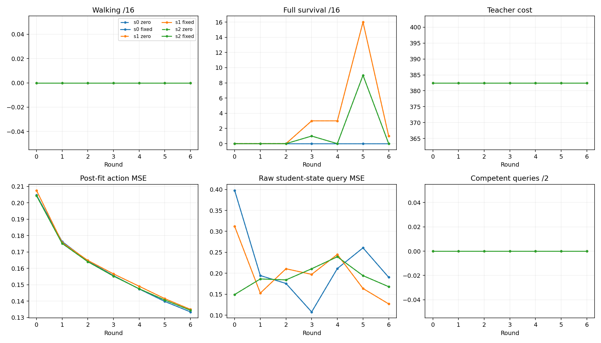

# Six-round full-trajectory PI comparison

Scientific completion: **True**. Independent audit passed: **True**.
Frozen walking-benefit criterion: **False**.

Of 72 acquisition solves, 0 changed the retained path by RMS≥1e-4; 0 also improved its fixed incoming-policy objective by≥1%.

| Stream | Round | Arm | Teacher walking /2 | Teacher cost | Reconstruction | Walking /16 | Survival /16 | Qualified queries | Raw query MSE |
|---|---:|---|---:|---:|---:|---:|---:|---:|---:|
|0|0|fixed|2|382.4918|0.204795|0|0|0/2|0.397768|
|0|0|zero|2|382.4918|0.204795|0|0|0/2|0.397768|
|0|1|fixed|2|382.4918|0.176396|0|0|0/2|0.194662|
|0|1|zero|2|382.4918|0.176396|0|0|0/2|0.194662|
|0|2|fixed|2|382.4918|0.164533|0|0|0/2|0.175776|
|0|2|zero|2|382.4918|0.164533|0|0|0/2|0.175776|
|0|3|fixed|2|382.4918|0.155607|0|0|0/2|0.107860|
|0|3|zero|2|382.4918|0.155607|0|0|0/2|0.107860|
|0|4|fixed|2|382.4918|0.147458|0|0|0/2|0.211305|
|0|4|zero|2|382.4918|0.147458|0|0|0/2|0.211305|
|0|5|fixed|2|382.4918|0.139817|0|0|0/2|0.260687|
|0|5|zero|2|382.4918|0.139817|0|0|0/2|0.260687|
|0|6|fixed|2|382.4918|0.133433|0|0|0/2|0.190520|
|0|6|zero|2|382.4918|0.133433|0|0|0/2|0.190520|
|1|0|fixed|2|382.4918|0.207613|0|0|0/2|0.312076|
|1|0|zero|2|382.4918|0.207613|0|0|0/2|0.312076|
|1|1|fixed|2|382.4918|0.175811|0|0|0/2|0.152772|
|1|1|zero|2|382.4918|0.175811|0|0|0/2|0.152772|
|1|2|fixed|2|382.4918|0.164881|0|0|0/2|0.210877|
|1|2|zero|2|382.4918|0.164881|0|0|0/2|0.210877|
|1|3|fixed|2|382.4918|0.156646|0|3|0/2|0.197423|
|1|3|zero|2|382.4918|0.156646|0|3|0/2|0.197423|
|1|4|fixed|2|382.4918|0.149112|0|3|0/2|0.244969|
|1|4|zero|2|382.4918|0.149112|0|3|0/2|0.244969|
|1|5|fixed|2|382.4918|0.141547|0|16|0/2|0.163804|
|1|5|zero|2|382.4918|0.141547|0|16|0/2|0.163804|
|1|6|fixed|2|382.4918|0.134981|0|1|0/2|0.127060|
|1|6|zero|2|382.4918|0.134981|0|1|0/2|0.127060|
|2|0|fixed|2|382.4918|0.204415|0|0|0/2|0.149359|
|2|0|zero|2|382.4918|0.204415|0|0|0/2|0.149359|
|2|1|fixed|2|382.4918|0.175230|0|0|0/2|0.186547|
|2|1|zero|2|382.4918|0.175230|0|0|0/2|0.186547|
|2|2|fixed|2|382.4918|0.164091|0|0|0/1|0.184248|
|2|2|zero|2|382.4918|0.164091|0|0|0/1|0.184248|
|2|3|fixed|2|382.4918|0.155302|0|1|0/2|0.210816|
|2|3|zero|2|382.4918|0.155302|0|1|0/2|0.210816|
|2|4|fixed|2|382.4918|0.147579|0|0|0/2|0.239420|
|2|4|zero|2|382.4918|0.147579|0|0|0/2|0.239420|
|2|5|fixed|2|382.4918|0.140693|0|9|0/2|0.194425|
|2|5|zero|2|382.4918|0.140693|0|9|0/2|0.194425|
|2|6|fixed|2|382.4918|0.134418|0|0|0/2|0.168096|
|2|6|zero|2|382.4918|0.134418|0|0|0/2|0.168096|

All raw/qualified query counts remain separate. Missing anchors are not zero errors.
The query is task-only, fixed-template, fixed-budget full PI; it is not an optimal expert.

## Joint-angle traces

- [Stream 0, fixed, round 0](angles_s0_fixed_r00.png)
- [Stream 0, fixed, round 1](angles_s0_fixed_r01.png)
- [Stream 0, fixed, round 2](angles_s0_fixed_r02.png)
- [Stream 0, fixed, round 3](angles_s0_fixed_r03.png)
- [Stream 0, fixed, round 4](angles_s0_fixed_r04.png)
- [Stream 0, fixed, round 5](angles_s0_fixed_r05.png)
- [Stream 0, fixed, round 6](angles_s0_fixed_r06.png)
- [Stream 0, zero, round 0](angles_s0_zero_r00.png)
- [Stream 0, zero, round 1](angles_s0_zero_r01.png)
- [Stream 0, zero, round 2](angles_s0_zero_r02.png)
- [Stream 0, zero, round 3](angles_s0_zero_r03.png)
- [Stream 0, zero, round 4](angles_s0_zero_r04.png)
- [Stream 0, zero, round 5](angles_s0_zero_r05.png)
- [Stream 0, zero, round 6](angles_s0_zero_r06.png)
- [Stream 1, fixed, round 0](angles_s1_fixed_r00.png)
- [Stream 1, fixed, round 1](angles_s1_fixed_r01.png)
- [Stream 1, fixed, round 2](angles_s1_fixed_r02.png)
- [Stream 1, fixed, round 3](angles_s1_fixed_r03.png)
- [Stream 1, fixed, round 4](angles_s1_fixed_r04.png)
- [Stream 1, fixed, round 5](angles_s1_fixed_r05.png)
- [Stream 1, fixed, round 6](angles_s1_fixed_r06.png)
- [Stream 1, zero, round 0](angles_s1_zero_r00.png)
- [Stream 1, zero, round 1](angles_s1_zero_r01.png)
- [Stream 1, zero, round 2](angles_s1_zero_r02.png)
- [Stream 1, zero, round 3](angles_s1_zero_r03.png)
- [Stream 1, zero, round 4](angles_s1_zero_r04.png)
- [Stream 1, zero, round 5](angles_s1_zero_r05.png)
- [Stream 1, zero, round 6](angles_s1_zero_r06.png)
- [Stream 2, fixed, round 0](angles_s2_fixed_r00.png)
- [Stream 2, fixed, round 1](angles_s2_fixed_r01.png)
- [Stream 2, fixed, round 2](angles_s2_fixed_r02.png)
- [Stream 2, fixed, round 3](angles_s2_fixed_r03.png)
- [Stream 2, fixed, round 4](angles_s2_fixed_r04.png)
- [Stream 2, fixed, round 5](angles_s2_fixed_r05.png)
- [Stream 2, fixed, round 6](angles_s2_fixed_r06.png)
- [Stream 2, zero, round 0](angles_s2_zero_r00.png)
- [Stream 2, zero, round 1](angles_s2_zero_r01.png)
- [Stream 2, zero, round 2](angles_s2_zero_r02.png)
- [Stream 2, zero, round 3](angles_s2_zero_r03.png)
- [Stream 2, zero, round 4](angles_s2_zero_r04.png)
- [Stream 2, zero, round 5](angles_s2_zero_r05.png)
- [Stream 2, zero, round 6](angles_s2_zero_r06.png)

## Limits

No first-round benefit gate was used. These six rounds do not establish asymptotic convergence, general teachability prediction, novelty or equal-compute superiority to cloning/DAgger. If retained plans barely change, the intended teacher adaptation was not established under this optimizer. Policy improvement on a stationary teacher bank is continued cloning, not evidence of beneficial coupling.

All scientific work counters are in summary.json; worker ledgers distinguish requested, completed and unknown work. Audit and engineering resources are separate. This report performs no inference, physics or fitting.
