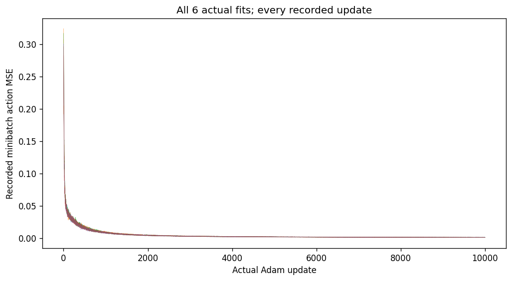
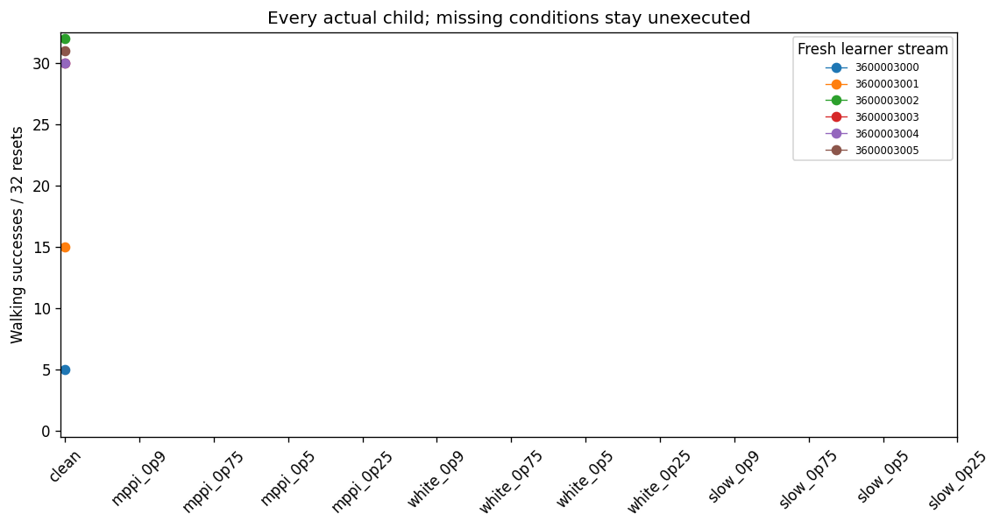
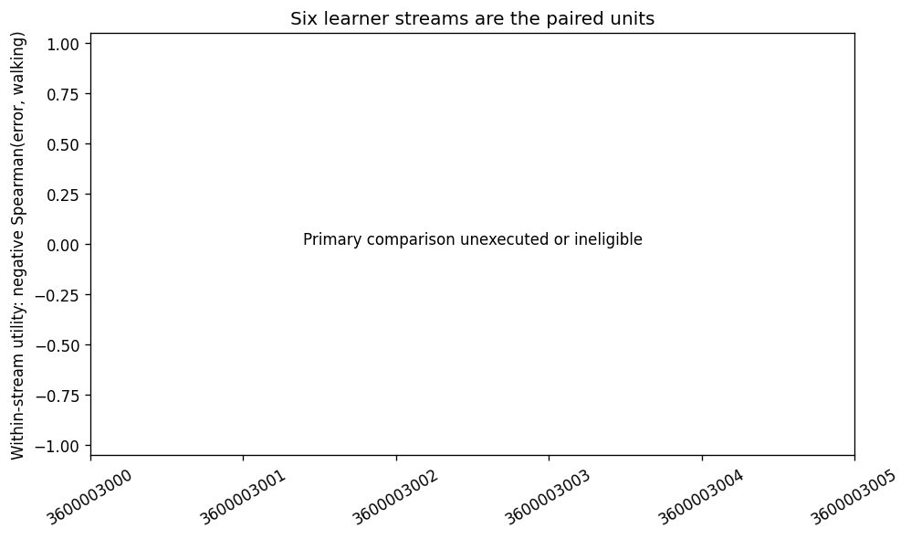

# J2.0 saved-evidence report

Worker status: `STOPPED_CLEAN_POSITIVE_CONTROL`. Independent audit passed.

Primary comparison was not executed after the declared qualification stop. Missing statistics remain missing.

Reference qualification walking per 16-reset panel:
`[16, 16]`.
Clean-child qualification:
`{"qualified": false, "walking": [5, 15, 32, 30, 30, 31]}`.

The 6 actual fits produced 143 walking successes and
143 full-survival episodes in 192
standalone attempts, with 151357 executed controls.
Native cost sums to 86999.02903, absorbing-tail cost to
203215, and complete cost to 290214.029.
These totals describe the actual roster; unexecuted conditions have no outcomes.

[Every case](cases.csv) separates walking, survival, observed duration, censoring,
native/terminal/tail costs, reconstruction, checkpoint identity and probe duration.
Full survivors are censored at eight seconds. Probe gaps pool actual unequal
pre-fall prefixes; duration/fall controls are secondary and do not change admission.

[Six grouped primary units](per_seed_primary.csv) copy the audited seed-level
utilities and secondary duration controls. Conditions and reset episodes are not
independent students. Any-walking AUC concerns at least one success, not competence.
The case table separately records the frozen 15/16-in-each-panel convention.

All 60000 curve points are preserved in [learning_curves.csv.gz](learning_curves.csv.gz),
including each complete original scalar record. The plotted minibatch losses are
fitting measurements, not held reconstruction or walking.

The primary score is measured after fitting on the exact evaluated checkpoint.
This result does not establish pre-update teachability, a better learning
mechanism, MPPI guidance or a closed loop. Before-update A/B/C are ungraded;
D/E remain explicitly inapplicable. No follow-up is authorized by this report.

[Cost accounting](cost.json) retains the worker and audit work separately from
this saved-only publication. No checkpoint, raw array, model or simulator was
loaded by the report. Final report I/O, wall time and source hashes are in
[receipt.json](receipt.json). A lossless compact mirror may supply `name.json.gz`
when `name.json` is absent; decoded bytes must retain the original audit hash.
