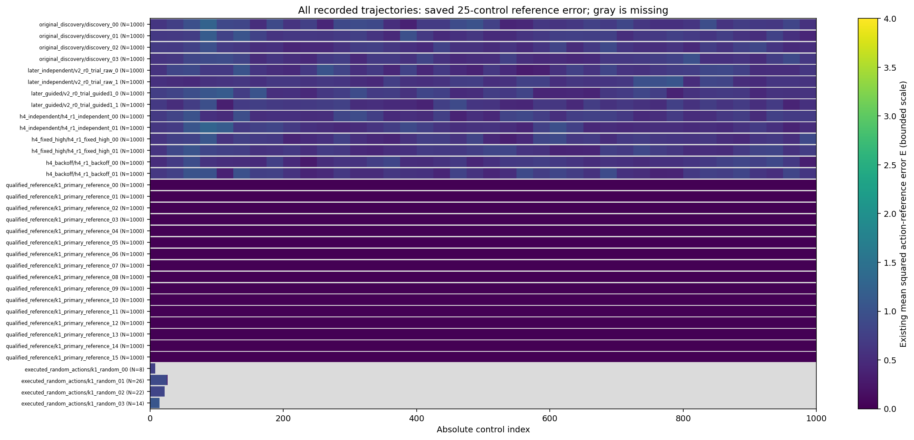
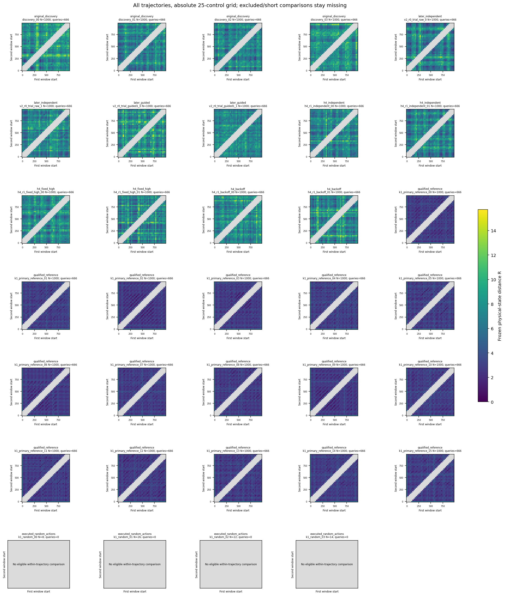
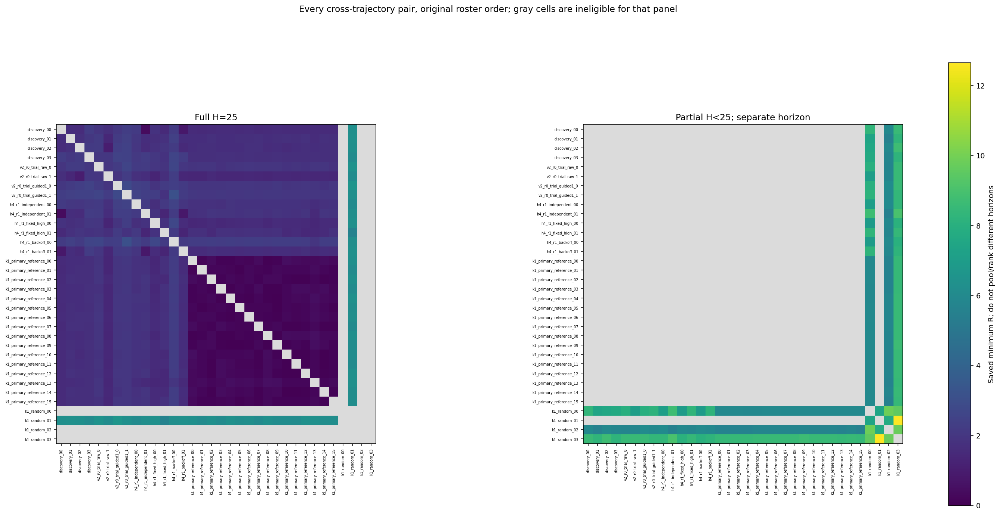
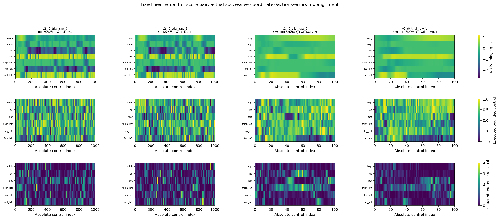

# K1.2 saved-motion diagnosis

Actual samples were rendered from the hash-bound compact raw archive.

Every original trajectory remains present, with source IDs, executed lengths and absolute control order. The full-motion atlas has one page per trajectory and shows all saved physical/action samples plus the first 100 controls. Its 30 available terminal states are physical observations only; no terminal actions or missing discovery endpoints are invented. Gray regions are unobserved, never zeros. Native qpos contains root displacement, height, pitch and six joint angles; nine velocities remain unclipped. No simulator, geometric stick model, phase alignment, FFT, new inference or learning is involved.

The derived atlas shows each saved 25-control mean and min/max band on its actual interval, including partial tails. These summaries do not recover the within-bin sequence or display terminal points. Full H=25 and shorter cross-pair windows are separate panels; every saved pair minimum and its state/action/error contributions remains in the CSV. Each minimum is a selected fragment: longer trajectories supply more candidate windows, and its query count remains explicit. Within-trajectory maps retain excluded cells and no-comparison trajectories as missing. Bins, frames, actuators and selected windows are not independent task replications. R is the frozen physical-state distance, not teachability or a newly selected policy ranking. Segment action MSE and own-state reference errors remain distinct.

The fixed later-independent pair is shown at its own recorded successive states without temporal warping. Similarity, recurrence and short matched windows do not establish gait phase, a stable limit cycle, consequential errors, recovery, competent student walking or useful coupling. Different successful/nonperiodic solutions remain valid. No new student execution is performed here.

[Full saved-motion atlas](full_motion_atlas.pdf) · [Derived block-summary atlas](derived_curve_atlas.pdf)

