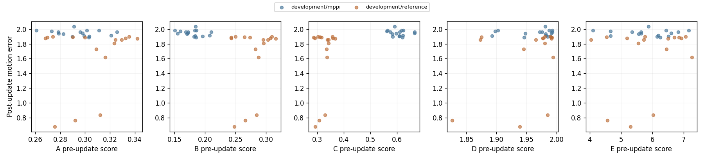
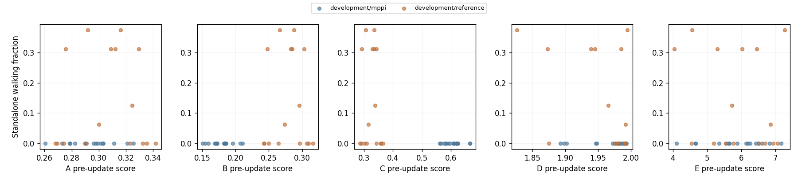
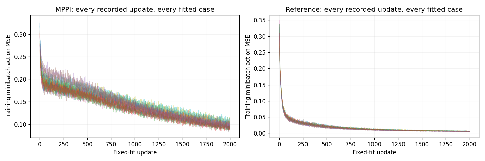

# J1.0: similarity before a fixed learning update

The joint predictive objective remains unmet in J1.0. Unidentified walking discrimination is not evidence that a distance predicts walking success. A motion-only result is partial.

This is a saved-only report. Walking, full survival, complete cost and same-start motion reproduction are separate outcomes. Competent walking with a different gait remains valid walking. A copied walking checkpoint is an execution control, not evidence of fresh-student learning.

The five candidates share measured learning outcomes and prediction-model capacity. Scores were intended to be sealed before learning. Only the independent audit can certify ordering, source joins and the full experiment; this reporter does not repeat those checks or fit a model.

Recorded status: CLOSED_DEVELOPMENT_VARIATION_INELIGIBLE. Independent audit: True; full scientific audit: True; association verified: True.

## Actual learning outcomes

| split | source | actual_groups | cases | completed_fits | standalone_episodes | standalone_walking | standalone_full_survival | reproduction_measured_cases | reproduced |
| --- | --- | --- | --- | --- | --- | --- | --- | --- | --- |
| development | mppi | 8 | 16 | 16 | 256 | 0 | 2 | 16 | 0 |
| development | reference | 8 | 16 | 16 | 256 | 35 | 38 | 16 | 0 |

Missing/unattempted outcomes remain missing. Full-window walking/reproduction gates cannot be replaced by prefix fit or survival. The report contains every recorded case and update, including ineligible sources and failed controls.

Teacher source outcomes are recorded independently in teachers.csv, including complete cost, walking and full survival. They are not child outcomes and are not multiplied into independent groups by learner replication.

## Five-score and rejected-candidate record

| candidate | definition | limitations |
| --- | --- | --- |
| A | mean six-torque squared residual on teacher states | Conditional torque agreement is not competence or learnability |
| B | fixed five-control causal box residual, valid controls only | Smoothing can remove consequential timing differences |
| C | development affine explained MSE plus twice residual MSE | C is a model-dependent proxy, not an identity metric; exact nonlinear copies can have positive explanatory residual. |
| D | same-start synchronized motion with explicit missing fraction | Incoming execution similarity may not predict a later fixed learning update |
| E | development-standardized joint occupancy SW2 plus explicit missing fraction | Joint occupancy intentionally discards temporal ordering |
| orthonormal_fourier_mse | Parseval alias of A | Parseval alias of A |
| action_law_to_point_w2 | Expected MSE alias | Expected MSE alias |
| explained_only | Ignores contradictory same-observation supervision | Ignores contradictory same-observation supervision |
| conditional_mean_lambda1 | With the true conditional mean, orthogonal decomposition equals expected MSE | With the true conditional mean, orthogonal decomposition equals expected MSE |

| candidate | status | motion_identified | walking_identified | motion_rmse | walking_brier | motion_simultaneous_lower | walking_simultaneous_lower | passed |
| --- | --- | --- | --- | --- | --- | --- | --- | --- |
| A | baseline | missing | missing | missing | missing | missing | missing | missing |
| B | untested_or_unidentified | missing | missing | missing | missing | missing | missing | missing |
| C | untested_or_unidentified | missing | missing | missing | missing | missing | missing | missing |
| D | untested_or_unidentified | missing | missing | missing | missing | missing | missing | missing |
| E | untested_or_unidentified | missing | missing | missing | missing | missing | missing | missing |
| orthonormal_fourier_mse | rejected_calibration_or_algebraic_alias | missing | missing | missing | missing | missing | missing | missing |
| action_law_to_point_w2 | rejected_calibration_or_algebraic_alias | missing | missing | missing | missing | missing | missing | missing |
| explained_only | rejected_calibration_or_algebraic_alias | missing | missing | missing | missing | missing | missing | missing |
| conditional_mean_lambda1 | rejected_calibration_or_algebraic_alias | missing | missing | missing | missing | missing | missing | missing |

Definitions, calibrations, limitations, largest protected prediction errors and costs are preserved together in score_table.csv. score_outcome_pairs.csv keeps all available pre-score/post-outcome joins. Unidentified numeric errors are descriptive, not a predictive certificate. Bootstrap uncertainty is the saved paired-group procedure, not a new fit or resampling here.

Frozen predictive thresholds, observed eligibility/variation gates, bootstrap bounds, calibration results and the within-MPPI probe summary are preserved verbatim in [saved_measurements.json](saved_measurements.json). No score is selected by an expected oracle ranking, and no new calibration or bootstrap is run here.

Frozen prediction gates: `{"bootstrap_repetitions": 9999, "bootstrap_seed": 2026129802, "development_iterations": 1, "max_iterations": 100, "min_motion_RMSE_relative_improvement": 0.1, "min_walking_Brier_absolute_improvement": 0.02, "min_walking_Brier_relative_improvement": 0.1, "minimum_motion_std": 0.1, "minimum_positive_MPPI_cases": 4, "minimum_positive_groups": 3, "minimum_source_groups": 8, "minimum_zero_MPPI_cases": 4, "motion_prediction_clip": [0, 3], "primary_source": "mppi", "ridge": 1.0, "simultaneous_confidence": 0.95, "tolerance": 1e-10}`

## Visual evidence

Learning curves show all stochastic training minibatch measurements; they are not full-corpus reconstruction or standalone competence measurements.

Atlas: [Synchronized actual motion/contact/control/video atlas](../render_002/result/index.html)

## Costs and limits

The receipt preserves worker, audit and rendering accounting separately. Planning simulations are included in the worker census. Nested wall/CPU measures are not additive; rendering/engineering do not become free planning. Missing cost fields remain missing.

Scientific worker work census: `{"completed": {"backward_rows": 16384000, "checkpoint_loads": 1, "contact_force_queries": 159155, "contact_measurements": 161759, "environment_constructions": 1, "external_mj_forward_calls": 1508, "fits": 32, "live_queries": 161551, "model_controls": 101746176, "model_queries": 24632, "native_controls": 161551, "neural_rows": 16553551, "optimizer_constructions": 48, "optimizer_steps": 64000, "physics_substeps": 407630908, "policy_constructions": 48, "prediction_calls": 201583, "resets": 528, "restores": 272, "snapshot_reads": 162531}, "requested": {"backward_rows": 16384000, "checkpoint_loads": 1, "contact_force_queries": 159155, "contact_measurements": 161759, "environment_constructions": 1, "external_mj_forward_calls": 1508, "fits": 32, "live_queries": 161551, "model_controls": 101746176, "model_queries": 24632, "native_controls": 161551, "neural_rows": 16553551, "optimizer_constructions": 48, "optimizer_steps": 64000, "physics_substeps": 407630908, "policy_constructions": 48, "prediction_calls": 201583, "resets": 528, "restores": 272, "snapshot_reads": 162531}, "returned_unpersisted": {}, "storage": {"array_format": "walker-array-stream-v1", "backward_rows": 16384000, "completed_backward_rows": 16384000, "completed_controls": 101907727, "completed_live_controls": 161551, "completed_model_controls": 101746176, "completed_neural_rows": 16553551, "completed_optimizer_steps": 64000, "completed_physics_substeps": 407630908, "emergency_reserved_bytes": 16384, "episodes": 0, "evidence_poisoned": false, "failed_measurements": 0, "failed_queries": 0, "live_queries": 161551, "measurement_requests": 0, "model_queries": 24632, "neural_rows": 16553551, "optimizer_steps": 64000, "physics_frames": 407630908, "queries": 186183, "rejected_measurements": 0, "rejected_queries": 0, "requested_backward_rows": 16384000, "requested_controls": 101907727, "requested_live_controls": 161551, "requested_model_controls": 101746176, "requested_neural_rows": 16553551, "requested_optimizer_steps": 64000, "requested_physics_substeps": 407630908, "reserved_external_bytes": 536870912, "reset_errors": 0, "resets": 528, "restores": 272, "snapshots": 162531, "storage_bytes": 2333136321, "storage_limit_bytes": 6979321856, "unknown_partial_backward_rows": 0, "unknown_partial_controls": 0, "unknown_partial_model_controls": 0, "unknown_partial_neural_rows": 0, "unknown_partial_optimizer_steps": 0, "unknown_partial_physics_substeps": 0, "wall_seconds": 3016.2271090739996}, "unknown_partial": {}}`

No in-MPPI similarity guidance comparison or follow-up is launched by this report. Only a separately reviewed, frozen protocol may test whether a passing score improves a next standalone student while protecting competent independent discovery.
