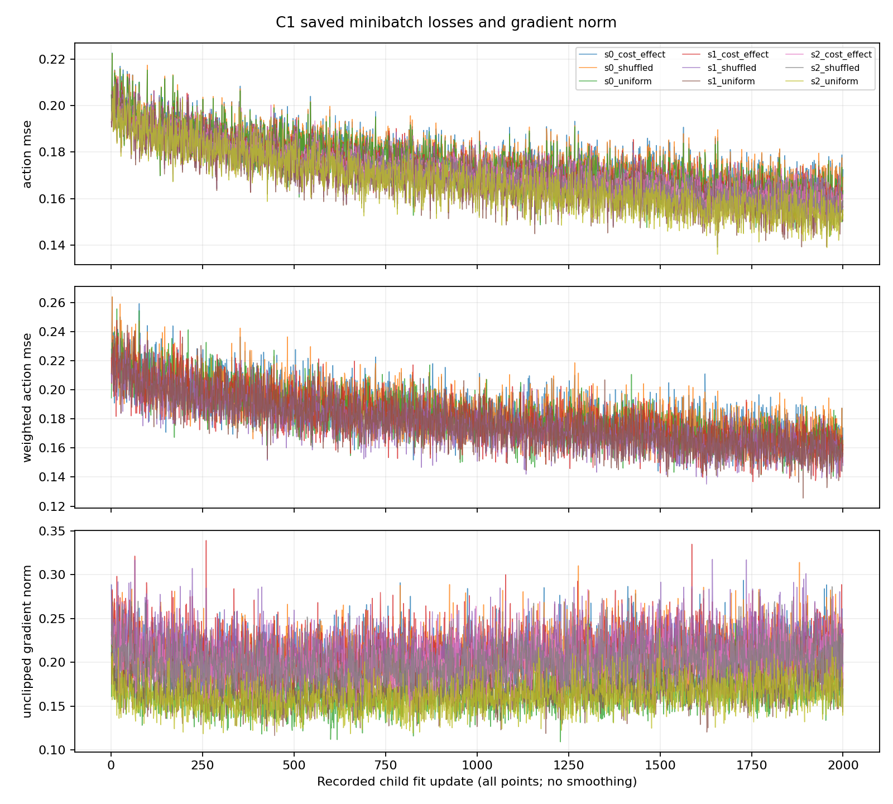
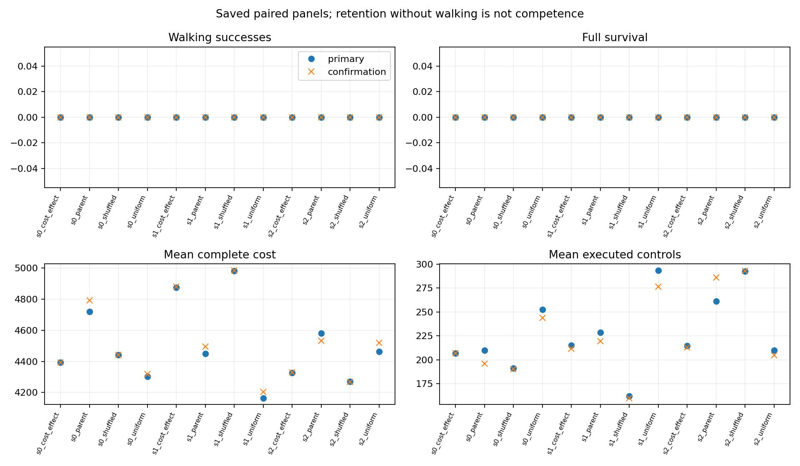

# C1.0: cost-effect-weighted fitting

Status: `COMPLETED_FIXED_C1_ROSTER`. Saved scientific audit receipt bound: **True**.

AUDIT_COORDINATOR_FAILED; outer closure incomplete; saved scientific receipt reports passing checks. The original audit exit receipt is missing and the child exit code is unknown. This is not a completed overall audit or an admitted benefit claim. Recorded outcomes and the original scientific receipt are preserved separately.

Overall audit closure passed: **False**. Saved scientific checks and failed coordinator closure are distinct.


| passed | full_scientific_audit_passed | scientific_contrast_completed | scientific_status |
| --- | --- | --- | --- |
| True | True | True | completed_fixed_roster |


## Teacher replay

| tag | walking | survived | controls | cost | raw_cost | native_terminal | absorbing_cost |
| --- | --- | --- | --- | --- | --- | --- | --- |
| baseline_teacher_s0_independent_00 | True | True | 1000 | 353.5363530342355 | 353.5363530342355 | 0.0 | 0.0 |
| baseline_teacher_s0_independent_01 | True | True | 1000 | 361.6763650692577 | 361.6763650692577 | 0.0 | 0.0 |
| baseline_teacher_s0_independent_02 | True | True | 1000 | 357.6175668105228 | 357.6175668105228 | 0.0 | 0.0 |
| baseline_teacher_s0_independent_03 | True | True | 1000 | 366.08546009420877 | 366.08546009420877 | 0.0 | 0.0 |
| baseline_teacher_s1_independent_00 | True | True | 1000 | 362.0190144749737 | 362.0190144749737 | 0.0 | 0.0 |
| baseline_teacher_s1_independent_01 | True | True | 1000 | 376.03627487090444 | 376.03627487090444 | 0.0 | 0.0 |
| baseline_teacher_s1_independent_02 | True | True | 1000 | 389.9281137563751 | 389.9281137563751 | 0.0 | 0.0 |
| baseline_teacher_s1_independent_03 | True | True | 1000 | 369.1877639331241 | 369.1877639331241 | 0.0 | 0.0 |
| baseline_teacher_s2_independent_00 | True | True | 1000 | 358.0111614300241 | 358.0111614300241 | 0.0 | 0.0 |
| baseline_teacher_s2_independent_01 | True | True | 1000 | 343.8443743496991 | 343.8443743496991 | 0.0 | 0.0 |
| baseline_teacher_s2_independent_02 | True | True | 1000 | 370.8569336686098 | 370.8569336686098 | 0.0 | 0.0 |
| baseline_teacher_s2_independent_03 | True | True | 1000 | 366.16056267684246 | 366.16056267684246 | 0.0 | 0.0 |


## Standalone students

Walking and full survival are separate. Individual competence requires at least 15/16 walking on both fresh panels; survival alone is retention. Source-context results use previously observed teacher resets; primary and confirmation use fresh paired resets. No returning to one reference path is required.

| panel | actor | episodes | walking_successes | full_survivals | mean_cost | controls | roster_status |
| --- | --- | --- | --- | --- | --- | --- | --- |
| primary | s0_parent | 16 | 0 | 0 | 4720.170643353033 | 3360 | fixed_roster_complete |
| primary | s0_uniform | 16 | 0 | 0 | 4302.255425529196 | 4037 | fixed_roster_complete |
| primary | s0_cost_effect | 16 | 0 | 0 | 4394.151033051377 | 3307 | fixed_roster_complete |
| primary | s0_shuffled | 16 | 0 | 0 | 4441.149583212891 | 3057 | fixed_roster_complete |
| primary | s1_parent | 16 | 0 | 0 | 4449.164495537563 | 3655 | fixed_roster_complete |
| primary | s1_uniform | 16 | 0 | 0 | 4163.6075468690615 | 4696 | fixed_roster_complete |
| primary | s1_cost_effect | 16 | 0 | 0 | 4874.887332304104 | 3439 | fixed_roster_complete |
| primary | s1_shuffled | 16 | 0 | 0 | 4982.758013425268 | 2591 | fixed_roster_complete |
| primary | s2_parent | 16 | 0 | 0 | 4581.956274193451 | 4178 | fixed_roster_complete |
| primary | s2_uniform | 16 | 0 | 0 | 4464.47038079886 | 3356 | fixed_roster_complete |
| primary | s2_cost_effect | 16 | 0 | 0 | 4327.519560857052 | 3432 | fixed_roster_complete |
| primary | s2_shuffled | 16 | 0 | 0 | 4270.982320365267 | 4677 | fixed_roster_complete |
| confirmation | s0_parent | 16 | 0 | 0 | 4791.579965118106 | 3135 | fixed_roster_complete |
| confirmation | s0_uniform | 16 | 0 | 0 | 4319.439880610476 | 3902 | fixed_roster_complete |
| confirmation | s0_cost_effect | 16 | 0 | 0 | 4394.154375024442 | 3307 | fixed_roster_complete |
| confirmation | s0_shuffled | 16 | 0 | 0 | 4442.827862613 | 3043 | fixed_roster_complete |
| confirmation | s1_parent | 16 | 0 | 0 | 4494.455271356717 | 3513 | fixed_roster_complete |
| confirmation | s1_uniform | 16 | 0 | 0 | 4202.73425229573 | 4424 | fixed_roster_complete |
| confirmation | s1_cost_effect | 16 | 0 | 0 | 4879.718494796854 | 3388 | fixed_roster_complete |
| confirmation | s1_shuffled | 16 | 0 | 0 | 4986.043452434739 | 2557 | fixed_roster_complete |
| confirmation | s2_parent | 16 | 0 | 0 | 4533.129196315716 | 4575 | fixed_roster_complete |
| confirmation | s2_uniform | 16 | 0 | 0 | 4518.732738347206 | 3274 | fixed_roster_complete |
| confirmation | s2_cost_effect | 16 | 0 | 0 | 4330.919499504056 | 3407 | fixed_roster_complete |
| confirmation | s2_shuffled | 16 | 0 | 0 | 4268.896008015137 | 4688 | fixed_roster_complete |
| source | s0_parent | 4 | 0 | 0 | 4775.821417086416 | 814 | fixed_roster_complete |
| source | s0_uniform | 4 | 0 | 0 | 4318.215157648736 | 978 | fixed_roster_complete |
| source | s0_cost_effect | 4 | 0 | 0 | 4400.058578975409 | 816 | fixed_roster_complete |
| source | s0_shuffled | 4 | 0 | 0 | 4442.644626132234 | 761 | fixed_roster_complete |
| source | s1_parent | 4 | 0 | 0 | 4483.13808064204 | 955 | fixed_roster_complete |
| source | s1_uniform | 4 | 0 | 0 | 4257.503892867762 | 1000 | fixed_roster_complete |
| source | s1_cost_effect | 4 | 0 | 0 | 4899.103163580738 | 806 | fixed_roster_complete |
| source | s1_shuffled | 4 | 0 | 0 | 4989.178919160451 | 631 | fixed_roster_complete |
| source | s2_parent | 4 | 0 | 0 | 4394.139136616708 | 1295 | fixed_roster_complete |
| source | s2_uniform | 4 | 0 | 0 | 4601.989983341517 | 773 | fixed_roster_complete |
| source | s2_cost_effect | 4 | 0 | 0 | 4354.459095065731 | 807 | fixed_roster_complete |
| source | s2_shuffled | 4 | 0 | 0 | 4268.6393814764715 | 1172 | fixed_roster_complete |


## Fitting and held trajectories

Ordinary action MSE is distinct from weighted training loss. Every saved JSON curve point is retained without smoothing in curves.csv; no missing point is fabricated. Raw-only curve prefixes require a separately audited scalar extract; this renderer never decodes their arrays.

| actor | dataset | rows | action_mse | weighted_action_mse | batch_size |
| --- | --- | --- | --- | --- | --- |
| s0_parent | own_corpus | missing | 0.20545558330174632 | 0.2267408944616042 | missing |
| s0_parent | train | missing | 0.16789552209896935 | missing | missing |
| s0_parent | validation | missing | 0.19899855302476793 | missing | missing |
| s0_uniform | own_corpus | 4000 | 0.1609833875957078 | 0.17489790694497756 | 1000 |
| s0_uniform | train | 4000 | 0.1990475923342658 | missing | 1024 |
| s0_uniform | validation | 2000 | 0.20237757160017342 | missing | 1024 |
| s0_cost_effect | own_corpus | 4000 | 0.1658723696753994 | 0.1682132738920971 | 1000 |
| s0_cost_effect | train | 4000 | 0.20480140969621669 | missing | 1024 |
| s0_cost_effect | validation | 2000 | 0.20675749132996044 | missing | 1024 |
| s0_shuffled | own_corpus | 4000 | 0.1655086379858565 | 0.1757639727994519 | 1000 |
| s0_shuffled | train | 4000 | 0.20440782798083038 | missing | 1024 |
| s0_shuffled | validation | 2000 | 0.20838257378410435 | missing | 1024 |
| s1_parent | own_corpus | missing | 0.20256610368382372 | 0.22673763721209045 | missing |
| s1_parent | train | missing | 0.168076163890597 | missing | missing |
| s1_parent | validation | missing | 0.19769326529350975 | missing | missing |
| s1_uniform | own_corpus | 4000 | 0.15342856850790956 | 0.1696347484644989 | 1000 |
| s1_uniform | train | 4000 | 0.19706139277036536 | missing | 1024 |
| s1_uniform | validation | 2000 | 0.20005329053187873 | missing | 1024 |
| s1_cost_effect | own_corpus | 4000 | 0.15859914993902266 | 0.16084711429236043 | 1000 |
| s1_cost_effect | train | 4000 | 0.20363421503386853 | missing | 1024 |
| s1_cost_effect | validation | 2000 | 0.2075541956144941 | missing | 1024 |
| s1_shuffled | own_corpus | 4000 | 0.1575083820294577 | 0.1699545707233929 | 1000 |
| s1_shuffled | train | 4000 | 0.20423566889646746 | missing | 1024 |
| s1_shuffled | validation | 2000 | 0.20427941745565023 | missing | 1024 |
| s2_parent | own_corpus | missing | 0.20124330783701253 | 0.22080031006659145 | missing |
| s2_parent | train | missing | 0.16990548447830697 | missing | missing |
| s2_parent | validation | missing | 0.19634369912478145 | missing | missing |
| s2_uniform | own_corpus | 4000 | 0.15133195562601265 | 0.16359784262844804 | 1000 |
| s2_uniform | train | 4000 | 0.20022492288419771 | missing | 1024 |
| s2_uniform | validation | 2000 | 0.20501616842266765 | missing | 1024 |
| s2_cost_effect | own_corpus | 4000 | 0.15729762526286495 | 0.15700076692359263 | 1000 |
| s2_cost_effect | train | 4000 | 0.20697879067083352 | missing | 1024 |
| s2_cost_effect | validation | 2000 | 0.21151036517859342 | missing | 1024 |
| s2_shuffled | own_corpus | 4000 | 0.15577337657977708 | 0.1642407274773984 | 1000 |
| s2_shuffled | train | 4000 | 0.20789425051344293 | missing | 1024 |
| s2_shuffled | validation | 2000 | 0.2125739896157323 | missing | 1024 |


Recorded learning points: **18000**. Recorded standalone episode rows: **432**.

## Gates and paired gaps

Saved gates (not reselected by this renderer):

```json

{
  "primary": {
    "passed": false,
    "qualifying_streams": [],
    "regressions": []
  },
  "confirmation": {
    "passed": false,
    "qualifying_streams": [],
    "regressions": []
  },
  "confirmed": false,
  "confirmed_streams": [],
  "uniform_parent_primary": {
    "passed": false,
    "qualifying_streams": [],
    "regressions": []
  },
  "uniform_parent_confirmation": {
    "passed": false,
    "qualifying_streams": [],
    "regressions": []
  },
  "uniform_parent_confirmed": false,
  "uniform_parent_confirmed_streams": [],
  "individual_competence": {
    "0": {
      "parent": false,
      "uniform": false,
      "cost_effect": false,
      "shuffled": false
    },
    "1": {
      "parent": false,
      "uniform": false,
      "cost_effect": false,
      "shuffled": false
    },
    "2": {
      "parent": false,
      "uniform": false,
      "cost_effect": false,
      "shuffled": false
    }
  }
}

```

Contrast gate:

```json

{
  "passed": true,
  "reasons": [],
  "redraw_allowed": false
}

```

Teacher–student gaps below are only from matched source starting contexts; they are not a fresh generalization panel.

| actor | source_tag | teacher_cost | student_cost | cost_gap | teacher_walking | student_walking | teacher_survived | student_survived |
| --- | --- | --- | --- | --- | --- | --- | --- | --- |
| s0_parent | teacher_s0_independent_00 | 353.5363530342355 | 4790.226741109629 | 4436.6903880753935 | True | False | True | False |
| s0_parent | teacher_s0_independent_01 | 361.6763650692577 | 4722.860230211862 | 4361.183865142604 | True | False | True | False |
| s0_parent | teacher_s0_independent_02 | 357.6175668105228 | 4758.269730435167 | 4400.652163624644 | True | False | True | False |
| s0_parent | teacher_s0_independent_03 | 366.08546009420877 | 4831.928966589005 | 4465.843506494796 | True | False | True | False |
| s0_uniform | teacher_s0_independent_00 | 353.5363530342355 | 4321.018522158697 | 3967.4821691244615 | True | False | True | False |
| s0_uniform | teacher_s0_independent_01 | 361.6763650692577 | 4303.004454211401 | 3941.328089142143 | True | False | True | False |
| s0_uniform | teacher_s0_independent_02 | 357.6175668105228 | 4322.054602843636 | 3964.4370360331127 | True | False | True | False |
| s0_uniform | teacher_s0_independent_03 | 366.08546009420877 | 4326.783051381208 | 3960.697591286999 | True | False | True | False |
| s0_cost_effect | teacher_s0_independent_00 | 353.5363530342355 | 4396.250219786655 | 4042.7138667524196 | True | False | True | False |
| s0_cost_effect | teacher_s0_independent_01 | 361.6763650692577 | 4414.017531445141 | 4052.341166375883 | True | False | True | False |
| s0_cost_effect | teacher_s0_independent_02 | 357.6175668105228 | 4402.653874327522 | 4045.0363075169994 | True | False | True | False |
| s0_cost_effect | teacher_s0_independent_03 | 366.08546009420877 | 4387.312690342315 | 4021.2272302481065 | True | False | True | False |
| s0_shuffled | teacher_s0_independent_00 | 353.5363530342355 | 4443.271840053635 | 4089.7354870193994 | True | False | True | False |
| s0_shuffled | teacher_s0_independent_01 | 361.6763650692577 | 4440.871490689506 | 4079.195125620248 | True | False | True | False |
| s0_shuffled | teacher_s0_independent_02 | 357.6175668105228 | 4446.362493778845 | 4088.7449269683225 | True | False | True | False |
| s0_shuffled | teacher_s0_independent_03 | 366.08546009420877 | 4440.072680006953 | 4073.9872199127444 | True | False | True | False |
| s1_parent | teacher_s1_independent_00 | 362.0190144749737 | 4176.833816797458 | 3814.8148023224844 | True | False | True | False |
| s1_parent | teacher_s1_independent_01 | 376.03627487090444 | 4832.4747723332 | 4456.438497462295 | True | False | True | False |
| s1_parent | teacher_s1_independent_02 | 389.9281137563751 | 4449.564614696888 | 4059.636500940513 | True | False | True | False |
| s1_parent | teacher_s1_independent_03 | 369.1877639331241 | 4473.679118740615 | 4104.491354807491 | True | False | True | False |
| s1_uniform | teacher_s1_independent_00 | 362.0190144749737 | 4242.980786382499 | 3880.9617719075254 | True | False | True | False |
| s1_uniform | teacher_s1_independent_01 | 376.03627487090444 | 4313.23145500986 | 3937.1951801389555 | True | False | True | False |
| s1_uniform | teacher_s1_independent_02 | 389.9281137563751 | 4150.948144740953 | 3761.0200309845773 | True | False | True | False |
| s1_uniform | teacher_s1_independent_03 | 369.1877639331241 | 4322.855185337738 | 3953.6674214046134 | True | False | True | False |
| s1_cost_effect | teacher_s1_independent_00 | 362.0190144749737 | 4907.041812708755 | 4545.022798233781 | True | False | True | False |
| s1_cost_effect | teacher_s1_independent_01 | 376.03627487090444 | 4916.477400218848 | 4540.441125347943 | True | False | True | False |
| s1_cost_effect | teacher_s1_independent_02 | 389.9281137563751 | 4866.597127954446 | 4476.669014198071 | True | False | True | False |
| s1_cost_effect | teacher_s1_independent_03 | 369.1877639331241 | 4906.296313440901 | 4537.108549507777 | True | False | True | False |
| s1_shuffled | teacher_s1_independent_00 | 362.0190144749737 | 4992.075994769312 | 4630.056980294338 | True | False | True | False |
| s1_shuffled | teacher_s1_independent_01 | 376.03627487090444 | 4989.847845701336 | 4613.811570830432 | True | False | True | False |
| s1_shuffled | teacher_s1_independent_02 | 389.9281137563751 | 4985.029100167685 | 4595.10098641131 | True | False | True | False |
| s1_shuffled | teacher_s1_independent_03 | 369.1877639331241 | 4989.762736003471 | 4620.574972070347 | True | False | True | False |
| s2_parent | teacher_s2_independent_00 | 358.0111614300241 | 4700.706433006157 | 4342.695271576133 | True | False | True | False |
| s2_parent | teacher_s2_independent_01 | 343.8443743496991 | 4845.124458452605 | 4501.280084102906 | True | False | True | False |
| s2_parent | teacher_s2_independent_02 | 370.8569336686098 | 4119.023622641741 | 3748.1666889731314 | True | False | True | False |
| s2_parent | teacher_s2_independent_03 | 366.16056267684246 | 3911.702032366331 | 3545.5414696894886 | True | False | True | False |
| s2_uniform | teacher_s2_independent_00 | 358.0111614300241 | 4845.227352725709 | 4487.216191295685 | True | False | True | False |
| s2_uniform | teacher_s2_independent_01 | 343.8443743496991 | 4324.234942543636 | 3980.390568193937 | True | False | True | False |
| s2_uniform | teacher_s2_independent_02 | 370.8569336686098 | 4432.484400963297 | 4061.6274672946874 | True | False | True | False |
| s2_uniform | teacher_s2_independent_03 | 366.16056267684246 | 4806.01323713342 | 4439.852674456578 | True | False | True | False |
| s2_cost_effect | teacher_s2_independent_00 | 358.0111614300241 | 4347.852155564304 | 3989.8409941342798 | True | False | True | False |
| s2_cost_effect | teacher_s2_independent_01 | 343.8443743496991 | 4329.939105059462 | 3986.094730709763 | True | False | True | False |
| s2_cost_effect | teacher_s2_independent_02 | 370.8569336686098 | 4373.304121061975 | 4002.4471873933653 | True | False | True | False |
| s2_cost_effect | teacher_s2_independent_03 | 366.16056267684246 | 4366.7409985771865 | 4000.580435900344 | True | False | True | False |
| s2_shuffled | teacher_s2_independent_00 | 358.0111614300241 | 4118.372884667133 | 3760.361723237109 | True | False | True | False |
| s2_shuffled | teacher_s2_independent_01 | 343.8443743496991 | 4722.1796024446085 | 4378.335228094909 | True | False | True | False |
| s2_shuffled | teacher_s2_independent_02 | 370.8569336686098 | 4191.05913445362 | 3820.20220078501 | True | False | True | False |
| s2_shuffled | teacher_s2_independent_03 | 366.16056267684246 | 4042.945904340525 | 3676.7853416636826 | True | False | True | False |


## Accounting and evidence

Complete saved requested/completed/unknown-partial work, worker process metadata, preparation and audit scope are preserved in costs.json. Budget ceilings are not charges for completed work.

Host: `robopil5090`. New raw arrays/index/ledger and child checkpoints remain under `/home/jaisel/mppi-gps-workspace/runs/2026-11-02_student_consequence_c1_001/worker/`; incoming parents and inputs under `/home/jaisel/mppi-gps-workspace/runs/2026-11-02_student_consequence_c1_001/prepared/`. Inherited source evidence: `/home/jaisel/mppi-gps-workspace/runs/2026-11-01_teacher_proposal_h5_0_r1_001`. This renderer never opens them.

Fixed-tape effects are not feedback Q, recovery, intrinsic importance or a proof of teachability. This learner diagnostic does not establish MPPI–policy coupling or a CIO–GPS reproduction.




