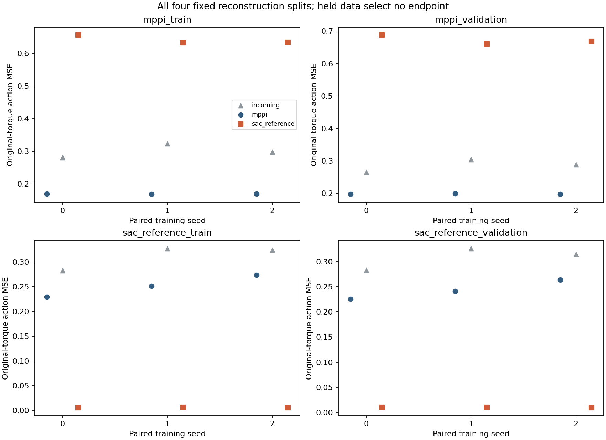
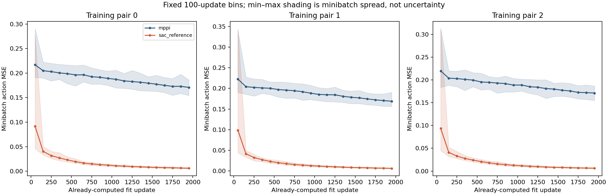
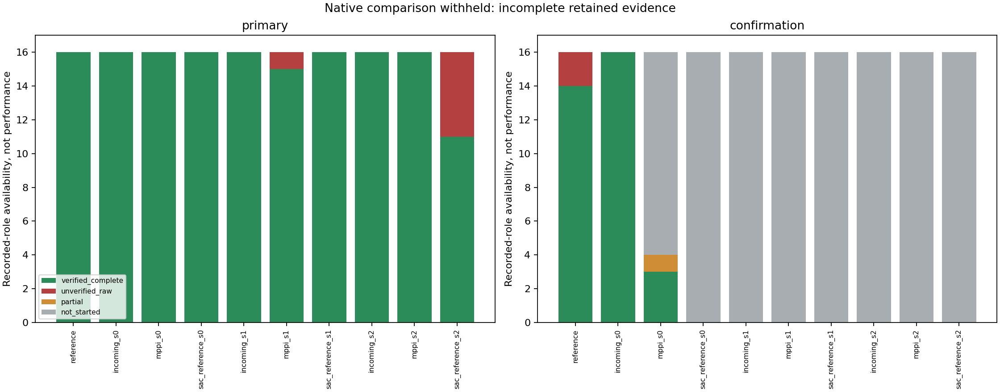
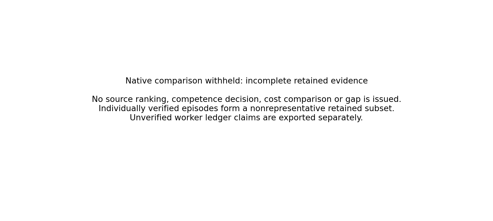

# S1 forensic display: interrupted experiment, failed native-evidence audit

**The scientific integrity audit remains FAILED. This explicit forensic display does not accept the run, complete its comparison or change the failed summary/receipt.** The original evaluation result and owner exit remain absent. No retry or later learning intervention is launched.

Individually verified native outcomes: **187**, a nonrepresentative retained subset. Unverified ledger episode claims: **8**. Partial attempts: **1**. Worker actor-panel claims: **12**.

## Closed fitting remains available

All six original fixed-budget source fits, their ownership receipts, four-split reconstruction metrics and loss curves remain separate from the native HDF5 loss. Both arms use matched fresh 128-tanh initializations, common W2 normalization, paired indices and exactly 2,000 updates. Changing the demonstrated corpus jointly changes states, gaits and labels; lower reconstruction is not evidence of walking or a property such as multimodality being isolated.

`fitting.csv`, `trajectories.csv`, `actuator_errors.csv`, `reconstruction_control_bins.csv` and `learning_bins.csv` retain these fitting measurements. CUDA batched reconstruction and CPU batch-one deployment differ as frozen; no extra CPU reconstruction forwards were performed. Full per-update curve hashes remain bound in `learning_bins_manifest.json`.

This render reads the original hash-bound fit curves; it performs no new fitting or inference.

## Native evidence classes remain separate

| Durable roster status | Planned roles |
|---|---:|
| not_started | 124 |
| partial | 1 |
| unverified_raw | 8 |
| verified_complete | 187 |

`verified_native_subset.csv` and `episodes.csv` contain only individually verified complete episode outcomes. Their missingness is not random or balanced; they are not a smaller substitute experiment. No actor/source rate, native cost ranking, teacher–student gap, competence gate or comparative interval is issued from that subset. Native plots display availability and a withheld-comparison notice, not performance bars.

`ledger_episode_claims.csv` preserves documentary worker claims with raw-verification status. `unverified_ledger_episode_claims.csv` isolates claims lacking full native-array verification. `worker_actor_summary_claims.csv` preserves the original worker panel summaries separately. Their ledger source SHA and byte size match the independently preserved original file catalog. A ledger claim is not promoted to an independently verified native outcome.

`partial_attempts.csv` retains verified steps and observed native cost separately from ledger-recorded boundaries. Final walking, survival and complete cost remain unknown: no post-interruption fall, absorbing penalty or completion is invented. `missing_roster.csv` preserves all 320 roles; unstarted roles describe the durable record while an unknown unrecorded tail remains unresolved.

Both final gates and bootstrap panels are withheld. Historical source-teacher outcomes remain available, but fresh native gaps are withheld, including comparisons using the shared reference. Documentary success counts must not be presented as fully verified panel rates.

## Preservation and accounting

Original files, the failed audit and the separately labelled recovery copy remain preserved. Padding a recovery copy does not recover missing information. This renderer does not read or repair HDF5; its inputs are the unchanged closed-fit result, failed postmortem summary and receipt, source-bound ledger claims and preservation catalog. All are hash-bound in the report.

`cost_accounting.json` retains exact closed-fit counters and the known durable native ledger prefix separately from the **unknown unrecorded tail**. Final wall and snapshot totals may be null; a lower bound is not an exact total. Reporting itself performs zero new policy inference, training, physics or teacher acquisition.

```json
{
  "known_durable_prefix": {
    "neural_rows": 3235608,
    "completed_checkpoint_loads": 10,
    "completed_controls": 55607,
    "completed_physics_substeps": 222428,
    "requested_controls": 55607,
    "requested_optimizer_steps": 12000,
    "live_queries": 55607,
    "requested_physics_substeps": 222428,
    "queries": 55607,
    "episodes": 195,
    "completed_live_controls": 55607,
    "requested_neural_rows": 3235608,
    "requested_live_controls": 55607,
    "measurement_requests": 91726,
    "completed_neural_rows": 3235608,
    "backward_rows": 3072000,
    "resets": 196,
    "requested_checkpoint_loads": 10,
    "optimizer_steps": 12000,
    "completed_optimizer_steps": 12000,
    "physics_frames": 222428,
    "completed_backward_rows": 3072000,
    "requested_backward_rows": 3072000,
    "snapshots": null,
    "wall_seconds": null,
    "wall_seconds_lower_bound": 1097.3096642070086
  },
  "unknown_unrecorded_tail": {
    "status": "unresolved_not_zero",
    "explanation": "An abrupt reboot prevented final counters and exits. Pending registered operations are listed separately; even an empty pending set does not certify that the durable prefix captures all pre-reboot work."
  }
}
```





