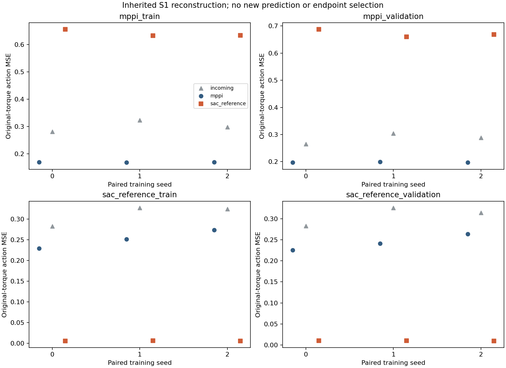
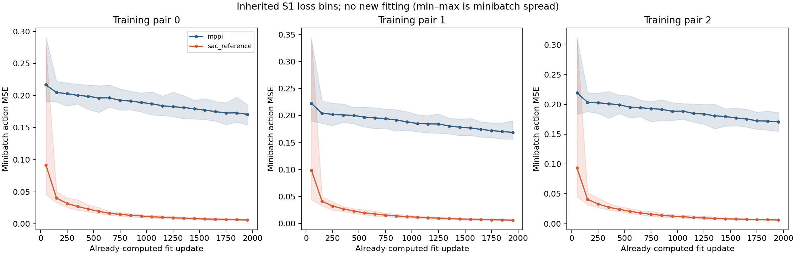
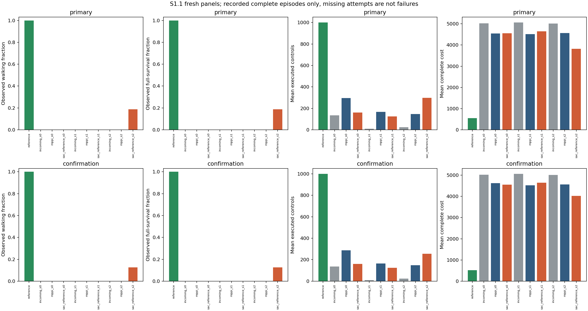
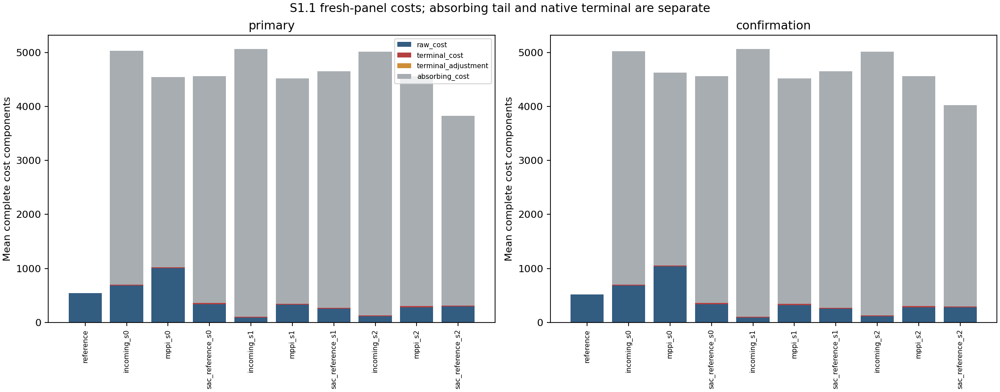

# S1.1: fresh evaluation of the retained S1 actors

Artifact: **result.json**. Artifact execution complete: **True**. Status: **evaluation_complete**. Recorded native attempts: **320/320**.
Error: `null`.
**Evaluation only:** all fitting, four-split reconstruction metrics and loss curves are inherited from the original closed S1 fit result. S1.1 performs zero fitting, reconstruction inference, backward steps, Adam updates or GPU work. Its new native outcomes use entirely fresh paired reset panels, and the original interrupted native attempts are not pooled into either panel. These are the same three training realizations, not three new training replications.


Full saved-result scope: the six original per-update fit JSONs are read and hash-checked; their 100-update summaries are exported for portable rendering. No policy or simulator is called.

## Intervention and limits

Original S1 fitting design (inherited): three paired fresh 128-tanh initializations each fit once on 4,000 original MPPI rows and once on 4,000 executed competent-reference rows, at the fixed 2k endpoint. Both use the exact shared W2 normalization, paired minibatch index tapes and optimizer settings. The source changes reset contexts, states, gait, torque statistics and controller history jointly. This is a whole-corpus source comparison; it does not isolate noise, multimodality or trajectory diversity.
The common MPPI-training normalization preserves the current input map; a failure may still reflect conditioning or the finite fitting budget.

The reference-data arm uses the reference's own executed behavior, not reference relabels at MPPI states. Both original source arms were fit on the same pinned CUDA backend; historical CPU W2 policies are context, not matched controls. Native standalone execution uses the pinned CPU simulator. No new teacher acquisition, trajectory optimization or acquisition–learning feedback occurs.

## Reconstruction and learning curves

`fitting.csv` contains every available incoming/final actor on all four fixed splits; `trajectories.csv` and `actuator_errors.csv` retain source, teacher and actuator detail. Each source has 4k training and 2k held rows. Held corpora were previously examined development evidence, excluded from gradients and normalization; they select no endpoint. Original target dtypes are preserved in evidence, with float32 fitting and float64 diagnostic residual arithmetic.

`learning_bins.csv` summarizes already-computed minibatch losses in fixed 100-update bins. A final partial bin contains only recorded updates. Min–max shading is minibatch spread, not a confidence interval. Full per-update JSON hashes and update counts remain in `learning_bins_manifest.json`; no extra diagnostic inference is hidden in these curves.
Inherited curve files: **6/6**; binned original updates: **12000/12000**.

## Standalone outcomes and separate decisions

Both 16-reset panels are required for all ten actors, regardless of the primary result. `episodes.csv` retains every supplied attempt, including incomplete records. Summaries below use recorded complete episodes with known outcomes, and disclose their denominators; absent or failed work is not imputed as a completed failure. A partial fitting or CPU stage remains incomplete.


| Panel | Actor | Complete / recorded | Walking | Full survival | Mean controls | Velocity MAE | Complete cost |
|---|---|---:|---:|---:|---:|---:|---:|
| confirmation | incoming_s0 | 16/16 | 0 | 0 | 135.812 | 2.35529 | 5023.97 |
| confirmation | incoming_s1 | 16/16 | 0 | 0 | 9 | 2.71959 | 5062.88 |
| confirmation | incoming_s2 | 16/16 | 0 | 0 | 24 | 2.07206 | 5015.12 |
| confirmation | mppi_s0 | 16/16 | 0 | 0 | 286.938 | 1.78814 | 4624.11 |
| confirmation | mppi_s1 | 16/16 | 0 | 0 | 164.688 | 0.866644 | 4521.4 |
| confirmation | mppi_s2 | 16/16 | 0 | 0 | 148.188 | 0.818073 | 4562.63 |
| confirmation | reference | 16/16 | 16 | 16 | 1000 | 0.224695 | 516.557 |
| confirmation | sac_reference_s0 | 16/16 | 0 | 0 | 160.562 | 0.886554 | 4556.1 |
| confirmation | sac_reference_s1 | 16/16 | 0 | 0 | 125.125 | 0.846203 | 4649.09 |
| confirmation | sac_reference_s2 | 16/16 | 2 | 2 | 254.25 | 0.605869 | 4022.93 |
| primary | incoming_s0 | 16/16 | 0 | 0 | 134.938 | 2.36032 | 5026.01 |
| primary | incoming_s1 | 16/16 | 0 | 0 | 9 | 2.72283 | 5062.84 |
| primary | incoming_s2 | 16/16 | 0 | 0 | 24 | 2.07083 | 5015.05 |
| primary | mppi_s0 | 16/16 | 0 | 0 | 296.438 | 1.68738 | 4540.96 |
| primary | mppi_s1 | 16/16 | 0 | 0 | 166.5 | 0.86414 | 4514.74 |
| primary | mppi_s2 | 16/16 | 0 | 0 | 147.688 | 0.816361 | 4564.02 |
| primary | reference | 16/16 | 16 | 16 | 1000 | 0.240069 | 545.181 |
| primary | sac_reference_s0 | 16/16 | 0 | 0 | 160.375 | 0.873002 | 4558.25 |
| primary | sac_reference_s1 | 16/16 | 0 | 0 | 125.062 | 0.834815 | 4647.28 |
| primary | sac_reference_s2 | 16/16 | 3 | 3 | 297.062 | 0.602469 | 3823.52 |

The source-benefit screen requires ≥2 additional walking successes in ≥2 of 3 pairs, with no walking or full-survival regression in any pair, separately on both panels. Individual provisional competence requires ≥15/16 walking on each panel. These are separate decisions: a walking gain need not be competence, and retention without walking is retention improvement. All actor seeds and the fresh reference control remain visible; one competent seed is not seed-robust fitting.

Declared confirmed source walking benefit: **False**.

```json
{
  "competence": {
    "incoming_s0": false,
    "incoming_s1": false,
    "incoming_s2": false,
    "mppi_s0": false,
    "mppi_s1": false,
    "mppi_s2": false,
    "reference": true,
    "sac_reference_s0": false,
    "sac_reference_s1": false,
    "sac_reference_s2": false
  },
  "confirmation": {
    "checks": {
      "all_pair_survival_nonregression": true,
      "all_pair_walking_nonregression": true,
      "positive_pairs": false
    },
    "pairs": [
      {
        "controls_delta": -126.375,
        "pair": 0,
        "relative_cost_gain": 0.014707095245664825,
        "survival_gain": 0,
        "survival_nonregression": true,
        "walking_gain": 0,
        "walking_nonregression": true
      },
      {
        "controls_delta": -39.5625,
        "pair": 1,
        "relative_cost_gain": -0.02824115329939092,
        "survival_gain": 0,
        "survival_nonregression": true,
        "walking_gain": 0,
        "walking_nonregression": true
      },
      {
        "controls_delta": 106.0625,
        "pair": 2,
        "relative_cost_gain": 0.11828639129926066,
        "survival_gain": 2,
        "survival_nonregression": true,
        "walking_gain": 2,
        "walking_nonregression": true
      }
    ],
    "walking_screen": false
  },
  "confirmed_walking_benefit": false,
  "primary": {
    "checks": {
      "all_pair_survival_nonregression": true,
      "all_pair_walking_nonregression": true,
      "positive_pairs": false
    },
    "pairs": [
      {
        "controls_delta": -136.0625,
        "pair": 0,
        "relative_cost_gain": -0.003805842281932925,
        "survival_gain": 0,
        "survival_nonregression": true,
        "walking_gain": 0,
        "walking_nonregression": true
      },
      {
        "controls_delta": -41.4375,
        "pair": 1,
        "relative_cost_gain": -0.029358125069000263,
        "survival_gain": 0,
        "survival_nonregression": true,
        "walking_gain": 0,
        "walking_nonregression": true
      },
      {
        "controls_delta": 149.375,
        "pair": 2,
        "relative_cost_gain": 0.1622471595970929,
        "survival_gain": 3,
        "survival_nonregression": true,
        "walking_gain": 3,
        "walking_nonregression": true
      }
    ],
    "walking_screen": false
  }
}
```

`descriptive_bootstrap.json` resamples three paired training streams and shared reset columns. It requires complete paired panels; missing outcomes produce an unavailable result, not an imputed interval. Corpora are fixed, and frames, actors' resets and endpoints are not extra training replications. All-zero observed walking does not prove equal population success rates.
S1.1 evaluates the same fixed three S1 training streams after observing the interrupted run's documentary primary declarations. A later pass cannot erase or retroactively confirm that original screen, and repeated testing is not a new learning gain. Bootstrap rows use only the new S1.1 reset panels; inherited native attempts are excluded.


## Costs, source teachers and causal verdict

Complete cost = raw native step cost excluding terminal + native terminal + terminal adjustment + absorbing missing-controls tail. The native terminal is not charged twice. `cost_components.csv` and episode rows retain these components separately. `paired_cost_components.csv` gives matched-reset reference-data-minus-MPPI-data component differences where both recorded panels align; their sum is the complete-cost difference. Lower complete cost and longer retention need not independently corroborate recovered gait.

Recorded historical source-teacher outcomes: **12/12**, retained in `teacher_outcomes.json` and source tables. `teacher_student_gaps.csv` compares each child's own-source historical teachers against fresh student episodes. These are descriptive unpaired gaps, not matched-reset causal differences. Unavailable historical cost components remain unavailable; none is reconstructed from assumptions.

### Fresh matched reference–student gaps

`matched_reference_gaps.csv` compares each reference-data child with the fresh reference on the same complete 16-reset panel. Differences are child minus reference. It retains walking and full-survival count gaps, controls, velocity MAE and every complete-cost component. `matched_reference_gap_status.csv` explains unavailable or misaligned comparisons; none is imputed.

The reference panel is one shared control across three training pairs, not three independent teacher replications or three times its recorded work. Reset-snapshot equality is checked by the independent native audit. Fresh matched MPPI-teacher gaps are unavailable because S1 collects no new MPPI teacher episodes; historical own-source gaps above remain unpaired.

| Panel | Child pair | Walking gap | Survival gap | Mean controls gap | Complete-cost gap | Velocity-MAE gap |
|---|---:|---:|---:|---:|---:|---:|
| primary | 0 | -16 | -16 | -839.625 | 4013.06 | 0.632933 |
| primary | 1 | -16 | -16 | -874.938 | 4102.1 | 0.594746 |
| primary | 2 | -13 | -13 | -702.938 | 3278.34 | 0.362399 |
| confirmation | 0 | -16 | -16 | -839.438 | 4039.55 | 0.661859 |
| confirmation | 1 | -16 | -16 | -874.875 | 4132.53 | 0.621509 |
| confirmation | 2 | -14 | -14 | -745.75 | 3506.37 | 0.381174 |

A reference-data clone meeting the provisional competence criterion would establish a competent learning control under this exact setup; occasional successful episodes remain successes, not competence. A source advantage identifies the chosen corpus intervention, not its causal property or unique correct actions. Failure of both arms does not prove class incapacity. Neither outcome closes the MPPI–policy loop; a later mechanism and a second useful acquisition–learning round would require their own versioned protocol. Retain negative results and formulate one unlaunched next hypothesis; no weighting, transport loss, critic, normalization change or follow-up launches automatically.

`work_groups.csv` and `cost_accounting.json` keep original closed fitting, original interrupted evaluation's known prefix, its unknown tail, and newly paid S1.1 native work separate. Original 12,000 Adam updates, 3,072,000 backward rows and 3,180,000 forward rows are inherited once, not new S1.1 work; no unknown original amount is set to zero. Off-host acknowledgement and mirror engineering costs remain separately recorded.






