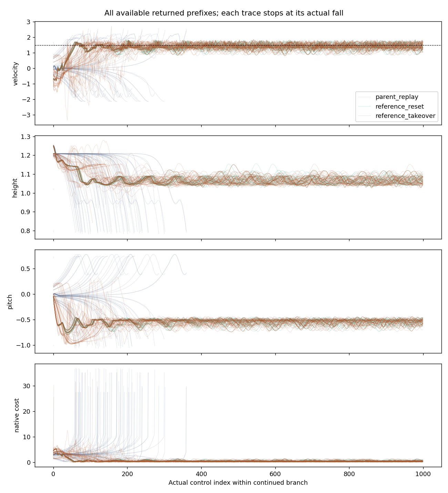
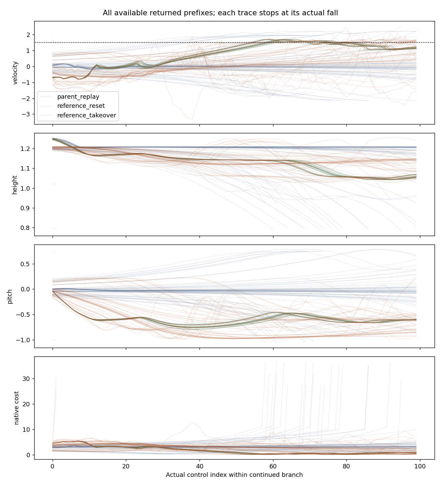

# S1.2 V: reference behavior at preserved student-visited states

Saved evidence only. This block tests reference behavior and the exact replay/control contract; it performs no learning and makes no teachability or MPPI-coupling claim.

Independent audit: True. Closure: complete_reference_usefulness_screen.

Walking requires 1,000 actual controls, no fall and full-window velocity MAE at most 0.3. Longer survival without walking is retention only. Native terminal cost is charged once; each missing control after an actual fall contributes five to the absorbing tail. Unattempted stages and missing post-fall states are never filled with zeros.

| kind | panel | stream | population | episodes | walking | survival | controls | native_cost | native_terminal | absorbing_cost | cost |
| --- | --- | --- | --- | --- | --- | --- | --- | --- | --- | --- | --- |
| parent_replay | confirmation | 0 | initial_secondary | 4 | 0 | 0 | 850 | 3282.9428671462365 | 80.0 | 15750.0 | 19032.942867146237 |
| parent_replay | confirmation | 0 | noninitial_primary | 12 | 0 | 0 | 861 | 4069.205584092301 | 240.0 | 55695.0 | 59764.2055840923 |
| parent_replay | confirmation | 1 | initial_secondary | 4 | 0 | 0 | 866 | 2441.7469982433004 | 80.0 | 15670.0 | 18111.7469982433 |
| parent_replay | confirmation | 1 | noninitial_primary | 12 | 0 | 0 | 876 | 2552.6816959169114 | 240.0 | 55620.0 | 58172.68169591691 |
| parent_replay | confirmation | 2 | initial_secondary | 4 | 0 | 0 | 1118 | 3529.170177068757 | 80.0 | 14410.0 | 17939.170177068758 |
| parent_replay | confirmation | 2 | noninitial_primary | 12 | 0 | 0 | 1128 | 3849.6330514892556 | 240.0 | 54360.0 | 58209.63305148926 |
| parent_replay | primary | 0 | initial_secondary | 4 | 0 | 0 | 780 | 3094.4744169292053 | 80.0 | 16100.0 | 19194.474416929206 |
| parent_replay | primary | 0 | noninitial_primary | 12 | 0 | 0 | 791 | 3892.3085962548016 | 240.0 | 56045.0 | 59937.30859625481 |
| parent_replay | primary | 1 | initial_secondary | 4 | 0 | 0 | 919 | 2603.5155543256687 | 80.0 | 15405.0 | 18008.51555432567 |
| parent_replay | primary | 1 | noninitial_primary | 12 | 0 | 0 | 929 | 2719.013258564397 | 240.0 | 55355.0 | 58074.013258564395 |
| parent_replay | primary | 2 | initial_secondary | 4 | 0 | 0 | 1148 | 3612.583055448676 | 80.0 | 14260.0 | 17872.58305544868 |
| parent_replay | primary | 2 | noninitial_primary | 12 | 0 | 0 | 1160 | 3928.1255281646695 | 240.0 | 54200.0 | 58128.125528164666 |
| reference_reset | confirmation | missing | own_reset_positive_control | 16 | 16 | 16 | 16000 | 8505.381094976776 | 0.0 | 0.0 | 8505.381094976776 |
| reference_reset | primary | missing | own_reset_positive_control | 16 | 16 | 16 | 16000 | 8511.650298910597 | 0.0 | 0.0 | 8511.650298910597 |
| reference_takeover | confirmation | 0 | initial_secondary | 4 | 4 | 4 | 4000 | 2051.899759632246 | 0.0 | 0.0 | 2051.899759632246 |
| reference_takeover | confirmation | 0 | noninitial_primary | 12 | 2 | 7 | 7111 | 6277.230366763025 | 100.0 | 24445.0 | 30722.230366763026 |
| reference_takeover | confirmation | 1 | initial_secondary | 4 | 4 | 4 | 4000 | 2051.899759632246 | 0.0 | 0.0 | 2051.899759632246 |
| reference_takeover | confirmation | 1 | noninitial_primary | 12 | 7 | 8 | 8004 | 4633.5570758583835 | 80.0 | 19980.0 | 24613.557075858385 |
| reference_takeover | confirmation | 2 | initial_secondary | 4 | 4 | 4 | 4000 | 2051.899759632246 | 0.0 | 0.0 | 2051.899759632246 |
| reference_takeover | confirmation | 2 | noninitial_primary | 12 | 6 | 8 | 8004 | 4921.954104562619 | 80.0 | 19980.0 | 24901.954104562625 |
| reference_takeover | primary | 0 | initial_secondary | 4 | 4 | 4 | 4000 | 2104.372699105967 | 0.0 | 0.0 | 2104.372699105967 |
| reference_takeover | primary | 0 | noninitial_primary | 12 | 1 | 8 | 8005 | 6617.333088918366 | 80.0 | 19975.0 | 26592.333088918367 |
| reference_takeover | primary | 1 | initial_secondary | 4 | 4 | 4 | 4000 | 2104.372699105967 | 0.0 | 0.0 | 2104.372699105967 |
| reference_takeover | primary | 1 | noninitial_primary | 12 | 7 | 8 | 8005 | 4949.306466268771 | 80.0 | 19975.0 | 24924.306466268772 |
| reference_takeover | primary | 2 | initial_secondary | 4 | 4 | 4 | 4000 | 2104.372699105967 | 0.0 | 0.0 | 2104.372699105967 |
| reference_takeover | primary | 2 | noninitial_primary | 12 | 4 | 7 | 7066 | 4801.7296701310825 | 100.0 | 24670.0 | 29471.729670131077 |

Only the 72 noninitial anchors enter gain/nonregression admission. The 24 initial anchors are secondary. The same two or more streams must gain at least two walking outcomes in both panels, with no walking or full-survival regression in any stream. Own-reset positive controls require at least 15/16 walking on each panel.

The 96 anchors are nested within 24 preserved parent episodes, with four anchors per episode. They are paired continuations, not 96 independent task replications. The 32 own-reset controls use the declared matched canonical reset contexts. Successful reference continuations would establish behavior under this assay, not useful labels or successful learning.

The all-prefix figures show every available executed trace and stop each trace at its actual fall. CSV files preserve all available outcomes and returned controls.

Complete saved accounting is in report_receipt.json; a missing cost record remains missing. Conditional learning requires separate review and authorization.
