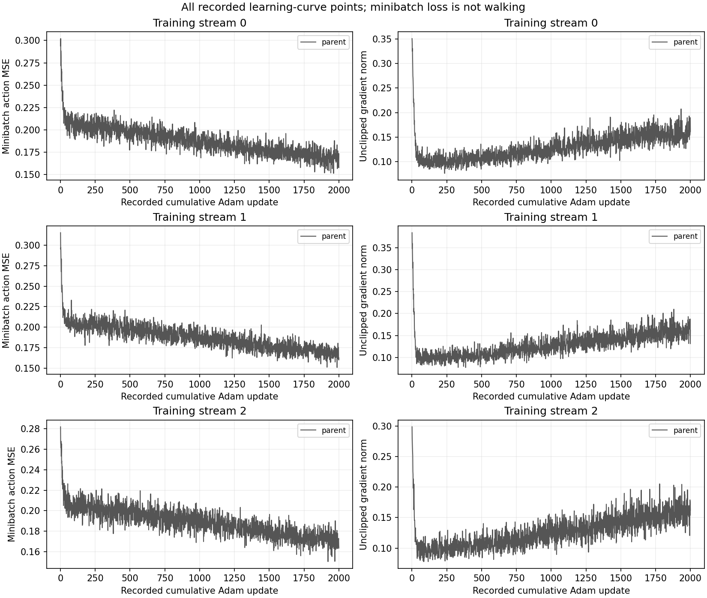

# H5.0 preparation and execution status

Status: **teacher_competence_negative_no_child_fits**.

The descriptive motion distance R, conditional action agreement D, and usefulness after a fixed2,000-update learning block have different roles. H5.0 holds D fixed and changes only its placement in the second search stream.

Launch authorized: `True`. Useful-learning prerequisite satisfied: `False`.

| Full-roster reservation | Amount |
|---|---:|
| Model controls | 1,338,799,104 |
| Live controls | 456,000 |
| Physics substeps | 5,357,020,416 |
| Worker neural rows | 2,005,857,552 |
| Independent audit neural rows | 1,999,713,552 |
| Adam updates | 24,000 |

These are prospective maxima, not claims of completed work. Preparation performs no inference, integration, fitting or acquisition.

## Recorded work

```json
{
  "requested_controls": 852938336,
  "completed_controls": 852938336,
  "requested_model_controls": 852903936,
  "completed_model_controls": 852903936,
  "requested_live_controls": 34400,
  "completed_live_controls": 34400,
  "requested_physics_substeps": 3411753344,
  "completed_physics_substeps": 3411753344,
  "unknown_partial_controls": 0,
  "unknown_partial_physics_substeps": 0,
  "model_queries": 206472,
  "live_queries": 34400,
  "failed_queries": 0,
  "rejected_queries": 0,
  "measurement_requests": 121311,
  "failed_measurements": 0,
  "rejected_measurements": 0,
  "requested_neural_rows": 1087519492,
  "completed_neural_rows": 1087519492,
  "unknown_partial_neural_rows": 0,
  "requested_backward_rows": 1536000,
  "completed_backward_rows": 1536000,
  "unknown_partial_backward_rows": 0,
  "requested_optimizer_steps": 6000,
  "completed_optimizer_steps": 6000,
  "unknown_partial_optimizer_steps": 0,
  "resets": 36,
  "reset_errors": 0,
  "restores": 0,
  "snapshots": 584980,
  "episodes": 36,
  "requested_checkpoint_loads": 3,
  "completed_checkpoint_loads": 3,
  "unknown_partial_checkpoint_loads": 0,
  "neural_rows": 1087519492,
  "backward_rows": 1536000,
  "optimizer_steps": 6000,
  "queries": 240872,
  "physics_frames": 3411753344,
  "wall_seconds": 8684.198369992002,
  "array_format": "walker-array-stream-v1",
  "storage_bytes": 206888153082,
  "storage_limit_bytes": 532575944704,
  "reserved_external_bytes": 17179869184,
  "emergency_reserved_bytes": 131072,
  "evidence_poisoned": false,
  "reservation_integrity": {
    "stopped": false,
    "errors": {
      "input_errors": 0,
      "budget_errors": 0,
      "import_errors": 0,
      "external_errors": 0
    },
    "pending": [],
    "native_validation_failed": false
  }
}
```

## Launch blockers


## Recorded outcomes

Worker claims require the separate full independent audit before admission.

```json
{
  "teacher_summaries": {
    "0": {
      "independent": {
        "episodes": 4,
        "successes": 4,
        "survived": 4,
        "controls": 4000,
        "mean_cost": 359.7289362520562,
        "costs": [
          353.5363530342355,
          361.6763650692577,
          357.6175668105228,
          366.08546009420877
        ],
        "complete": true
      },
      "selector_only": {
        "episodes": 4,
        "successes": 4,
        "survived": 4,
        "controls": 4000,
        "mean_cost": 375.784239157188,
        "costs": [
          373.1287702067204,
          395.69901360837264,
          349.3283849740727,
          384.9807878395861
        ],
        "complete": true
      },
      "proposal_guided": {
        "episodes": 4,
        "successes": 4,
        "survived": 4,
        "controls": 4000,
        "mean_cost": 361.13244064146517,
        "costs": [
          359.1655638137338,
          359.1247611947443,
          365.8937951414064,
          360.3456424159763
        ],
        "complete": true
      }
    },
    "1": {
      "independent": {
        "episodes": 4,
        "successes": 4,
        "survived": 4,
        "controls": 4000,
        "mean_cost": 374.2927917588444,
        "costs": [
          362.0190144749737,
          376.03627487090444,
          389.9281137563751,
          369.1877639331241
        ],
        "complete": true
      },
      "selector_only": {
        "episodes": 4,
        "successes": 3,
        "survived": 3,
        "controls": 3201,
        "mean_cost": 1333.1718843762806,
        "costs": [
          4230.693172233047,
          371.18596651395455,
          379.21453281834715,
          351.59386593977354
        ],
        "complete": true
      },
      "proposal_guided": {
        "episodes": 4,
        "successes": 4,
        "survived": 4,
        "controls": 4000,
        "mean_cost": 377.16638659777936,
        "costs": [
          377.6519396589498,
          384.4544563772101,
          370.24641491103785,
          376.3127354439198
        ],
        "complete": true
      }
    },
    "2": {
      "independent": {
        "episodes": 4,
        "successes": 4,
        "survived": 4,
        "controls": 4000,
        "mean_cost": 359.7182580312939,
        "costs": [
          358.0111614300241,
          343.8443743496991,
          370.8569336686098,
          366.16056267684246
        ],
        "complete": true
      },
      "selector_only": {
        "episodes": 4,
        "successes": 4,
        "survived": 4,
        "controls": 4000,
        "mean_cost": 377.15345781296077,
        "costs": [
          364.1746758991956,
          394.5979833181575,
          378.8058213992539,
          371.035350635236
        ],
        "complete": true
      },
      "proposal_guided": {
        "episodes": 4,
        "successes": 3,
        "survived": 3,
        "controls": 3199,
        "mean_cost": 1338.1121090963563,
        "costs": [
          4231.0474344209015,
          360.07088831515466,
          415.9956698899924,
          345.33444375937705
        ],
        "complete": true
      }
    }
  },
  "teacher_admission": {
    "0": {
      "independent": {
        "walking": true,
        "cost": true
      },
      "selector_only": {
        "walking": true,
        "cost": true
      },
      "proposal_guided": {
        "walking": true,
        "cost": true
      }
    },
    "1": {
      "independent": {
        "walking": true,
        "cost": true
      },
      "selector_only": {
        "walking": false,
        "cost": false
      },
      "proposal_guided": {
        "walking": true,
        "cost": true
      }
    },
    "2": {
      "independent": {
        "walking": true,
        "cost": true
      },
      "selector_only": {
        "walking": true,
        "cost": true
      },
      "proposal_guided": {
        "walking": false,
        "cost": false
      }
    }
  },
  "evaluations": {},
  "primary_gate": null,
  "confirmation_gate": null,
  "paired_teacher_student_gap": {},
  "confirmed_benefit": false
}
```

The fixed teacher-competence stop prevented child fitting and standalone student evaluation. Useful learning was not measured.

## Saved diagnostic provenance

The supplied extract declares ledger and audit-receipt bindings. This renderer hashes the extract, not those external raw files, and does not repeat the audit.

```json
{
  "source_ledger": {
    "file": "evidence/ledger.jsonl",
    "scope": "external_run",
    "bytes": 1336968073,
    "sha256": "ee35cd7438a5b0bdaf441dd2b02a8a814f2709a8d78fded31cbd3f5578ece61c"
  },
  "audit_receipt": {
    "file": "audit/result/receipt.json",
    "sha256": "87c99b040b0ab1e6df1153ab537d3e44a4ed2b29db6c9293a8a8eacea0a625ea"
  }
}
```

## Full-data reconstruction and held error

All saved rows: [full_data_metrics.csv](full_data_metrics.csv).

| tag | rows | action_mse | dataset |
| --- | --- | --- | --- |
| s0_parent_initial/train | 4000 | 0.3042375557734966 | historical_W1 |
| s0_parent_initial/validation | 2000 | 0.295830806034993 | held_trajectory |
| s0_parent/train | 4000 | 0.16789552209896935 | historical_W1 |
| s0_parent/validation | 2000 | 0.19899855302476793 | held_trajectory |
| s1_parent_initial/train | 4000 | 0.305331888797128 | historical_W1 |
| s1_parent_initial/validation | 2000 | 0.2976335593837683 | held_trajectory |
| s1_parent/train | 4000 | 0.168076163890597 | historical_W1 |
| s1_parent/validation | 2000 | 0.19769326529350975 | held_trajectory |
| s2_parent_initial/train | 4000 | 0.2837716311107694 | historical_W1 |
| s2_parent_initial/validation | 2000 | 0.27589152186806937 | held_trajectory |
| s2_parent/train | 4000 | 0.16990548447830697 | historical_W1 |
| s2_parent/validation | 2000 | 0.19634369912478145 | held_trajectory |

Full-data action MSE averages over rows and six actions. Incoming/endpoint rows use the same arm's acquisition data; historical W1 and held-trajectory measurements remain separate. Minibatch loss is a different measurement.

## Teacher outcomes

All saved rows: [teacher_outcomes.csv](teacher_outcomes.csv).

| cohort | stream | arm | episodes | successes | survived | controls | mean_cost | summary_source | roster_status |
| --- | --- | --- | --- | --- | --- | --- | --- | --- | --- |
| acquisition | 0 | independent | 4 | 4 | 4 | 4000 | 359.7289362520562 | worker_result | recorded_worker_summary |
| acquisition | 0 | selector_only | 4 | 4 | 4 | 4000 | 375.784239157188 | worker_result | recorded_worker_summary |
| acquisition | 0 | proposal_guided | 4 | 4 | 4 | 4000 | 361.13244064146517 | worker_result | recorded_worker_summary |
| acquisition | 1 | independent | 4 | 4 | 4 | 4000 | 374.2927917588444 | worker_result | recorded_worker_summary |
| acquisition | 1 | selector_only | 4 | 3 | 3 | 3201 | 1333.1718843762806 | worker_result | recorded_worker_summary |
| acquisition | 1 | proposal_guided | 4 | 4 | 4 | 4000 | 377.16638659777936 | worker_result | recorded_worker_summary |
| acquisition | 2 | independent | 4 | 4 | 4 | 4000 | 359.7182580312939 | worker_result | recorded_worker_summary |
| acquisition | 2 | selector_only | 4 | 4 | 4 | 4000 | 377.15345781296077 | worker_result | recorded_worker_summary |
| acquisition | 2 | proposal_guided | 4 | 3 | 3 | 3199 | 1338.1121090963563 | worker_result | recorded_worker_summary |

## Standalone student outcomes

All saved rows: [student_outcomes.csv](student_outcomes.csv).

Not measured or unavailable in supplied evidence; not zero.

Longer retention without walking is not competent walking. Episode cost is complete cost. The episode CSV retains executed-prefix cost, terminal metadata, terminal adjustment and absorbing tail separately; the native fall terminal must not be charged twice. Missing post-fall observations remain missing.

## Exactly paired teacher–student gaps

All saved rows: [paired_gap.csv](paired_gap.csv).

Not measured or unavailable in supplied evidence; not zero.

Only the saved paired-gap contexts are differenced. Acquisition teachers and primary students are not paired gaps.

## Teacher-state conditional action agreement

All saved rows: [teacher_action_agreement.csv](teacher_action_agreement.csv).

| episode | rows | action_agreement |
| --- | --- | --- |
| teacher_s0_independent_00 | 1000 | 1.1683026149655065 |
| teacher_s0_selector_only_00 | 1000 | 1.318866971021246 |
| teacher_s0_proposal_guided_00 | 1000 | 1.1259771294803353 |
| teacher_s0_independent_01 | 1000 | 1.1969077795569114 |
| teacher_s0_selector_only_01 | 1000 | 1.1878745369989117 |
| teacher_s0_proposal_guided_01 | 1000 | 1.1468857072737746 |
| teacher_s0_independent_02 | 1000 | 1.2962312750791003 |
| teacher_s0_selector_only_02 | 1000 | 1.1547593816945891 |
| teacher_s0_proposal_guided_02 | 1000 | 1.1953399159153626 |
| teacher_s0_independent_03 | 1000 | 1.2694923267458467 |
| teacher_s0_selector_only_03 | 1000 | 1.2286882397759935 |
| teacher_s0_proposal_guided_03 | 1000 | 1.1420241358231187 |
| teacher_s1_independent_00 | 1000 | 1.197842713660027 |
| teacher_s1_selector_only_00 | 201 | 1.6815024826491303 |
| teacher_s1_proposal_guided_00 | 1000 | 1.2397084311799484 |
| teacher_s1_independent_01 | 1000 | 1.2526737548673792 |
| teacher_s1_selector_only_01 | 1000 | 1.255964782897002 |
| teacher_s1_proposal_guided_01 | 1000 | 1.2068675993143667 |
| teacher_s1_independent_02 | 1000 | 1.2418597989312226 |
| teacher_s1_selector_only_02 | 1000 | 1.2638855993004627 |
| teacher_s1_proposal_guided_02 | 1000 | 1.2460335534148528 |
| teacher_s1_independent_03 | 1000 | 1.1692102178906645 |
| teacher_s1_selector_only_03 | 1000 | 1.1825672854587579 |
| teacher_s1_proposal_guided_03 | 1000 | 1.263250071887506 |
| teacher_s2_independent_00 | 1000 | 1.2216524371813207 |
| teacher_s2_selector_only_00 | 1000 | 1.1720653124943943 |
| teacher_s2_proposal_guided_00 | 199 | 1.3343364572549055 |
| teacher_s2_independent_01 | 1000 | 1.222496287225305 |
| teacher_s2_selector_only_01 | 1000 | 1.2001521866754885 |
| teacher_s2_proposal_guided_01 | 1000 | 1.1701513345125276 |
| teacher_s2_independent_02 | 1000 | 1.2202197169850129 |
| teacher_s2_selector_only_02 | 1000 | 1.1812525259511075 |
| teacher_s2_proposal_guided_02 | 1000 | 1.2652899657324015 |
| teacher_s2_independent_03 | 1000 | 1.1654709443755191 |
| teacher_s2_selector_only_03 | 1000 | 1.1759496542862866 |
| teacher_s2_proposal_guided_03 | 1000 | 1.0913108170366732 |

## Saved proposal-selection mechanism counts

All saved rows: [mechanism_summary.csv](mechanism_summary.csv).

| stream | arm | decisions | protected_guard_fallback_count | unique_selected_origins | baseline_verification_status_counts | guided_verification_status_counts |
| --- | --- | --- | --- | --- | --- | --- |
| 0 | independent | 4000 | 705 | 287 | {'ok': 3295, 'guard_fallback': 705} | {'ok': 3304, 'guard_fallback': 696} |
| 0 | selector_only | 4000 | 721 | 252 | {'ok': 3260, 'guard_fallback': 740} | {'ok': 3279, 'guard_fallback': 721} |
| 0 | proposal_guided | 4000 | 752 | 250 | {'ok': 3227, 'guard_fallback': 773} | {'ok': 3248, 'guard_fallback': 752} |
| 1 | independent | 4000 | 742 | 293 | {'ok': 3258, 'guard_fallback': 742} | {'ok': 3274, 'guard_fallback': 726} |
| 1 | selector_only | 3201 | 603 | 216 | {'ok': 2607, 'guard_fallback': 594} | {'ok': 2598, 'guard_fallback': 603} |
| 1 | proposal_guided | 4000 | 757 | 264 | {'ok': 3232, 'guard_fallback': 768} | {'ok': 3243, 'guard_fallback': 757} |
| 2 | independent | 4000 | 663 | 260 | {'ok': 3337, 'guard_fallback': 663} | {'ok': 3345, 'guard_fallback': 655} |
| 2 | selector_only | 4000 | 748 | 236 | {'ok': 3218, 'guard_fallback': 782} | {'ok': 3252, 'guard_fallback': 748} |
| 2 | proposal_guided | 3199 | 671 | 228 | {'ok': 2511, 'guard_fallback': 688} | {'guard_fallback': 671, 'ok': 2528} |

The CSV preserves every exact selected-origin count. These are counts of saved selection events; they alone do not prove the following control executed, that matched training data changed, or that any trajectory became teachable. The independent source/control audit and fixed-update walking outcomes remain separate evidence. No admission criterion is added by this summary.

Teacher agreement averages the sum of six squared action errors over executed time. Its action reduction differs from full-data MSE; neither establishes teachability.

## Recorded learning curves

Every saved update, including partial fitting records, is retained in [learning_curves.csv](learning_curves.csv). No smoothing, new evaluation or missing-update interpolation is performed.



[Vector figure](learning_curves.pdf).
