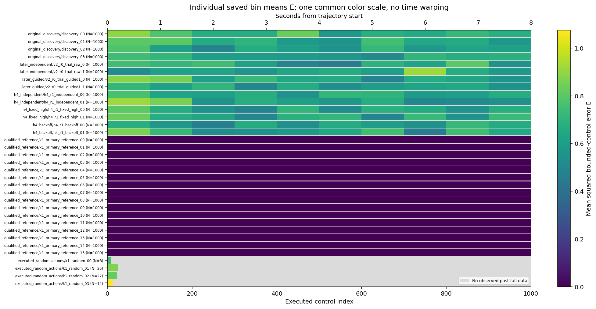
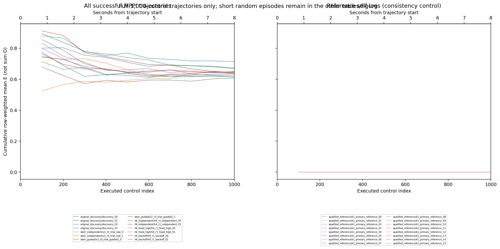
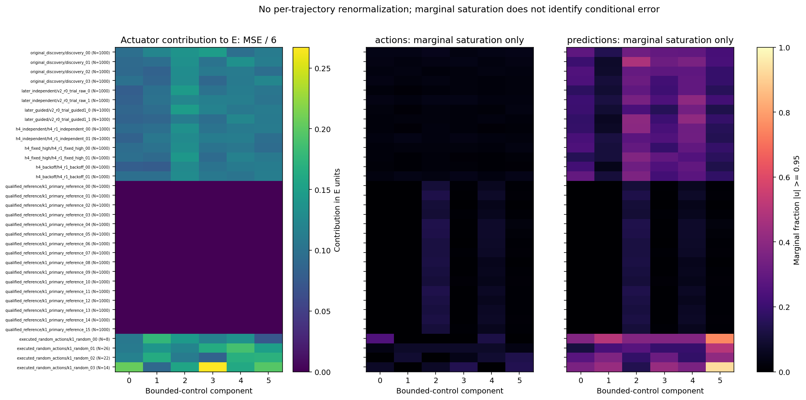
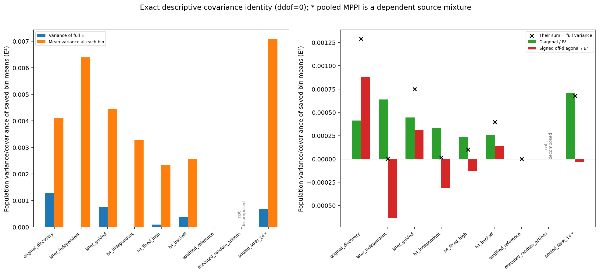

# Fixed-reference along-trajectory review

This is a saved-metadata analysis. The chosen policy is evaluated at each trajectory's own recorded successive states; no reference rollout, network evaluation or simulation is performed here. E is the existing sum of six squared action errors divided by 6N. D=6NE is the corresponding duration-dependent sum. Actions use the unchanged bounded control scale. All executed rows, including a fall-causing action, remain present; post-fall observations stay missing.

Individual identities, ancestry, source, ordered 100-control means and cumulative means are retained. A short random episode occupies only its observed rectangle width. Its one partial bin cannot supply a temporal decomposition. Full-horizon MPPI/reference sums and short random sums must not be compared as matched-duration evidence. Reference-self zeros are a consistency control.

The variance decomposition is exact algebra over saved bin means, with ddof=0. The full-trajectory variance equals the sum of all bin covariances divided by B². Signed off-diagonal terms can offset diagonal variation. The two-trajectory table preserves first-minus-second bin differences and their full difference. Bins, actuators, paired source contexts and frames are not independent task replications; there are no p-values or a chosen small-variance threshold. This does not recover within-bin per-control variance or establish a causal explanation.

Actuator contributions use MSE/6 on a common scale. Marginal action/prediction magnitude and saturation are reported separately; they do not identify error conditional on saturation. No phase alignment, per-trajectory renormalization, new weighting, metric selection or ranking rule is introduced.

Agreement on teacher states is separate from walking, survival and complete cost when a student chooses its own actions and visits new states. The repository's `docs/student_source_s1_1_results.md` supplies that separate fixed-update evaluation context. Variation here is not teachability, task importance or a beneficial trajectory-optimization mechanism. The implemented planner guidance is finite-horizon candidate reweighting, not whole-episode CIO optimization.

