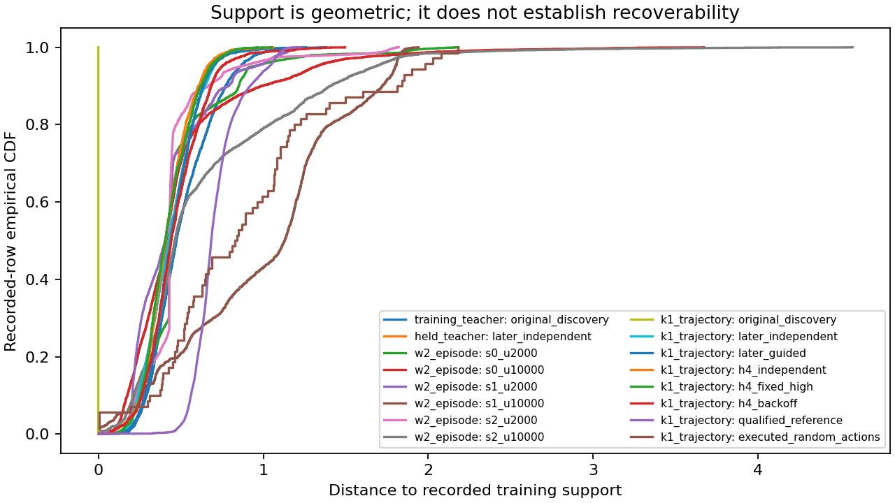
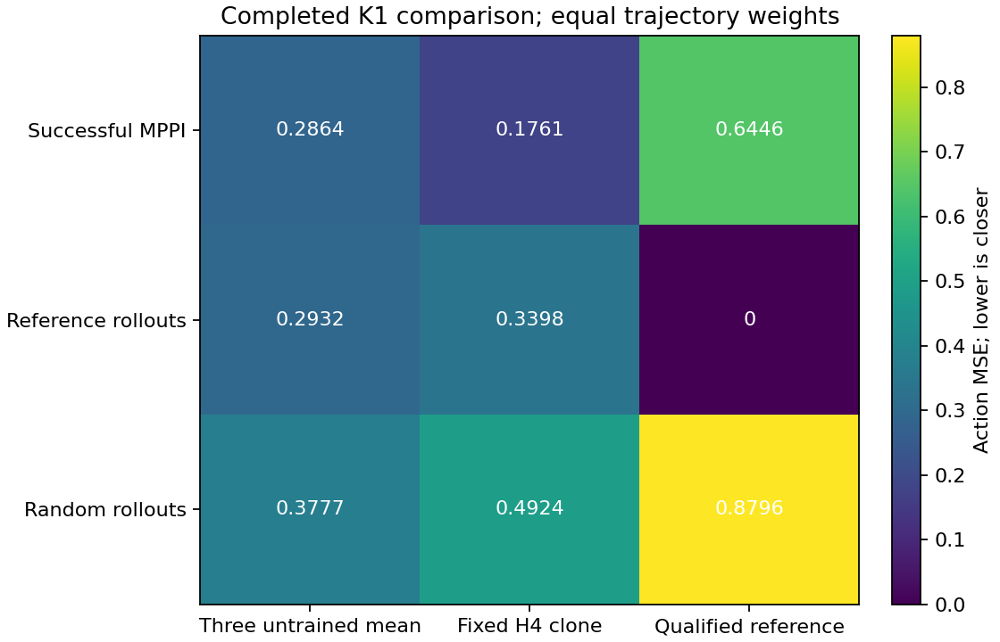
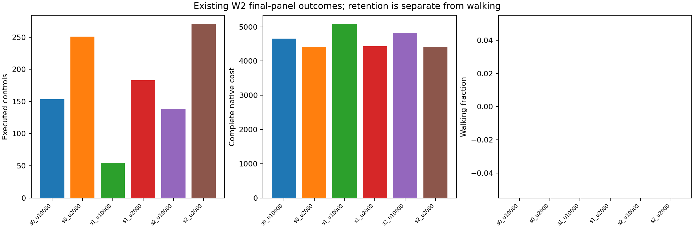
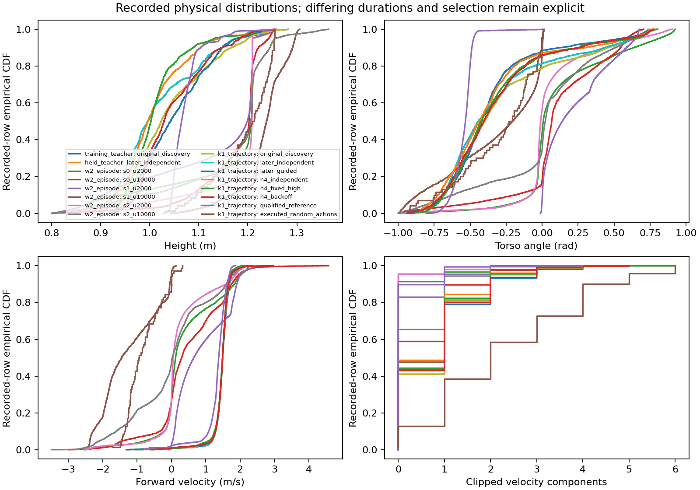
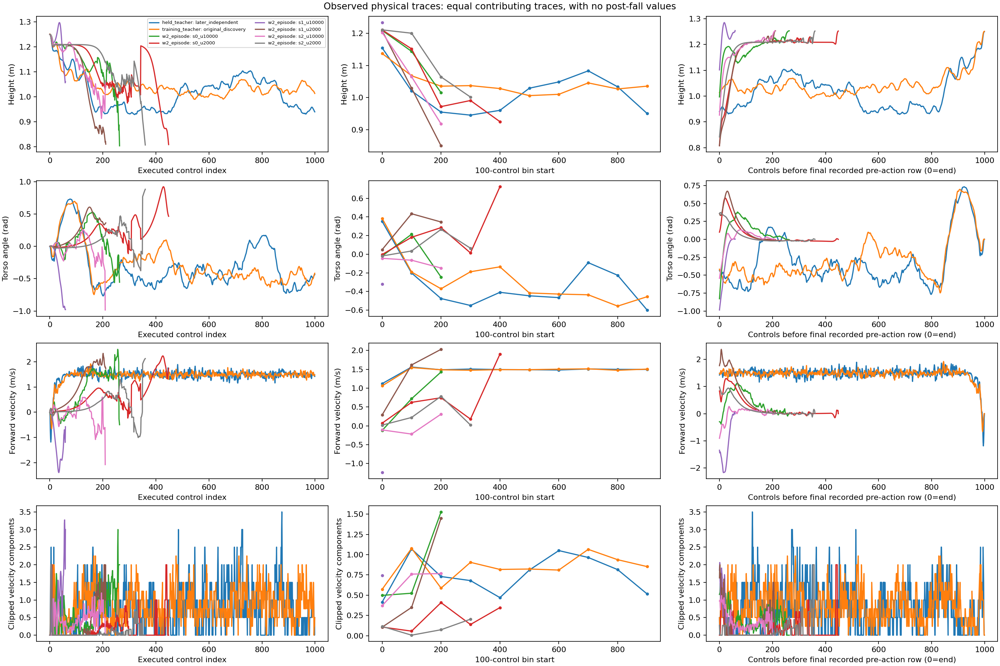
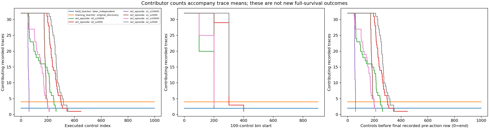
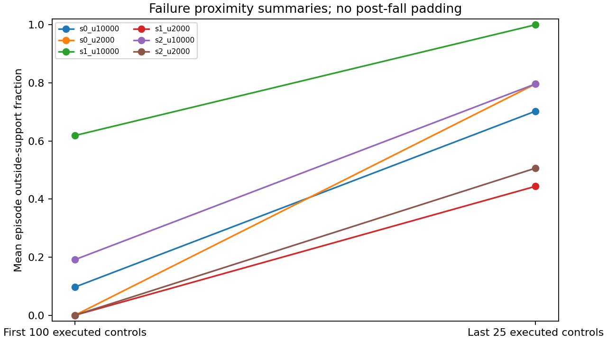
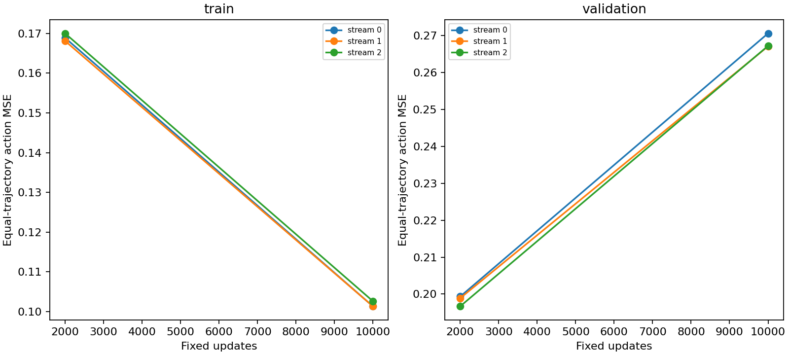
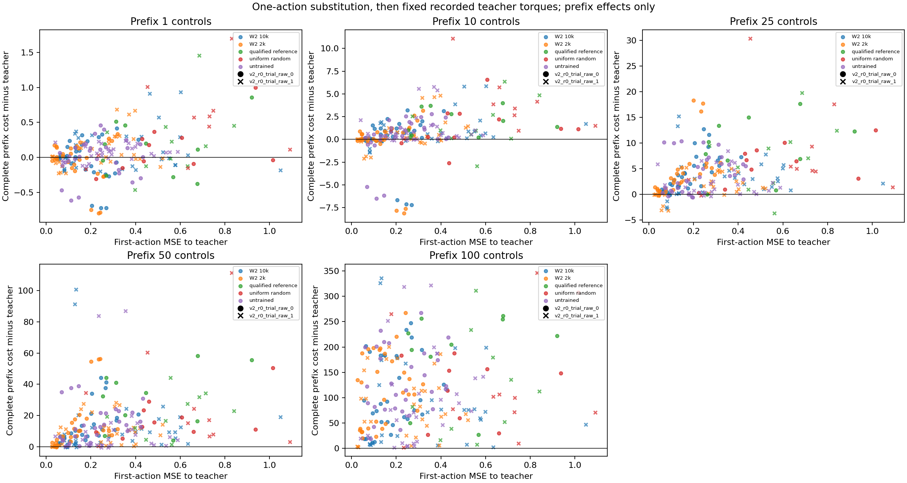

# Walker transfer diagnosis: saved support and controlled prefix consequences

Execution complete: **True**. Status: **diagnosis_complete**.
Recorded error: `null`.
Render scope: **complete saved-array report**. Full per-row coverage and reconstruction CSVs are exported.

## What was measured

D1 describes saved teacher/reference/random/student observations, training support, physical distributions, time-to-failure summaries and reconstruction. D2 substitutes one first torque, then executes the next 99 saved teacher torques open loop. Every horizon is a prefix of that same branch, not a separate query. There is no MPPI replanning, closed-loop policy continuation or new learning.

Action agreement, native competence, geometric support and prefix consequence are different measurements. Neither low MSE nor low support distance establishes teachability or recovery. These branches do not establish future walking, a useful learning weight or a beneficial acquisition–learning loop.

## Existing K1 comparison and W2 outcomes

K1's fixed score is action MSE, lower means closer. Its qualified reference is competent on its native reset panels, not proven optimal. Self-log agreement is largely a plumbing identity. Different trajectory groups have different state distributions and executed durations; random trajectories are not matched-duration negative examples. No metric was changed to force a preferred ordering.
The figure retains original source MSE where available. The trajectory CSV keeps both source MSE and the recomputation from saved float32 predictions; last-bit serialization differences are visible.

`k1_trajectory_policy.csv` preserves all supplied trajectory/policy scores; `k1_group_matrix.csv` preserves their declared aggregation. `w2_outcomes.csv` retains every supplied fixed-endpoint outcome. Longer survival without walking is retention improvement. Complete cost includes the missing-controls tail, so lower complete cost and longer survival need not be independent gait evidence.

## Support, frequency and reconstruction

D1 recorded-observation queries: 69701. Represented recorded coverage rows: 69701; reconstruction samples: 36000.

Training-teacher distances use leave-one-trajectory-out support; other records use all training rows. In-sample discovery self-matches are labelled explicitly and are not generalization evidence. These reference sets differ and are labelled in the CSV. Physical empirical CDFs describe recorded-row frequency, not a balanced sample of gait phases or causal state importance. Prefix/anchor selection and early termination affect these distributions. Frames and horizons are not independent trials.

The outside-support threshold and calibration are saved in `d1_summary.json`. First-100 and last-25 fractions are descriptive failure-proximity summaries, not evidence that drift caused failure. The canonical full report's `coverage_samples.csv` and `reconstruction_samples.csv` preserve every supplied recorded row; their hashes and row counts remain in the derived-curve cache. Torque errors on teacher observations are distinct from action consequences at substituted states.
`temporal_physical.csv` retains means by absolute control, fixed 100-control bin and time to recorded end. Each bin first averages within a trace, then equally across its observed contributors. `survivor_counts.csv` supplies contributing trace counts, row counts and denominators at every index; these availability counts are separate from native full-survival outcomes. `frequency_summary.csv` separates recorded-row-weighted occupancy from equal-trace means. Neither is a density estimator or a measure of control importance. Temporal figures show W2 and its training/held teachers; all K1 source groups remain in the temporal CSV and physical empirical CDFs.

## Replay gate and prefix consequences

Declared baseline gate: **True**. Saved baselines: **20** (planned 20); passed replay records: **20**. Perturbed branches: **220** (planned 220).
Complete matching baseline-gate records: **True**.

All 20 baseline replays must precede perturbed branches. Baseline numerical comparisons use the frozen absolute tolerance 1e-10 and zero relative tolerance; initial restore equality is exact. `baseline_replay.csv` retains each declared check, tolerance and maximum discrepancy. A false or incomplete gate invalidates D2 interpretation; partial results remain visible below.

Complete prefix cost = raw step cost excluding terminal + native terminal + absorbing missing-controls tail. `native_cost` includes the terminal contribution; it must not be added again. Prefix cost deltas are relative to the same teacher/anchor baseline. `consequence_prefixes.csv` retains every component, state/warm-start/integration RMS and executed count. `consequence_groups.csv` reports descriptive equal-anchor means and ranges by teacher, horizon and arm; ranges are not confidence intervals.

A large action error need not have a large consequence, and an earlier error is not automatically more important. The fixed-torque continuation tests local open-loop sensitivity, not how MPPI or a student would recover under its own feedback. Negative, mixed and invalid results are retained.

| Teacher | Horizon | Arm | Anchors | Mean action MSE | Mean complete-cost delta |
|---|---:|---|---:|---:|---:|
| v2_r0_trial_raw_0 | 1 | teacher | 10 | 0 | 0 |
| v2_r0_trial_raw_0 | 10 | teacher | 10 | 0 | 0 |
| v2_r0_trial_raw_0 | 25 | teacher | 10 | 0 | 0 |
| v2_r0_trial_raw_0 | 50 | teacher | 10 | 0 | 0 |
| v2_r0_trial_raw_0 | 100 | teacher | 10 | 0 | 0 |
| v2_r0_trial_raw_1 | 1 | teacher | 10 | 0 | 0 |
| v2_r0_trial_raw_1 | 10 | teacher | 10 | 0 | 0 |
| v2_r0_trial_raw_1 | 25 | teacher | 10 | 0 | 0 |
| v2_r0_trial_raw_1 | 50 | teacher | 10 | 0 | 0 |
| v2_r0_trial_raw_1 | 100 | teacher | 10 | 0 | 0 |
| v2_r0_trial_raw_0 | 1 | reference | 10 | 0.473667 | 0.137078 |
| v2_r0_trial_raw_0 | 10 | reference | 10 | 0.473667 | 1.95129 |
| v2_r0_trial_raw_0 | 25 | reference | 10 | 0.473667 | 9.06752 |
| v2_r0_trial_raw_0 | 50 | reference | 10 | 0.473667 | 31.3856 |
| v2_r0_trial_raw_0 | 100 | reference | 10 | 0.473667 | 187.883 |
| v2_r0_trial_raw_0 | 1 | untrained_0 | 10 | 0.218831 | -0.0337955 |
| v2_r0_trial_raw_0 | 10 | untrained_0 | 10 | 0.218831 | 0.0927096 |
| v2_r0_trial_raw_0 | 25 | untrained_0 | 10 | 0.218831 | 3.91261 |
| v2_r0_trial_raw_0 | 50 | untrained_0 | 10 | 0.218831 | 12.9678 |
| v2_r0_trial_raw_0 | 100 | untrained_0 | 10 | 0.218831 | 124.76 |
| v2_r0_trial_raw_0 | 1 | untrained_1 | 10 | 0.221652 | -0.0126084 |
| v2_r0_trial_raw_0 | 10 | untrained_1 | 10 | 0.221652 | 0.235787 |
| v2_r0_trial_raw_0 | 25 | untrained_1 | 10 | 0.221652 | 4.0128 |
| v2_r0_trial_raw_0 | 50 | untrained_1 | 10 | 0.221652 | 13.5545 |
| v2_r0_trial_raw_0 | 100 | untrained_1 | 10 | 0.221652 | 126.642 |
| v2_r0_trial_raw_0 | 1 | untrained_2 | 10 | 0.228009 | 0.0265932 |
| v2_r0_trial_raw_0 | 10 | untrained_2 | 10 | 0.228009 | 0.398117 |
| v2_r0_trial_raw_0 | 25 | untrained_2 | 10 | 0.228009 | 4.7334 |
| v2_r0_trial_raw_0 | 50 | untrained_2 | 10 | 0.228009 | 15.9953 |
| v2_r0_trial_raw_0 | 100 | untrained_2 | 10 | 0.228009 | 142.983 |
| v2_r0_trial_raw_0 | 1 | s0_u2000 | 10 | 0.14357 | -0.051649 |
| v2_r0_trial_raw_0 | 10 | s0_u2000 | 10 | 0.14357 | -0.232722 |
| v2_r0_trial_raw_0 | 25 | s0_u2000 | 10 | 0.14357 | 4.36958 |
| v2_r0_trial_raw_0 | 50 | s0_u2000 | 10 | 0.14357 | 12.5533 |
| v2_r0_trial_raw_0 | 100 | s0_u2000 | 10 | 0.14357 | 126.99 |
| v2_r0_trial_raw_0 | 1 | s0_u10000 | 10 | 0.1608 | 0.0147835 |
| v2_r0_trial_raw_0 | 10 | s0_u10000 | 10 | 0.1608 | 0.285833 |
| v2_r0_trial_raw_0 | 25 | s0_u10000 | 10 | 0.1608 | 4.55235 |
| v2_r0_trial_raw_0 | 50 | s0_u10000 | 10 | 0.1608 | 13.1292 |
| v2_r0_trial_raw_0 | 100 | s0_u10000 | 10 | 0.1608 | 112.942 |
| v2_r0_trial_raw_0 | 1 | s1_u2000 | 10 | 0.14255 | -0.0507896 |
| v2_r0_trial_raw_0 | 10 | s1_u2000 | 10 | 0.14255 | -0.302511 |
| v2_r0_trial_raw_0 | 25 | s1_u2000 | 10 | 0.14255 | 4.06941 |
| v2_r0_trial_raw_0 | 50 | s1_u2000 | 10 | 0.14255 | 12.6796 |
| v2_r0_trial_raw_0 | 100 | s1_u2000 | 10 | 0.14255 | 111.361 |
| v2_r0_trial_raw_0 | 1 | s1_u10000 | 10 | 0.18994 | -0.051794 |
| v2_r0_trial_raw_0 | 10 | s1_u10000 | 10 | 0.18994 | 0.0330026 |
| v2_r0_trial_raw_0 | 25 | s1_u10000 | 10 | 0.18994 | 4.48719 |
| v2_r0_trial_raw_0 | 50 | s1_u10000 | 10 | 0.18994 | 13.6402 |
| v2_r0_trial_raw_0 | 100 | s1_u10000 | 10 | 0.18994 | 116.562 |
| v2_r0_trial_raw_0 | 1 | s2_u2000 | 10 | 0.138093 | -0.0694974 |
| v2_r0_trial_raw_0 | 10 | s2_u2000 | 10 | 0.138093 | -0.303169 |
| v2_r0_trial_raw_0 | 25 | s2_u2000 | 10 | 0.138093 | 4.27321 |
| v2_r0_trial_raw_0 | 50 | s2_u2000 | 10 | 0.138093 | 12.6658 |
| v2_r0_trial_raw_0 | 100 | s2_u2000 | 10 | 0.138093 | 112.383 |
| v2_r0_trial_raw_0 | 1 | s2_u10000 | 10 | 0.194985 | -0.0383855 |
| v2_r0_trial_raw_0 | 10 | s2_u10000 | 10 | 0.194985 | 0.0450347 |
| v2_r0_trial_raw_0 | 25 | s2_u10000 | 10 | 0.194985 | 3.56137 |
| v2_r0_trial_raw_0 | 50 | s2_u10000 | 10 | 0.194985 | 10.9659 |
| v2_r0_trial_raw_0 | 100 | s2_u10000 | 10 | 0.194985 | 100.08 |
| v2_r0_trial_raw_0 | 1 | uniform_random | 10 | 0.559044 | 0.145275 |
| v2_r0_trial_raw_0 | 10 | uniform_random | 10 | 0.559044 | 1.42758 |
| v2_r0_trial_raw_0 | 25 | uniform_random | 10 | 0.559044 | 6.14352 |
| v2_r0_trial_raw_0 | 50 | uniform_random | 10 | 0.559044 | 18.545 |
| v2_r0_trial_raw_0 | 100 | uniform_random | 10 | 0.559044 | 136.874 |
| v2_r0_trial_raw_1 | 1 | reference | 10 | 0.56388 | 0.237318 |
| v2_r0_trial_raw_1 | 10 | reference | 10 | 0.56388 | 1.62594 |
| v2_r0_trial_raw_1 | 25 | reference | 10 | 0.56388 | 7.26665 |
| v2_r0_trial_raw_1 | 50 | reference | 10 | 0.56388 | 21.4766 |
| v2_r0_trial_raw_1 | 100 | reference | 10 | 0.56388 | 117.152 |
| v2_r0_trial_raw_1 | 1 | untrained_0 | 10 | 0.297385 | 0.0368222 |
| v2_r0_trial_raw_1 | 10 | untrained_0 | 10 | 0.297385 | 0.884989 |
| v2_r0_trial_raw_1 | 25 | untrained_0 | 10 | 0.297385 | 1.79923 |
| v2_r0_trial_raw_1 | 50 | untrained_0 | 10 | 0.297385 | 5.43244 |
| v2_r0_trial_raw_1 | 100 | untrained_0 | 10 | 0.297385 | 66.4816 |
| v2_r0_trial_raw_1 | 1 | untrained_1 | 10 | 0.295653 | 0.0892471 |
| v2_r0_trial_raw_1 | 10 | untrained_1 | 10 | 0.295653 | 1.39029 |
| v2_r0_trial_raw_1 | 25 | untrained_1 | 10 | 0.295653 | 2.71981 |
| v2_r0_trial_raw_1 | 50 | untrained_1 | 10 | 0.295653 | 13.1344 |
| v2_r0_trial_raw_1 | 100 | untrained_1 | 10 | 0.295653 | 107.485 |
| v2_r0_trial_raw_1 | 1 | untrained_2 | 10 | 0.301295 | 0.0924159 |
| v2_r0_trial_raw_1 | 10 | untrained_2 | 10 | 0.301295 | 0.997633 |
| v2_r0_trial_raw_1 | 25 | untrained_2 | 10 | 0.301295 | 2.05495 |
| v2_r0_trial_raw_1 | 50 | untrained_2 | 10 | 0.301295 | 13.1484 |
| v2_r0_trial_raw_1 | 100 | untrained_2 | 10 | 0.301295 | 109.92 |
| v2_r0_trial_raw_1 | 1 | s0_u2000 | 10 | 0.226412 | 0.0946885 |
| v2_r0_trial_raw_1 | 10 | s0_u2000 | 10 | 0.226412 | 0.589207 |
| v2_r0_trial_raw_1 | 25 | s0_u2000 | 10 | 0.226412 | 1.52461 |
| v2_r0_trial_raw_1 | 50 | s0_u2000 | 10 | 0.226412 | 10.1017 |
| v2_r0_trial_raw_1 | 100 | s0_u2000 | 10 | 0.226412 | 83.8171 |
| v2_r0_trial_raw_1 | 1 | s0_u10000 | 10 | 0.321661 | 0.130101 |
| v2_r0_trial_raw_1 | 10 | s0_u10000 | 10 | 0.321661 | 0.89171 |
| v2_r0_trial_raw_1 | 25 | s0_u10000 | 10 | 0.321661 | 3.27762 |
| v2_r0_trial_raw_1 | 50 | s0_u10000 | 10 | 0.321661 | 16.7391 |
| v2_r0_trial_raw_1 | 100 | s0_u10000 | 10 | 0.321661 | 100.854 |
| v2_r0_trial_raw_1 | 1 | s1_u2000 | 10 | 0.259604 | 0.108406 |
| v2_r0_trial_raw_1 | 10 | s1_u2000 | 10 | 0.259604 | 0.549507 |
| v2_r0_trial_raw_1 | 25 | s1_u2000 | 10 | 0.259604 | 1.58378 |
| v2_r0_trial_raw_1 | 50 | s1_u2000 | 10 | 0.259604 | 9.35728 |
| v2_r0_trial_raw_1 | 100 | s1_u2000 | 10 | 0.259604 | 90.7949 |
| v2_r0_trial_raw_1 | 1 | s1_u10000 | 10 | 0.371677 | 0.1316 |
| v2_r0_trial_raw_1 | 10 | s1_u10000 | 10 | 0.371677 | 0.738836 |
| v2_r0_trial_raw_1 | 25 | s1_u10000 | 10 | 0.371677 | 1.95369 |
| v2_r0_trial_raw_1 | 50 | s1_u10000 | 10 | 0.371677 | 8.55283 |
| v2_r0_trial_raw_1 | 100 | s1_u10000 | 10 | 0.371677 | 84.7366 |
| v2_r0_trial_raw_1 | 1 | s2_u2000 | 10 | 0.248276 | 0.0893937 |
| v2_r0_trial_raw_1 | 10 | s2_u2000 | 10 | 0.248276 | 0.477215 |
| v2_r0_trial_raw_1 | 25 | s2_u2000 | 10 | 0.248276 | 1.53392 |
| v2_r0_trial_raw_1 | 50 | s2_u2000 | 10 | 0.248276 | 9.87552 |
| v2_r0_trial_raw_1 | 100 | s2_u2000 | 10 | 0.248276 | 85.8537 |
| v2_r0_trial_raw_1 | 1 | s2_u10000 | 10 | 0.336433 | 0.0380508 |
| v2_r0_trial_raw_1 | 10 | s2_u10000 | 10 | 0.336433 | 0.946785 |
| v2_r0_trial_raw_1 | 25 | s2_u10000 | 10 | 0.336433 | 3.66973 |
| v2_r0_trial_raw_1 | 50 | s2_u10000 | 10 | 0.336433 | 18.7494 |
| v2_r0_trial_raw_1 | 100 | s2_u10000 | 10 | 0.336433 | 81.7278 |
| v2_r0_trial_raw_1 | 1 | uniform_random | 10 | 0.62859 | 0.481366 |
| v2_r0_trial_raw_1 | 10 | uniform_random | 10 | 0.62859 | 3.43388 |
| v2_r0_trial_raw_1 | 25 | uniform_random | 10 | 0.62859 | 8.07034 |
| v2_r0_trial_raw_1 | 50 | uniform_random | 10 | 0.62859 | 28.0907 |
| v2_r0_trial_raw_1 | 100 | uniform_random | 10 | 0.62859 | 115.256 |

## Figures and accounting

`cost_accounting.json` retains worker counters and wall time separately from this saved-only render. The report performs zero policy inference, physics, backward passes or optimizer steps. Repeated horizons do not multiply branch cost. Failed/partial work remains in the worker ledger and census.
